Seguimos con las funciones colectivas

## MPI_Reduce_scatter

`MPI_Reduce_scatter(send, receive, recv_cnt, MPI_INTEGER, MPI_SUM, MPI_COMM_WORLD)`


**Reduce y reparte:** cada proceso aporta un vector; MPI combina los valores posición a posición y distribuye el resultado en bloques consecutivos entre los procesos.

```c
int MPI_Reduce_scatter(const void *sendbuf, void *recvbuf,
                       const int recvcounts[], MPI_Datatype datatype,
                       MPI_Op op, MPI_Comm comm);

// Ejemplo de llamada en C:
MPI_Reduce_scatter(send, receive, recv_cnt,
                   MPI_INT, MPI_SUM, MPI_COMM_WORLD);
```

> En C, para elementos `int` usamos `MPI_INT`. El `MPI_INTEGER` del apunte inicial corresponde al tipo `INTEGER` de Fortran.

### Qué es cada argumento

| Argumento | Significado | Ejemplo con 3 procesos |
|---|---|---|
| `send` (`sendbuf`) | Vector de entrada local de cada proceso. Contiene tantos elementos como la suma de `recv_cnt`. | Cada proceso aporta 4 enteros. |
| `receive` (`recvbuf`) | Buffer local donde se escribe el bloque que recibe ese proceso. Debe tener capacidad para `recv_cnt[rank]` elementos. | P0 recibe 1; P1, 2; P2, 1. |
| `recv_cnt` (`recvcounts`) | Array con una entrada por proceso: la entrada `i` indica cuántos elementos recibe el rango `i`. Debe ser idéntico en todos. | `{1, 2, 1}`; cuenta elementos, no bytes. |
| `MPI_INT` (`datatype`) | Tipo MPI de los elementos. | Enteros `int` en C. |
| `MPI_SUM` (`op`) | Operación que combina valores de la misma posición. | Suma. |
| `MPI_COMM_WORLD` (`comm`) | Comunicador que determina el grupo participante. | Los 3 procesos del programa. |

Es **colectiva**: todos los procesos del comunicador deben llamarla en el mismo orden de llamadas colectivas. **No hay `root`**. La función devuelve un código de estado (`MPI_SUCCESS` si tiene éxito); el bloque recibido se guarda en `receive`.

### Ejemplo paso a paso

Tenemos 3 procesos y `recv_cnt = {1, 2, 1}`. Cada uno aporta **1 + 2 + 1 = 4 elementos**, aunque luego reciba menos.

| Entrada | Posición 0 | Posición 1 | Posición 2 | Posición 3 |
|---|---:|---:|---:|---:|
| P0 | 1 | 2 | 3 | 4 |
| P1 | 10 | 20 | 30 | 40 |
| P2 | 100 | 200 | 300 | 400 |
| **Resultado de sumar por columna** | **111** | **222** | **333** | **444** |

Por ejemplo, la posición 0 se calcula como `1 + 10 + 100 = 111`. Se suman las columnas entre procesos, no los elementos de cada fila.

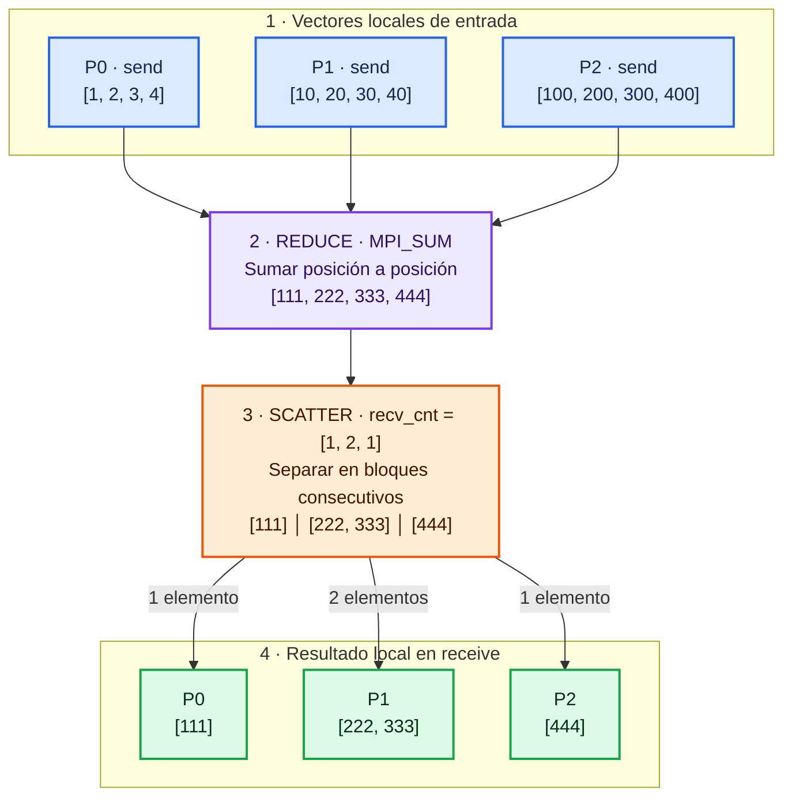

El diagrama representa el resultado lógico; MPI puede usar distintos algoritmos internos y no necesita reunir primero el vector en un proceso central.

El reparto sigue el orden de los rangos: P0 recibe la posición 0, P1 las posiciones 1 y 2, y P2 la posición 3. El bloque del rango `i` empieza en la suma de los tamaños de los bloques anteriores. En su buffer local, cada bloque se guarda desde `receive[0]`.

### Programa completo en C

```c
#include <mpi.h>
#include <stdio.h>

int main(int argc, char **argv)
{
    MPI_Init(&argc, &argv);
    int rank, size;
    MPI_Comm_rank(MPI_COMM_WORLD, &rank);
    MPI_Comm_size(MPI_COMM_WORLD, &size);

    if (size != 3) {
        if (rank == 0)
            fprintf(stderr, "Ejecuta con 3 procesos.\n");
        MPI_Finalize();
        return 1;
    }

    int recv_cnt[3] = {1, 2, 1};
    int factor = (rank == 0) ? 1 : (rank == 1) ? 10 : 100;
    int send[4];
    for (int j = 0; j < 4; ++j)
        send[j] = factor * (j + 1);

    // Capacidad para el mayor bloque: 2 enteros.
    // Cada proceso utiliza solo recv_cnt[rank] posiciones.
    int receive[2];
    MPI_Reduce_scatter(send, receive, recv_cnt,
                       MPI_INT, MPI_SUM, MPI_COMM_WORLD);

    printf("P%d recibe:", rank);
    for (int j = 0; j < recv_cnt[rank]; ++j)
        printf(" %d", receive[j]);
    printf("\n");

    MPI_Finalize();
    return 0;
}
```

Si guardas el código en `reduce_scatter.c`, en un entorno con MPI:

```bash
mpicc reduce_scatter.c -o reduce_scatter
mpirun -np 3 ./reduce_scatter
```

Resultado esperado (las líneas pueden aparecer en otro orden o intercalarse):

```text
P0 recibe: 111
P1 recibe: 222 333
P2 recibe: 444
```

**Para recordarlo:** todos aportan un vector completo de contribuciones, se reduce por posiciones y cada uno recibe un trozo. `MPI_Reduce` entrega el resultado completo a un `root`; `MPI_Allreduce`, completo a todos; `MPI_Reduce_scatter`, repartido entre todos.

Referencia: [documentación oficial de Open MPI](https://docs.open-mpi.org/en/v5.0.10/man-openmpi/man3/MPI_Reduce_scatter.3.html).


## MPI_Allgather

`MPI_Allgather` recopila una cantidad **igual** de datos de cada proceso y deja la concatenación ordenada por rango en el buffer de **todos** los procesos. No hay `root`: todos aportan y todos reciben.

```c
int MPI_Allgather(const void *sendbuf, int sendcount,
                  MPI_Datatype sendtype, void *recvbuf, int recvcount,
                  MPI_Datatype recvtype, MPI_Comm comm);
```

| Argumento | Significado |
|---|---|
| `sendbuf`, `sendcount`, `sendtype` | Buffer local, cantidad enviada por este proceso y tipo de esos elementos. Todos envían la misma cantidad y tipo compatible. |
| `recvbuf` | Buffer local con espacio para un bloque recibido de cada proceso. |
| `recvcount`, `recvtype` | Cantidad y tipo que se reciben **de cada proceso**; deben concordar con lo que envía cada origen. |
| `comm` | Comunicador del grupo participante. |

Con `p` procesos, cada `recvbuf` necesita `p * recvcount` elementos. El bloque del rango `i` queda en la posición `i * recvcount` (en unidades del tipo recibido). Todos deben llamar a la colectiva en el mismo orden.

Ejemplo

```Text

P0 -> 10 , 11
P1 -> 20 , 21
P2 -> 30 , 31
P3 -> 40 , 41

primero hacemos la recoleción según rango

10 , 11 , 20 , 21 , 30 , 31 , 40 , 41

PERO all ser un MPI_Allgather todos recibirán el resultado, por lo tanto

P0 -> 10 , 11 , 20 , 21 , 30 , 31 , 40 , 41
P1 -> 10 , 11 , 20 , 21 , 30 , 31 , 40 , 41
P2 -> 10 , 11 , 20 , 21 , 30 , 31 , 40 , 41
P3 -> 10 , 11 , 20 , 21 , 30 , 31 , 40 , 41

```

### Diagrama de `MPI_Allgather`

Cada proceso aporta el mismo número de elementos (en este ejemplo, dos). MPI los coloca en el resultado siguiendo el rango de los procesos y entrega el vector completo a **todos**.

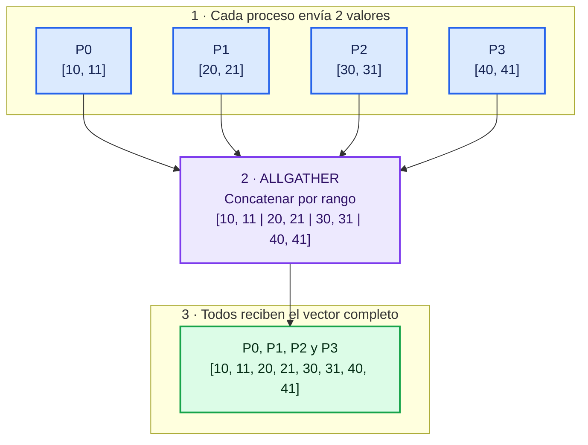

## MPI_Allgatherv

`MPI_Allgatherv` hace lo mismo que `MPI_Allgather`, pero cada proceso puede aportar una cantidad distinta de elementos. Cada proceso receptor proporciona sus propios arrays para describir cómo ordenar los bloques en su buffer. No hay `root` del que dependan los desplazamientos.

```c
int MPI_Allgatherv(const void *sendbuf, int sendcount,
                   MPI_Datatype sendtype, void *recvbuf,
                   const int recvcounts[], const int displs[],
                   MPI_Datatype recvtype, MPI_Comm comm);
```

| Argumento | Significado |
|---|---|
| `sendbuf`, `sendcount`, `sendtype` | Datos que aporta este proceso, número de elementos y tipo. `sendcount` puede variar por proceso. |
| `recvbuf` | Buffer local que reúne todos los bloques. Debe tener capacidad suficiente para cubrir los desplazamientos y tamaños. |
| `recvcounts[i]` | Cuántos elementos recibir del rango `i`. En cada receptor, debe concordar con lo que ese rango envía. |
| `displs[i]` | Posición inicial del bloque de rango `i` en `recvbuf`, medida en unidades de `recvtype`. |
| `recvtype`, `comm` | Tipo de los datos recibidos y comunicador participante. |

Todos envían y todos reciben la colección completa, pero cada proceso decide localmente sus `recvcounts` y `displs`. En una disposición compacta, `displs[i]` suele ser la suma de los conteos anteriores. Los huecos son válidos si hay espacio; las regiones escritas no deben solaparse.

Para calcular conteos y desplazamientos, cada proceso puede construir arrays como estos:

```c
for(int i = 0 ; i < 3 ; i++){
    recv_cnt[i] = 2 + i;
    desp_cnt[i] = 4*i + 1; // posiciones iniciales en el buffer receptor
}
```
Los conteos pueden ser distintos entre rangos, por eso se pasa un array `recvcounts`, incluso cuando casualmente todos los bloques tengan tamaño 2. En ese caso los conteos podrían ser `{2, 2, 2, ...}`. La llamada lleva el conteo local enviado (`sendcount`) y cada receptor describe los bloques entrantes con su array.

### Diagrama de `MPI_Allgatherv`

Aquí cada proceso puede enviar una cantidad distinta. En el ejemplo, los tamaños recibidos por rango son `recvcounts = [1, 2, 3, 1]` y los desplazamientos en el buffer son `displs = [0, 1, 3, 6]`. MPI coloca cada bloque en su posición y todos los procesos obtienen el mismo vector final.

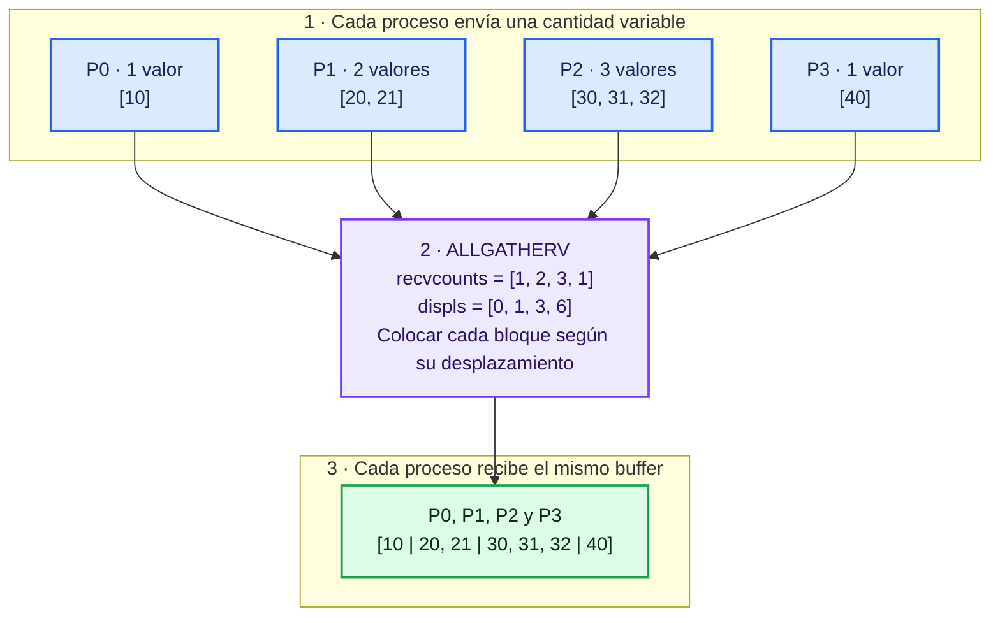

Los arrays `recvcounts` y `displs` describen, para cada rango, cuántos elementos colocar y desde qué posición del buffer receptor. En este ejemplo, el bloque de P2 comienza en la posición 3 y ocupa las posiciones 3, 4 y 5. Los desplazamientos se cuentan en unidades del tipo de recepción (`MPI_Datatype`); los huecos son posibles si los desplazamientos elegidos los dejan.

## `MPI_Alltoall`

`MPI_Alltoall` realiza un intercambio personalizado entre todos los procesos. Cada proceso divide su vector de envío en bloques iguales, uno para cada destino. El bloque número `j` se envía al proceso de rango `j`. A su vez, cada proceso recibe un bloque de cada origen y los guarda en orden de rango de origen. No reduce ni suma los datos.

```c
int MPI_Alltoall(const void *sendbuf, int sendcount,
                 MPI_Datatype sendtype, void *recvbuf, int recvcount,
                 MPI_Datatype recvtype, MPI_Comm comm);
```

| Argumento | Significado |
|---|---|
| `sendbuf` | Buffer local dividido en bloques, uno para cada destino. |
| `sendcount` | Elementos que este proceso envía a **cada** destino. Es el mismo tamaño para todos los destinos y procesos de esta llamada. |
| `sendtype` | Tipo MPI de cada elemento enviado. |
| `recvbuf` | Buffer que recibe un bloque de cada origen. |
| `recvcount` | Elementos que se reciben de **cada** origen; debe coincidir con lo que cada origen envía a este proceso. |
| `recvtype` | Tipo MPI de cada elemento recibido. |
| `comm` | Comunicador cuyos procesos participan en el intercambio. |

Todos los procesos llaman a la operación. Si hay `p` procesos y `sendcount = k`, cada proceso necesita espacio para `p × k` elementos en ambos buffers. Puede enviar un bloque a sí mismo también. La recepción queda ordenada por rango de origen: el bloque del origen `i` empieza en `recvbuf + i × recvcount` (teniendo en cuenta el tipo de dato).

### Ejemplo con 4 procesos

Cada proceso envía dos enteros a cada destino. Por ejemplo, P0 envía `[10, 11]` a P0, `[12, 13]` a P1, `[14, 15]` a P2 y `[16, 17]` a P3. P1 recibe el segundo bloque de cada origen, P2 el tercero, etc.

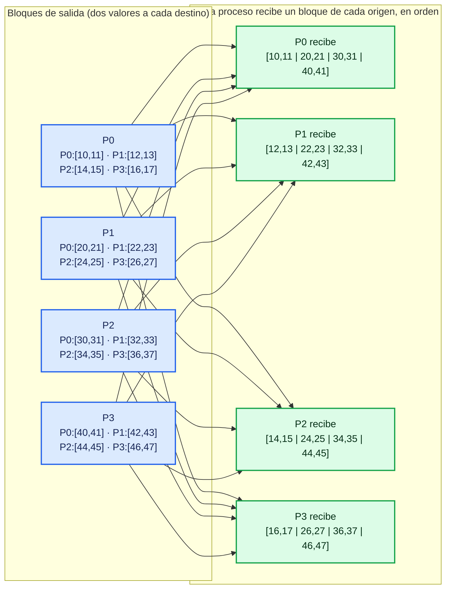

Se puede leer como una matriz: las **filas** son los procesos que envían y las **columnas** los destinos. Cada proceso receptor recoge su columna, concatenada por rango de origen. En este ejemplo, `sendcount = recvcount = 2`.

## `MPI_Alltoallv`

La variante `v` permite que los bloques enviados y recibidos tengan tamaños distintos. En cada proceso, `sendcounts[j]` indica cuántos elementos enviar al destino `j`, y `sdispls[j]` dónde empieza ese bloque en `sendbuf`. Análogamente, `recvcounts[i]` indica cuántos elementos recibir del origen `i`, y `rdispls[i]` dónde colocarlos en `recvbuf`.

```c
int MPI_Alltoallv(const void *sendbuf, const int sendcounts[],
                  const int sdispls[], MPI_Datatype sendtype,
                  void *recvbuf, const int recvcounts[],
                  const int rdispls[], MPI_Datatype recvtype,
                  MPI_Comm comm);
```

| Argumento | Significado |
|---|---|
| `sendbuf` / `recvbuf` | Buffers locales de envío y recepción. |
| `sendcounts[j]` | Número de elementos que este proceso manda al rango `j`. |
| `sdispls[j]` | Posición inicial del bloque destinado a `j` dentro de `sendbuf`. |
| `sendtype` / `recvtype` | Tipos MPI de los elementos enviados y recibidos. |
| `recvcounts[i]` | Número de elementos que este proceso espera del origen `i`. Debe coincidir con el `sendcounts` de ese origen hacia este rango. |
| `rdispls[i]` | Posición inicial del bloque del origen `i` en `recvbuf`. |
| `comm` | Comunicador cuyos procesos participan. |

Los arrays de conteos y desplazamientos tienen una entrada por proceso, y cada proceso puede tener valores distintos en sus propios arrays. Los desplazamientos se miden en unidades del tipo MPI correspondiente, no en bytes. Todos los procesos participan; tampoco hay reducción ni `root`.

### Ejemplo con cantidades variables

Usamos tres procesos. Cada celda indica lo que el proceso de la fila envía al destino de la columna:

| Origen ↓ / Destino → | P0 | P1 | P2 |
|---|---|---|---|
| **P0** | `[a00]` | `[a01, a02]` | `[]` |
| **P1** | `[b10, b11]` | `[b12]` | `[b13, b14, b15]` |
| **P2** | `[c20]` | `[]` | `[c21, c22]` |

Como ejemplo concreto, en P0: `sendcounts = [1, 2, 0]` y, usando bloques compactos, `sdispls = [0, 1, 3]`. Sus datos de envío son `[a00, a01, a02]`; el desplazamiento del bloque vacío puede señalar el final del buffer. Para recibir, P0 espera `[1, 2, 1]` elementos de P0, P1 y P2, respectivamente.

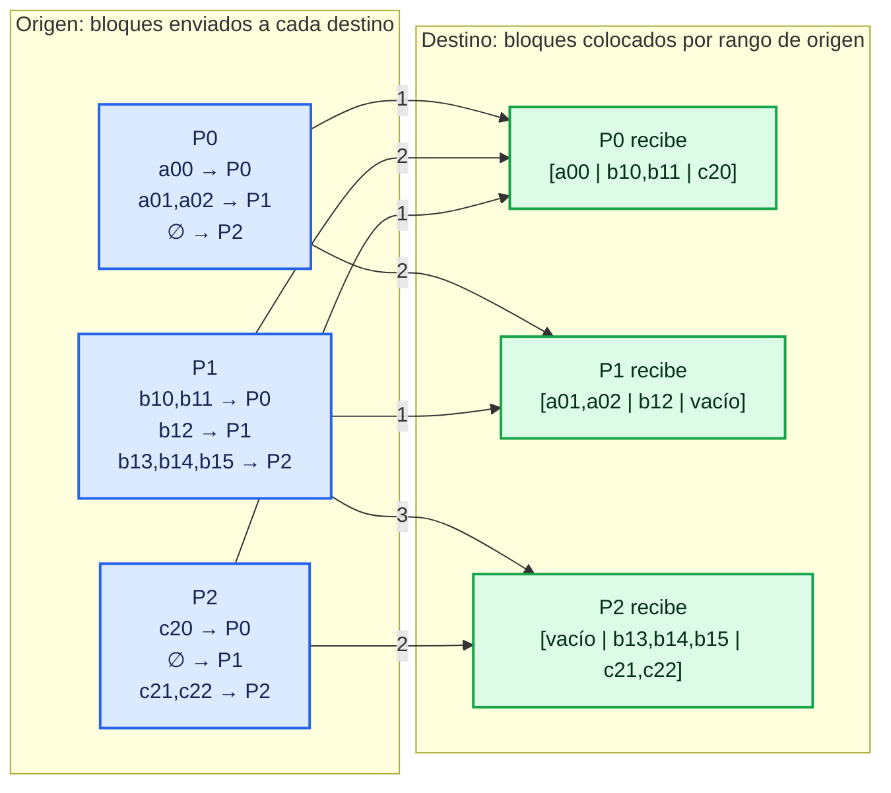

Los números sobre las flechas son las cantidades enviadas. La flecha P0→P2 y P2→P1 lleva cero elementos, así que no se dibuja. Cada receptor guarda los bloques entrantes en orden de rango de origen, en las posiciones indicadas por sus `rdispls`. El número de elementos de cada mensaje debe concordar entre el `sendcounts` del emisor y el `recvcounts` del receptor.

### Inciso: ¿cómo cambiar la posición de los ceros en `recvbuf`?

`MPI_Alltoallv` permite decidir **dónde empieza cada bloque recibido** mediante `rdispls`. Si el bloque completo cabe en una zona continua, se puede colocar directamente en la posición deseada. Pero la función no reordena los elementos dentro de un bloque ni deja huecos entre sus elementos: el bloque de cada origen se copia de forma contigua.

Por ejemplo, supongamos que el proceso recibe dos valores de cada uno de los cuatro orígenes:

```text
P0 aporta [10, 11]   P1 aporta [20, 21]
P2 aporta [30, 31]   P3 aporta [40, 41]
```

Queremos construir este buffer:

```text
[10, 11, 0, 0, 0, 21, 0, 0, 30, 0, 0, 0, 40, 41]
```

De P1 queremos conservar solo `21`, y de P2 solo `30`. Como cada bloque recibido tiene dos valores contiguos, primero recibimos los cuatro bloques juntos en un buffer temporal (usando desplazamientos `0, 2, 4, 6`) y después copiamos los valores a las posiciones elegidas. Inicializamos el destino a cero para que las posiciones sin copiar sigan siendo cero:

```c
int recvcounts[4] = {2, 2, 2, 2};
int rdispls[4]    = {0, 2, 4, 6};
int temporal[8];
int resultado[14] = {0};

MPI_Alltoallv(sendbuf, sendcounts, sdispls, MPI_INT,
              temporal, recvcounts, rdispls, MPI_INT,
              MPI_COMM_WORLD);

// temporal está ordenado por origen:
// [10, 11 | 20, 21 | 30, 31 | 40, 41]
resultado[0]  = temporal[0]; // 10, de P0
resultado[1]  = temporal[1]; // 11, de P0
resultado[5]  = temporal[3]; // 21, segundo valor de P1
resultado[8]  = temporal[4]; // 30, primer valor de P2
resultado[12] = temporal[6]; // 40, de P3
resultado[13] = temporal[7]; // 41, de P3
```

Así queda `resultado = [10, 11, 0, 0, 0, 21, 0, 0, 30, 0, 0, 0, 40, 41]`. Los `recvcounts` deben concordar con los datos que los emisores envían a este proceso; si se quiere recibir solo algunos valores directamente, los emisores también deben configurar sus bloques de envío para mandar exactamente esos valores. El buffer temporal es útil cuando se reciben bloques completos y luego se eligen o recolocan elementos.

### ¿Qué pasa si cambiamos `rdispls` de `{0, 4, 8, 12}` a `{0, 4, 2, 12}`?

Supongamos cuatro orígenes, `recvcounts = {4, 4, 4, 4}` y un `recvbuf` de 16 enteros. Cada desplazamiento marca dónde empieza el bloque de 4 elementos del origen correspondiente. Con `{0, 4, 8, 12}`, los bloques quedan seguidos sin solaparse. Al cambiar el desplazamiento de P2 de `8` a `2`, su bloque ocupa las posiciones 2–5 y se solapa con P0 (posiciones 0–3) y P1 (4–7).

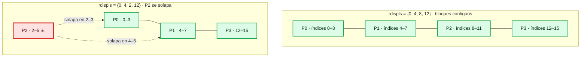

Los bloques de recepción no deben solaparse: dos mensajes intentarían escribir en las mismas posiciones del buffer, lo que hace inválida la operación. Los `rdispls` pueden dejar huecos (por ejemplo, volver a usar `{0, 4, 8, 12}` en un buffer mayor), pero cada región ocupada debe ser distinta. Si se busca elegir valores individuales o ponerlos en posiciones no contiguas, recíbelos primero en un buffer temporal y cópialos después, como en el ejemplo anterior.

### Diferencia rápida

| Operación | ¿Cuántos envía cada proceso a cada destino? | ¿Cómo se eligen los bloques? |
|---|---|---|
| `MPI_Alltoall` | El mismo número fijo. | Bloques iguales, colocados contiguamente por rango. |
| `MPI_Alltoallv` | Puede variar según destino y origen. | Arrays `sendcounts`, `sdispls`, `recvcounts` y `rdispls`. |

# Conceptos teóricos

Puede salir en traza. La recepción puede ser bloqueante.

## MPI_Send

Envío estándar bloqueante: el proceso puede continuar cuando MPI ya permite reutilizar el buffer de envío. Esto **no garantiza** que el receptor ya haya terminado su `MPI_Recv`; MPI puede copiar el mensaje a un buffer interno o esperar a que el receptor lo publique.

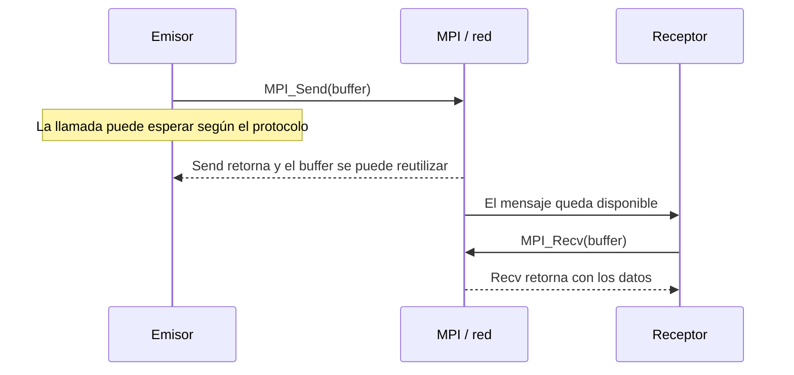

## MPI_Ssend
Envío síncrono, el envío finaliza cuando empieza la recepción. 
El envío finaliza cuando el receptor COMIENZA a recibir, no cuando lo recibe todo.

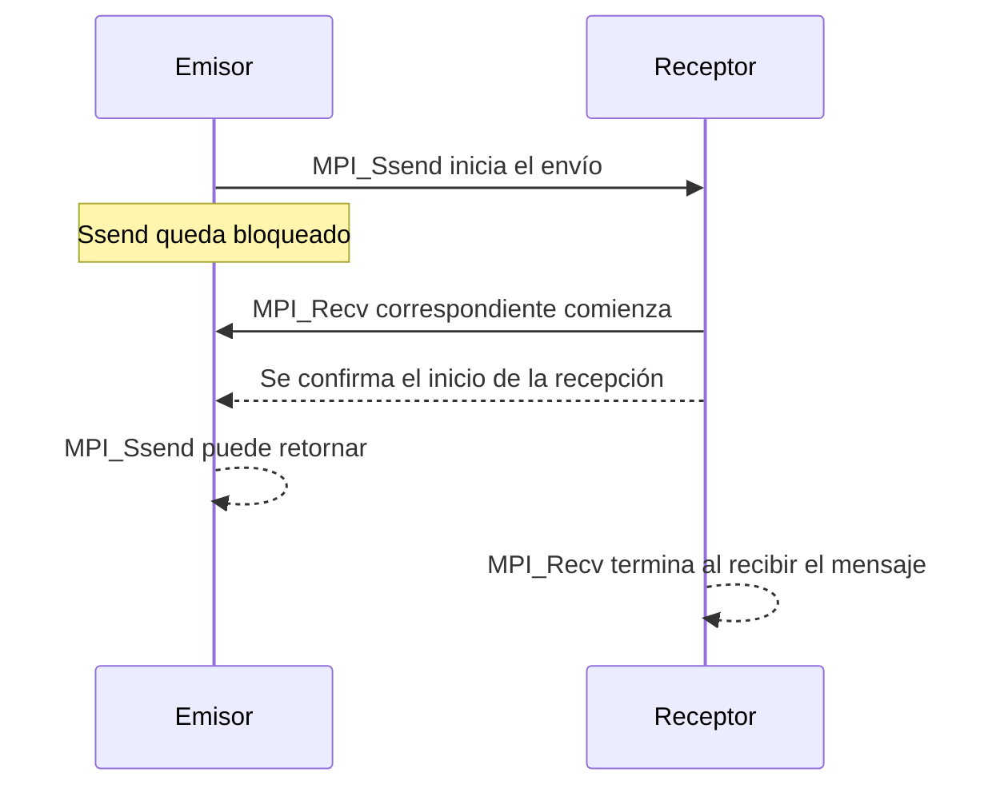

## MPI_Bsend
Envío basado en buffer, acaba independientemente del receptor cuando la información está en el buffer.
Los problemas los podemos tener en el buffer.

```mermaid
sequenceDiagram
    participant A as Emisor
    participant M as Buffer adjunto a MPI
    participant B as Receptor
    A->>M: MPI_Bsend copia el mensaje al buffer
    M-->>A: Bsend retorna; ya se puede reutilizar el buffer original
    Note over M: Hace falta espacio adjunto suficiente
    M->>B: MPI puede entregar el mensaje
    B->>M: MPI_Recv correspondiente
```

Antes de usar `MPI_Bsend`, el programa debe adjuntar memoria con `MPI_Buffer_attach`; debe liberarla después de que las operaciones hayan terminado y separar el buffer con `MPI_Buffer_detach`.

## MPI_Rsend
Acaba independiente de lo que pasa en recepción, es la función que más errores puede provocar y por tanto optimizar. Tenemos que estar seguros de que el receptor está preparado para recibir.

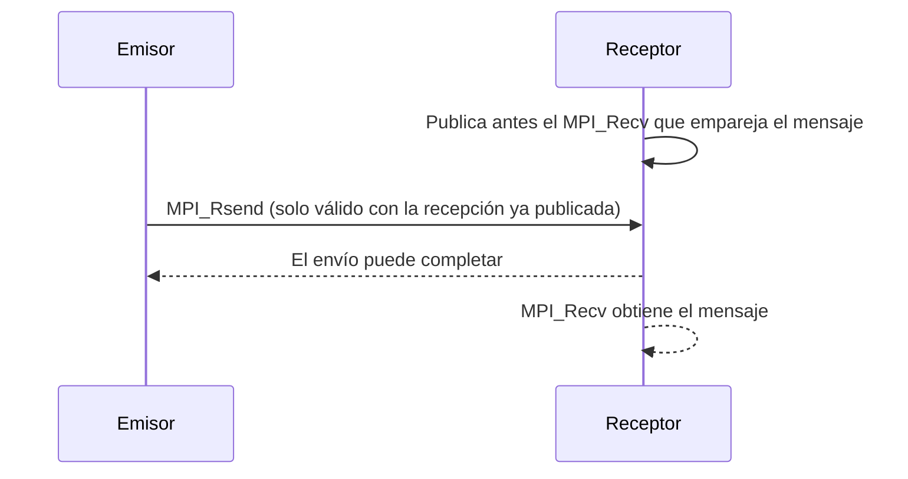

La recepción correspondiente debe estar ya publicada cuando se inicia `MPI_Rsend`; incumplir esa condición hace que el programa sea incorrecto.

## MPI_Recv
Cuando se llama a esta función no se retorna hasta que se ha recibido el mensaje (si no llega nunca no retorna nunca)

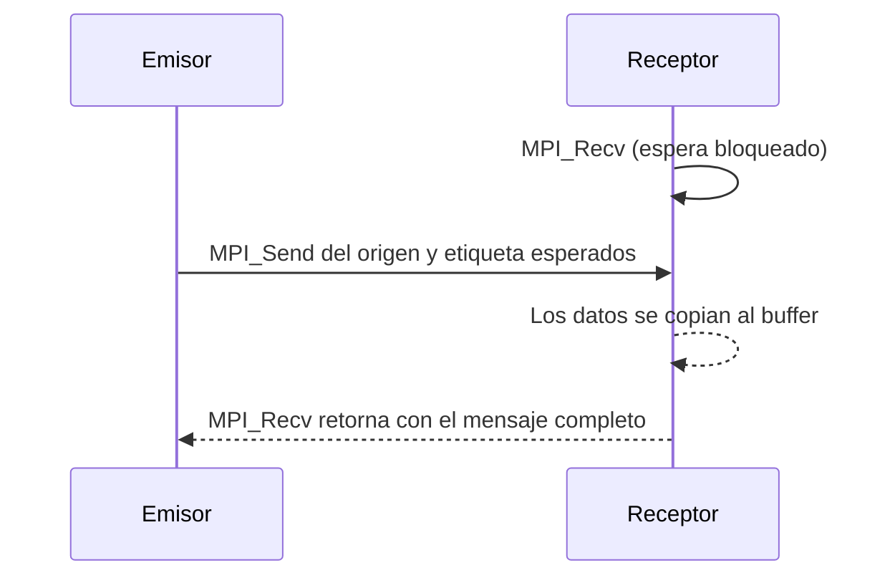

La llamada selecciona el mensaje usando comunicador, origen (o `MPI_ANY_SOURCE`), etiqueta (o `MPI_ANY_TAG`) y tipo/capacidad compatibles. Si nunca llega un mensaje que coincida, la recepción puede esperar indefinidamente.

## MPI_Isend

Una opción para intentar simultanear cómputo y comunicaciones son las funciones asíncronas (se intenta evitar que los procesos estén ociosos mientras se espera un proceso de envío o de recepción)

```mermaid
sequenceDiagram
    participant A as Proceso emisor
    participant M as MPI
    A->>M: MPI_Isend(buffer, &request)
    M-->>A: Retorna enseguida con una petición
    A->>A: Puede calcular usando otras variables
    A->>M: MPI_Wait(&request)
    M-->>A: Envío completado; ya puede reutilizar buffer
```

`MPI_Isend` no permite modificar ni reutilizar el buffer de envío hasta completar la petición con `MPI_Wait`, `MPI_Test` u otra finalización válida.

## MPI_Irecv

```mermaid
sequenceDiagram
    participant A as Emisor
    participant B as Proceso receptor
    B->>B: MPI_Irecv(buffer, &request)
    B-->>B: Retorna enseguida; la recepción queda publicada
    B->>B: Puede hacer trabajo independiente
    A->>B: El mensaje llega y se copia en buffer
    B->>B: MPI_Wait(&request) confirma la finalización
    Note over B: Ahora puede leer o reutilizar buffer
```

Hasta completar la petición, el programa no debe leer ni modificar la zona del buffer reservada para esa recepción.

## MPI_Wait

`MPI_Wait` bloquea hasta que la operación no bloqueante asociada a la petición se completa. Después, el buffer puede reutilizarse según fuera de envío o recepción. 

```c
MPI_Wait(
    MPI_Request *request,
    MPI_Status *status
)
```

Nos devuelve el status para saber que es lo que ha pasado.

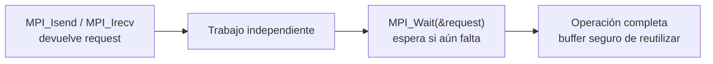

## MPI_Test

`MPI_Test` consulta una petición sin esperar: devuelve en `flag` si la operación ya se completó. Si `flag` es falso, se puede seguir trabajando y volver a consultar; si es verdadero, la operación terminó y se puede usar el buffer.

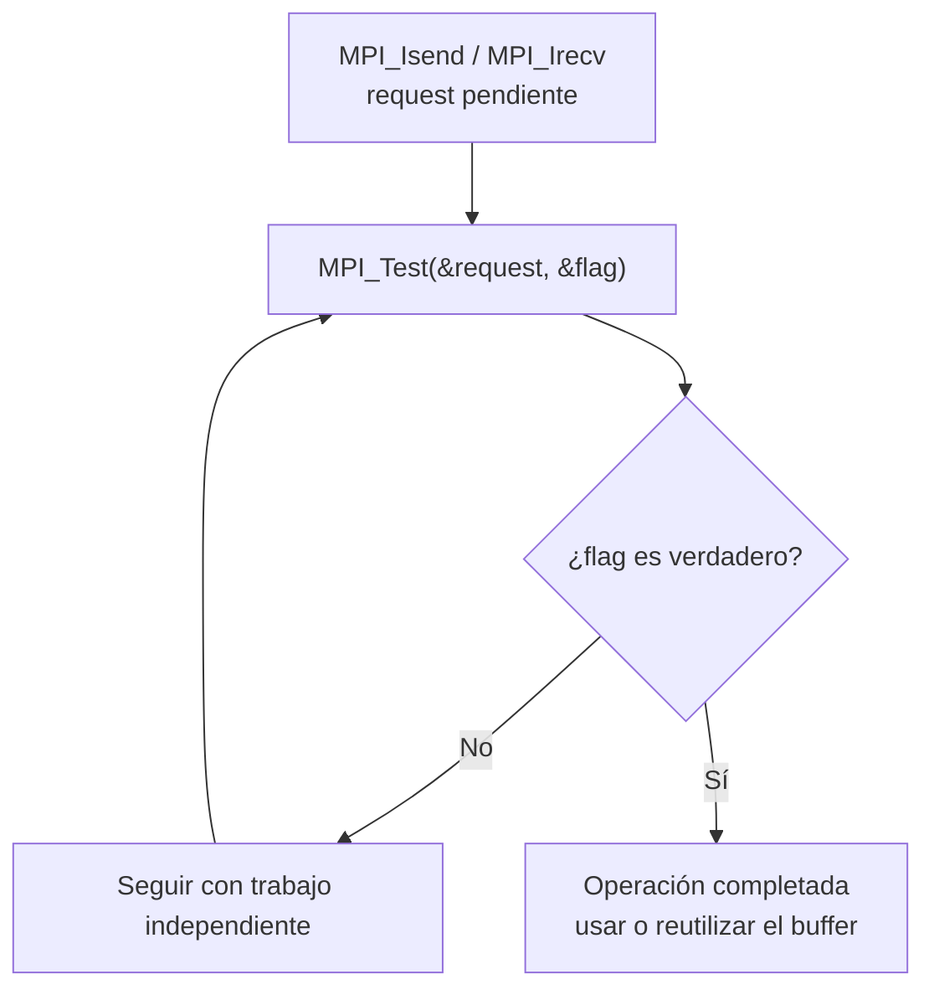

Cuando necesitamos enviar tipos de datos complejos podemos optar por dos opciones

1. Crear un tipo de datos derivado
2. empaquetar los datos

Si se ceea un tipo derivado en la creación se asegura la contigüidad de los datos en memoria.

# Comunicadores y grupos

Un **grupo** es una lista ordenada de procesos. Un **comunicador** combina un grupo con un contexto de comunicación: define quién puede hablar con quién, sus rangos dentro de ese universo y qué mensajes pertenecen a esa comunicación. El grupo aporta miembros y orden; el comunicador permite realizar las llamadas MPI. Por eso, para enviar un mensaje no basta con un rango: el rango siempre se interpreta dentro del comunicador que se pasa a `MPI_Send` o `MPI_Recv`.

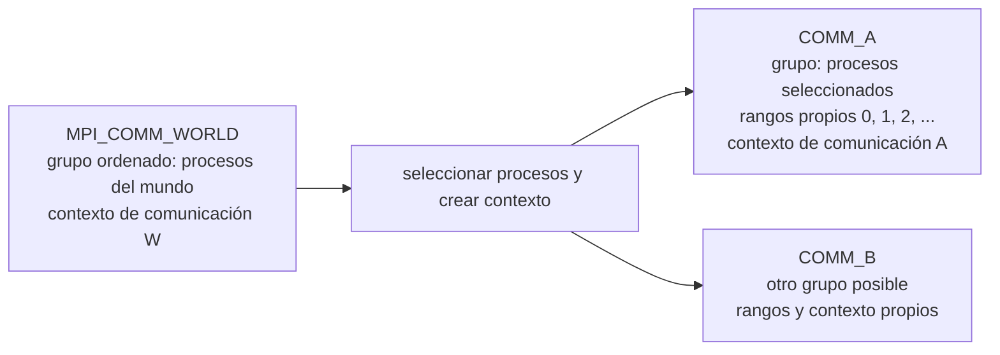

Dos comunicadores pueden incluir procesos coincidentes y aun así ser contextos separados. Un mensaje enviado en `COMM_A` no se recibe usando `COMM_B`, aunque coincidan el origen, el destino y la etiqueta.

## Comunicadores predefinidos

`MPI_COMM_WORLD` es el comunicador que incluye inicialmente a los procesos del trabajo MPI. `MPI_COMM_SELF` incluye solo al proceso que hace la llamada, con rango 0 dentro de ese comunicador. `MPI_COMM_NULL` **no es un comunicador utilizable**: indica que un proceso no pertenece al comunicador creado (o que no hay comunicador válido).

No hay que confundir estos comunicadores con los grupos predefinidos: `MPI_GROUP_EMPTY` es un grupo vacío válido y `MPI_GROUP_NULL` es un identificador de grupo inválido. Un grupo vacío no es lo mismo que un identificador nulo.

`MPI_COMM_WORLD` y `G_original` representan los mismos procesos en el mismo orden en este ejemplo: `G_original` se obtiene del grupo asociado a `MPI_COMM_WORLD`. Por eso, inicialmente, rango WORLD 0 identifica al mismo proceso que rango 0 de `G_original`, y así sucesivamente. **No son el mismo objeto**: `MPI_COMM_WORLD` es un comunicador con contexto de comunicación; `G_original` solo describe el conjunto ordenado de procesos. Los grupos nuevos tampoco crean procesos: seleccionan y ordenan procesos MPI que ya existen.

El grupo por sí mismo no es el canal para intercambiar mensajes. Se usa para crear un comunicador nuevo, por ejemplo `COMM2`. Ese comunicador permite que el subconjunto realice comunicaciones colectivas o punto a punto entre sus miembros sin incluir a los demás procesos de `MPI_COMM_WORLD`.

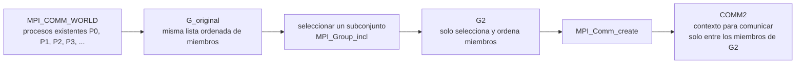

## Rangos: siempre relativos al grupo o comunicador

Los rangos empiezan en 0 y siguen el orden de miembros del grupo. No son identificadores globales permanentes del proceso. Por ejemplo, el proceso de rango 7 en `MPI_COMM_WORLD` puede ser rango 0 en un nuevo grupo creado con la lista `{7,5}`.

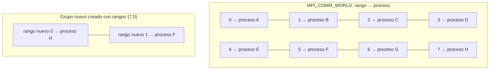

`MPI_Group_size(group, &n)` obtiene el número de procesos del grupo. `MPI_Group_rank(group, &rank)` obtiene el rango del proceso que realiza la llamada dentro de ese grupo; si no pertenece, devuelve `MPI_UNDEFINED`. Para consultar el rango de un comunicador se usa `MPI_Comm_rank(comm, &rank)`. Hay equivalentes para consultar su tamaño, como `MPI_Comm_size`.

En un ejercicio, «¿cuántos procesos hay en el grupo?» se contesta con `MPI_Group_size`. «¿Cuál es el identificador/rango de este proceso en el grupo?» se contesta con `MPI_Group_rank`. Si piden los rangos de los **miembros** comparados con otro grupo, se usa `MPI_Group_translate_ranks`. Los rangos son nombres relativos, no PID del sistema operativo.

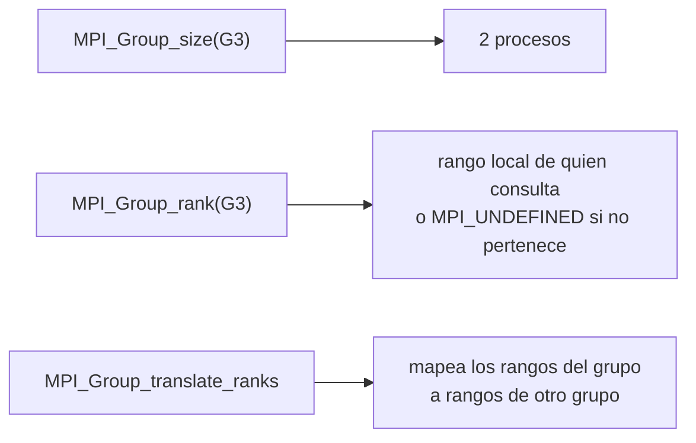

## Obtener y seleccionar grupos

`MPI_Comm_group(comm, &group)` obtiene el grupo asociado a un comunicador. No crea un comunicador nuevo: solo proporciona un objeto grupo que se puede usar para construir subconjuntos. Los grupos son inmutables; para seleccionar o combinar miembros se crea otro grupo.

`MPI_Group_incl` toma una lista de rangos del grupo de entrada y construye el grupo indicado por esa lista. **El orden de la lista determina los nuevos rangos.** `MPI_Group_excl` crea el grupo con los rangos restantes, conservando el orden del grupo de entrada. Las variantes `MPI_Group_range_incl` y `MPI_Group_range_excl` expresan selecciones como intervalos con paso.

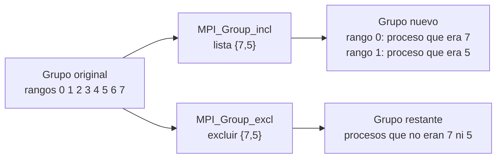

Para construir operaciones de conjuntos, MPI ofrece `MPI_Group_union`, `MPI_Group_intersection` y `MPI_Group_difference`. Reciben dos grupos y producen otro grupo con la unión, intersección o diferencia de sus miembros. El orden de miembros importa porque determina los rangos; consulta siempre los rangos resultantes con `MPI_Group_rank` o imprimiendo el mapeo.

## Crear un comunicador a partir de un grupo

`MPI_Comm_create(parent, group, &newcomm)` crea un comunicador con los miembros de `group` y un contexto nuevo. `group` debe ser un subconjunto del grupo de `parent`. **Todos los procesos de `parent` deben llamar a `MPI_Comm_create` en el mismo orden**, incluso quienes no pertenezcan al grupo nuevo. Los incluidos reciben un comunicador válido; los excluidos reciben `MPI_COMM_NULL`.

```mermaid
flowchart TB
    A["Todos los procesos de MPI_COMM_WORLD"] --> B["Todos llaman MPI_Comm_create<br/>con el mismo grupo G2"]
    B --> C["Miembros de G2"]
    B --> D["No miembros de G2"]
    C --> E["Obtienen COMM2 válido<br/>con rangos propios"]
    D --> F["Obtienen MPI_COMM_NULL<br/>no deben usar COMM2"]
```

`MPI_Comm_group` solo extrae el grupo existente; `MPI_Group_incl` o `MPI_Group_excl` construye el subconjunto; `MPI_Comm_create` crea el comunicador que ya se puede usar para enviar mensajes o llamar colectivas.

## Pregunta típica: ¿pueden hacer una colectiva solo los rangos WORLD 2 y 5?

**No usando `MPI_COMM_WORLD` y haciendo que solo ellos llamen.** Una colectiva es colectiva respecto al comunicador que se pasa: todos los procesos que pertenecen a ese comunicador deben participar en el orden compatible. Por eso, si se llama `MPI_Bcast(..., MPI_COMM_WORLD)` o `MPI_Reduce(..., MPI_COMM_WORLD)`, participan todos los procesos de WORLD, no solo los rangos 2 y 5. Que los otros procesos salten la llamada con un `if (rank == 2 || rank == 5)` no crea un subgrupo: puede dejar la operación bloqueada y el programa es incorrecto.

Para que solo participen 2 y 5, se crea un grupo con esos rangos, y a partir de él un comunicador. Todos los procesos de `MPI_COMM_WORLD` llaman a `MPI_Comm_create`; luego, solo los dos miembros llaman a las colectivas sobre `COMM25`.

```mermaid
flowchart TB
    W["MPI_COMM_WORLD<br/>P0 P1 P2 P3 P4 P5 P6 P7"] --> C["MPI_Comm_create con grupo {2,5}<br/>lo llaman todos los procesos WORLD"]
    C --> M["COMM25<br/>rango 0 = WORLD 2<br/>rango 1 = WORLD 5"]
    M --> B["MPI_Bcast(..., root=0, COMM25)<br/>solo participan WORLD 2 y 5"]
    M --> R["MPI_Reduce(..., root=0, COMM25)<br/>WORLD 2 y 5 contribuyen;<br/>WORLD 2 recibe el resultado"]
```

En `MPI_Bcast`, `root` es el rango **dentro de `COMM25`**, no el rango de WORLD. Como el grupo se crea con `{2,5}`, el root 0 es WORLD 2. En `MPI_Reduce`, todos los miembros de `COMM25` aportan; el root local 0 (WORLD 2) recibe la reducción.

```c
// Dentro del programa, después de MPI_Comm_group(MPI_COMM_WORLD, &G_original).
int rangos25[2] = {2, 5};
MPI_Group G25;
MPI_Comm COMM25;
MPI_Group_incl(G_original, 2, rangos25, &G25);

// La llamada la hacen TODOS los procesos de MPI_COMM_WORLD.
MPI_Comm_create(MPI_COMM_WORLD, G25, &COMM25);

// Solo los rangos WORLD 2 y 5 pertenecen a COMM25.
if (COMM25 != MPI_COMM_NULL) {
    int rank25, dato, local, suma;
    MPI_Comm_rank(COMM25, &rank25);

    dato = (rank25 == 0) ? 123 : 0;
    MPI_Bcast(&dato, 1, MPI_INT, 0, COMM25);
    // COMM25 rank 0 (WORLD 2) difunde 123 a COMM25 rank 1 (WORLD 5).

    local = (rank25 == 0) ? 2 : 5;
    MPI_Reduce(&local, &suma, 1, MPI_INT, MPI_SUM, 0, COMM25);
    if (rank25 == 0)
        printf("Suma de WORLD 2 y 5 = %d\n", suma); // imprime 7
}

MPI_Group_free(&G25);
if (COMM25 != MPI_COMM_NULL) MPI_Comm_free(&COMM25);
```

### ¿Y qué pasa con los rangos WORLD 7 y 5 de `COMM3`?

En el ejemplo anterior, `G3` se crea con la lista `{7,5}` y `COMM3` se asocia precisamente a esos dos procesos. Dentro de `COMM3` están solos: su grupo tiene tamaño 2, con rango COMM3 0 = WORLD 7 y rango COMM3 1 = WORLD 5. Por tanto, **sí pueden hacer `MPI_Bcast` o `MPI_Reduce` entre ellos usando `COMM3`**. No hace falta que participen los otros procesos de WORLD en esas colectivas (aunque todos sí participaron antes en la creación de `COMM3`).

```mermaid
flowchart LR
    A["WORLD 7<br/>COMM3 rank 0"] <-->|"colectivas sobre COMM3<br/>Bcast: root 0 · Reduce: root 0"| B["WORLD 5<br/>COMM3 rank 1"]
    X["WORLD 0,1,2,3,4,6<br/>recibieron MPI_COMM_NULL"] -. "no llaman las colectivas de COMM3" .-> A
```

En este `COMM3`, el root local 0 es WORLD 7 porque la lista `{7,5}` puso primero ese rango. Para que WORLD 5 fuese el root, se podría usar root local 1. La regla no cambia entre `MPI_Bcast` y `MPI_Reduce`: todos los miembros de `COMM3` participan; en `MPI_Reduce`, el resultado se entrega solo al root escogido.

## Ejemplo corregido

Este ejemplo supone al menos ocho procesos en `MPI_COMM_WORLD`. Todos extraen el grupo original y construyen los mismos grupos. `G2` contiene los procesos de rangos mundiales 0, 1 y 2. `G3` contiene primero el proceso 7 y después el 5; por eso sus rangos nuevos siguen ese orden.

### ¿Qué cambia con `{2, 1, 0}` en vez de `{0, 1, 2}`?

`MPI_Group_incl` conserva el orden de la lista `rangos1`. Con `{0,1,2}`, el rango 0 de `G2` corresponde al rango 0 de WORLD, el rango 1 al 1, y el rango 2 al 2. Si se usa `{2,1,0}`, **siguen siendo los mismos tres procesos**, pero se invierte su orden dentro del grupo. Al crear `COMM2`, sus rangos quedan así:

| Rango en `G2` / `COMM2` | Proceso identificado por su rango en `MPI_COMM_WORLD` |
|---:|---:|
| 0 | 2 |
| 1 | 1 |
| 2 | 0 |

```mermaid
flowchart LR
    subgraph listaA["rangos1 = {0, 1, 2}"]
        A0["rango nuevo 0 ← WORLD 0"] --- A1["rango nuevo 1 ← WORLD 1"] --- A2["rango nuevo 2 ← WORLD 2"]
    end
    subgraph listaB["rangos1 = {2, 1, 0}"]
        B0["rango nuevo 0 ← WORLD 2"] --- B1["rango nuevo 1 ← WORLD 1"] --- B2["rango nuevo 2 ← WORLD 0"]
    end
```

Esto puede cambiar el resultado del programa si el código interpreta `rank == 0` como un rol especial: con `{2,1,0}`, ese rango nuevo lo ocupa el proceso que era WORLD 2. Para encontrar el proceso correspondiente, se puede usar `MPI_Group_translate_ranks`, como en el ejemplo de abajo. La lista solo cambia miembros/orden del grupo; `MPI_Comm_create` establece el comunicador por el que ese subconjunto puede comunicarse.

```c
#include <mpi.h>
#include <stdio.h>

int main(int argc, char **argv) {
    MPI_Init(&argc, &argv);

    int rank_world, size_world;
    MPI_Comm_rank(MPI_COMM_WORLD, &rank_world);
    MPI_Comm_size(MPI_COMM_WORLD, &size_world);
    if (size_world < 8) {
        if (rank_world == 0)
            fprintf(stderr, "Ejecuta con al menos 8 procesos.\n");
        MPI_Finalize();
        return 1;
    }

    MPI_Group G_original, G2, G3;
    MPI_Comm COMM2, COMM3;
    // Prueba también {2, 1, 0}: mismos miembros, distinto orden/rangos.
    int rangos1[3] = {0, 1, 2};
    int rangos2[2] = {7, 5};

    MPI_Comm_group(MPI_COMM_WORLD, &G_original);
    MPI_Group_incl(G_original, 3, rangos1, &G2);
    MPI_Group_incl(G_original, 2, rangos2, &G3);

    // Pregunta típica: ¿cuántos procesos tiene cada grupo?
    int tam_G2, tam_G3;
    MPI_Group_size(G2, &tam_G2); // 3
    MPI_Group_size(G3, &tam_G3); // 2

    // ¿Qué rangos de MPI_COMM_WORLD identifican a sus miembros?
    // Traducimos los rangos locales de cada grupo al grupo original.
    if (rank_world == 0) {
        int indices_G2[3] = {0, 1, 2}, ids_world_G2[3];
        int indices_G3[2] = {0, 1}, ids_world_G3[2];
        MPI_Group_translate_ranks(G2, tam_G2, indices_G2,
                                  G_original, ids_world_G2);
        MPI_Group_translate_ranks(G3, tam_G3, indices_G3,
                                  G_original, ids_world_G3);

        printf("G2: tamaño %d; rangos WORLD:", tam_G2);
        for (int i = 0; i < tam_G2; ++i) printf(" %d", ids_world_G2[i]);
        printf("\nG3: tamaño %d; rangos WORLD:", tam_G3);
        for (int i = 0; i < tam_G3; ++i) printf(" %d", ids_world_G3[i]);
        printf("\n");
    }

    // Estas dos llamadas las ejecutan todos los procesos de WORLD,
    // en el mismo orden, también los que quedarán fuera del grupo.
    MPI_Comm_create(MPI_COMM_WORLD, G2, &COMM2);
    MPI_Comm_create(MPI_COMM_WORLD, G3, &COMM3);

    if (COMM2 != MPI_COMM_NULL) {
        int rank2, size2;
        MPI_Comm_rank(COMM2, &rank2);
        MPI_Comm_size(COMM2, &size2);
        printf("rango WORLD %d -> rango COMM2 %d de %d\n",
               rank_world, rank2, size2);
    }
    if (COMM3 != MPI_COMM_NULL) {
        int rank3;
        MPI_Comm_rank(COMM3, &rank3);
        printf("rango WORLD %d -> rango COMM3 %d\n",
               rank_world, rank3);
    }

    if (COMM2 != MPI_COMM_NULL) MPI_Comm_free(&COMM2);
    if (COMM3 != MPI_COMM_NULL) MPI_Comm_free(&COMM3);
    MPI_Group_free(&G2);
    MPI_Group_free(&G3);
    MPI_Group_free(&G_original);
    MPI_Finalize();
    return 0;
}
```

Salida esperada del recuento y la traducción:

```text
G2: tamaño 3; rangos WORLD: 0 1 2
G3: tamaño 2; rangos WORLD: 7 5
```

Además, en `COMM2`, los rangos WORLD 0, 1 y 2 pasan a ser rangos 0, 1 y 2. En `COMM3`, el rango WORLD 7 pasa a rango 0 y el rango WORLD 5 a rango 1. Los demás procesos reciben `MPI_COMM_NULL` para esos comunicadores. En la ejecución, las líneas impresas por procesos distintos pueden aparecer en cualquier orden.

## Liberar recursos

Los grupos obtenidos o creados dinámicamente se liberan con `MPI_Group_free`; los comunicadores creados se liberan con `MPI_Comm_free`. No se liberan los comunicadores predefinidos como `MPI_COMM_WORLD` o `MPI_COMM_SELF`. Se libera por separado el grupo y el comunicador: son objetos diferentes.

Referencia: [MPI Forum — grupos](https://www.mpi-forum.org/docs/mpi-5.0/mpi50-report/node180.htm) y [creación de comunicadores](https://www.mpi-forum.org/docs/mpi-5.0/mpi50-report/node190.htm).
