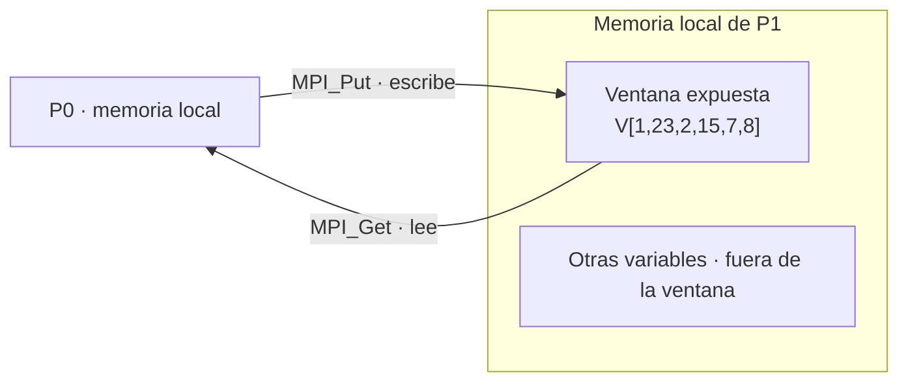
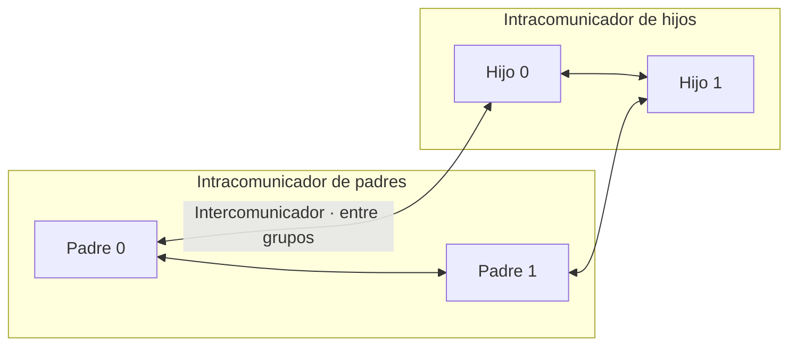

# Clase del 20 de octubre: MPI-2

> **Prácticas de la asignatura:** únicamente se utilizarán las funciones de MPI-1 vistas en clase. Este bloque de MPI-2 es informativo.

MPI-2 amplía MPI con entrada/salida paralela, acceso remoto a memoria y gestión dinámica de procesos. Estas capacidades resuelven necesidades distintas y se pueden utilizar independientemente.

## 1. Entrada y salida paralela: MPI-IO

La entrada/salida puede convertirse en un cuello de botella: si un único proceso lee todo y lo distribuye, los demás pueden esperar a que termine. MPI-IO permite expresar accesos a un fichero desde varios procesos y coordinarlos, incluidas operaciones colectivas.

La mejora depende del patrón de acceso, la implementación MPI, la red y el almacenamiento. Un sistema de ficheros paralelo puede proporcionar mayor ancho de banda agregado. **MPI-IO no necesita un dispositivo especial para funcionar**, pero su interfaz no elimina por sí sola las limitaciones del almacenamiento.

La misma distinción se aplica a `MPI_Bcast`: puede funcionar sin soporte específico de difusión en hardware; dicho soporte puede acelerar ciertas implementaciones. Disponibilidad de una operación y aceleración mediante hardware son cosas diferentes.

En esta clase se presenta el objetivo de MPI-IO, sin desarrollar aún su API de ficheros. [Referencia: capítulo de E/S de MPI-2.2](https://www.mpi-forum.org/docs/mpi-2.2/mpi22-report/mpi22-report.htm).

## 2. Comunicación bilateral, unilateral y solapamiento

En una comunicación **bilateral** o *two-sided*, un proceso inicia el envío y otro publica la recepción correspondiente. Son ejemplos `MPI_Send`/`MPI_Recv` y `MPI_Isend`/`MPI_Irecv`.

En una comunicación **unilateral** o *one-sided*, el origen describe la transferencia y accede a una región expuesta por otro proceso. El destino no publica un `MPI_Recv` por cada transferencia. Este modelo se denomina **RMA: Remote Memory Access**, acceso remoto a memoria.

| Clasificación | Qué distingue |
|---|---|
| Bilateral / unilateral | Quién especifica y participa explícitamente en cada transferencia. |
| Bloqueante / no bloqueante | Qué garantiza el retorno de una llamada y cómo se completa la operación. |
| Síncrono / otros modos de envío | Qué coordinación exige el modo de envío con la recepción. |

`MPI_Isend` es bilateral y no bloqueante. `MPI_Ssend` es un envío síncrono bloqueante. **Unilateral no significa automáticamente no bloqueante**: las operaciones RMA tienen reglas propias de finalización y pueden requerir esperas de sincronización.

Solapar comunicación y cómputo consiste en realizar trabajo independiente mientras progresa una comunicación. Por ejemplo: iniciar una recepción, calcular con otros datos y esperar antes de utilizar lo recibido. Se intenta aprovechar tiempo que de otro modo se pasaría esperando. La ganancia depende de que haya trabajo independiente y de cómo progrese MPI.

## 3. QUÉ ES UNA VENTANA: una zona de memoria expuesta

Una **ventana** es una zona de la memoria local de un proceso que este expone para que los procesos participantes puedan acceder a ella mediante RMA. MPI proporciona además un objeto `MPI_Win` que representa el conjunto de regiones expuestas por los procesos del grupo y la información necesaria para acceder a ellas.

La memoria sigue perteneciendo a cada proceso. No se convierte toda su memoria en compartida ni se pueden usar sus punteros locales directamente desde otro proceso. El acceso remoto se expresa mediante el rango del destino y un desplazamiento dentro de su ventana.



La ventana delimita qué región se ofrece a MPI. **No es una barrera de seguridad frente a procesos hostiles**: los participantes deben cumplir los límites y las reglas de la API. También deben ordenar los accesos para evitar condiciones de carrera.

### 3.1. Crear una ventana: MPI_Win_create

```c
MPI_Win_create(base, size, disp_unit, info, comm, &win);
```

| Argumento | Significado |
|---|---|
| `base` | Dirección inicial de la memoria local expuesta. |
| `size` | Tamaño de esa región **en bytes**, de tipo `MPI_Aint`. Puede ser cero. |
| `disp_unit` | Unidad en bytes que escala los desplazamientos dirigidos a esta región. |
| `info` | Indicaciones a la implementación; puede usarse `MPI_INFO_NULL`. |
| `comm` | Intracomunicador de los procesos participantes. |
| `win` | Objeto ventana devuelto por MPI. |

La creación es colectiva: llaman todos los procesos de `comm`. Cada uno puede exponer un tamaño diferente o ninguna memoria. `MPI_Win_create` **no reserva el vector**: expone memoria que ya existe y que debe seguir siendo válida durante su uso.

Con `disp_unit = sizeof(int)`, un acceso con `target_disp = 2` apunta al elemento de índice 2 del destino. Se aplica la unidad declarada **por el destino**. En cambio, `size` siempre está en bytes.

### 3.2. Liberar una ventana: MPI_Win_free

```c
MPI_Win_free(&win);
```

Es colectiva y se llama después de completar la participación en RMA. Libera el objeto ventana; con `MPI_Win_create`, el almacenamiento expuesto sigue siendo responsabilidad del programa. Si se obtuvo con `malloc`, podrá liberarse después con `free`.

[Referencia: creación y liberación de ventanas](https://www.mpi-forum.org/docs/mpi-2.2/mpi22-report/node231.htm).

## 4. Operaciones sobre una ventana

El **origen** es quien llama a la operación. El **destino** es el proceso cuya ventana se accede. En `Get`, los datos viajan del destino al origen.

| Función | Efecto | Dirección de los datos |
|---|---|---|
| `MPI_Put` | Escribe en la ventana del destino. | Memoria del origen → ventana del destino. |
| `MPI_Get` | Lee la ventana del destino. | Ventana del destino → memoria del origen. |
| `MPI_Accumulate` | Combina datos con los existentes mediante una operación admitida. | Aportación del origen → actualización del destino. |

Con `V1=[1,23,2]` en P0 y `V2=[15,7,8]` en la ventana de P1, en **tres casos independientes**:

```text
MPI_Put:                 P0 [1,23,2] ────────> P1 [1,23,2]
MPI_Get:                 P0 [15,7,8] <──────── P1 [15,7,8]
MPI_Accumulate, MPI_SUM:  P0 [1,23,2] ── suma ─> P1 [16,30,10]
```

`MPI_Accumulate` no se limita a sumar: `op` selecciona una operación admitida, como `MPI_SUM` o `MPI_MAX`, con tipos compatibles. Estas son las tres operaciones RMA básicas presentadas para MPI-2; las versiones posteriores amplían la API.

```c
MPI_Put(origin_addr, origin_count, origin_datatype,
        target_rank, target_disp, target_count, target_datatype, win);

MPI_Get(origin_addr, origin_count, origin_datatype,
        target_rank, target_disp, target_count, target_datatype, win);

MPI_Accumulate(origin_addr, origin_count, origin_datatype,
               target_rank, target_disp, target_count, target_datatype,
               op, win);
```

Los argumentos `origin_*` describen el búfer local; `target_*`, la región remota. Los accesos deben caber en la ventana y tener tipos y cantidades compatibles. El retorno de estas llamadas no equivale a tener completados todos sus efectos remotos: se aplican las reglas de sincronización de la ventana.

[Referencias: operaciones RMA](https://www.mpi-forum.org/docs/mpi-2.2/mpi22-report/node233.htm), [Put](https://www.mpi-forum.org/docs/mpi-2.2/mpi22-report/node234.htm) y [Accumulate](https://www.mpi-forum.org/docs/mpi-2.2/mpi22-report/node237.htm).

## 5. Sincronización y condiciones de carrera

Si dos procesos escriben sin coordinación en la misma zona, o uno lee mientras otro la modifica de forma incompatible, puede haber una condición de carrera. La semejanza con memoria compartida está en la necesidad de ordenar los accesos; los procesos MPI siguen teniendo memoria propia.

Las operaciones RMA se realizan dentro de **épocas de acceso**: intervalos abiertos y cerrados mediante sincronizaciones de ventana. Hay que distinguir finalización en el origen, finalización en el destino y disponibilidad para accesos locales del propietario.

### 5.1. Destino activo

El propietario participa explícitamente en la sincronización, aunque no haga un `Recv` por cada dato.

- `MPI_Win_fence`: sincronización colectiva del grupo de la ventana, útil para separar fases de cálculo y comunicación.
- `MPI_Win_start` / `MPI_Win_complete`: abren y cierran la época de acceso del origen en el modelo por grupos.
- `MPI_Win_post` / `MPI_Win_wait`: abren y cierran la época de exposición correspondiente en el destino.

### 5.2. Destino pasivo

El origen usa `MPI_Win_lock` y `MPI_Win_unlock` para acceder a la ventana de un destino. El destino no ejecuta una sincronización por cada acceso de esa época, pero ya participó en la creación de la ventana y debe respetar las reglas de acceso a su memoria.

Los bloqueos pueden ser compartidos o exclusivos. No sustituyen por sí solos un protocolo que indique cuándo un consumidor debe leer un resultado ni hacen correcto cualquier acceso local simultáneo.

### 5.3. Ejemplo completo con MPI_Win_fence

Requiere **exactamente dos procesos**. Ambos exponen un vector; P0 escribe `V1` en la ventana de P1. Todos participan en las dos sincronizaciones y en la liberación.

```c
#include <mpi.h>
#include <stdio.h>

int main(int argc, char **argv) {
    MPI_Init(&argc, &argv);
    int rank, size;
    MPI_Comm_rank(MPI_COMM_WORLD, &rank);
    MPI_Comm_size(MPI_COMM_WORLD, &size);
    if (size != 2) {
        if (rank == 0) fprintf(stderr, "Ejecuta con exactamente 2 procesos.\n");
        MPI_Finalize();
        return 1;
    }

    int v[3];
    const int v1[3] = {1, 23, 2};
    const int v2[3] = {15, 7, 8};
    for (int i = 0; i < 3; ++i) v[i] = (rank == 0 ? v1[i] : v2[i]);

    MPI_Win win;
    MPI_Win_create(v, (MPI_Aint)sizeof v, sizeof(int),
                   MPI_INFO_NULL, MPI_COMM_WORLD, &win);
    MPI_Win_fence(0, win);
    if (rank == 0)
        MPI_Put(v, 3, MPI_INT, 1, 0, 3, MPI_INT, win);
    MPI_Win_fence(0, win);

    if (rank == 1) printf("P1: [%d,%d,%d]\n", v[0], v[1], v[2]);
    MPI_Win_free(&win);
    MPI_Finalize();
    return 0;
}
```

P1 imprime `[1,23,2]`. El segundo `fence` completa la fase y permite a P1 consultar su vector actualizado. Un `MPI_Barrier` aislado no sustituye las reglas de sincronización RMA.

Las funciones de sincronización anteriores completan el apartado que pedía desarrollar las ventanas. [Referencias: sincronización RMA](https://www.mpi-forum.org/docs/mpi-2.2/mpi22-report/node238.htm) y [Fence](https://www.mpi-forum.org/docs/mpi-2.2/mpi22-report/node239.htm).

## 6. Diferencia entre intracomunicador e intercomunicador

| Aspecto | Intracomunicador | Intercomunicador |
|---|---|---|
| Grupos | Un grupo de procesos. | Dos grupos disjuntos: local y remoto. |
| Comunicación punto a punto | Entre miembros del mismo grupo. | Entre miembros de grupos diferentes. |
| Rango propio | Dentro del grupo del comunicador. | Dentro del grupo local. |
| Rango de origen/destino de un mensaje | Dentro del mismo grupo. | Dentro del grupo remoto. |
| Ejemplo | `MPI_COMM_WORLD`, `MPI_COMM_SELF`, un subconjunto con comunicador propio. | La conexión que devuelve `MPI_Comm_spawn` entre padres e hijos. |



Las flechas son ejemplos, no conexiones exclusivas: cualquier miembro de un grupo puede dirigirse a un rango válido del grupo remoto.

Puede haber un padre 0 y un hijo 0 porque el rango es relativo al grupo. Desde un padre, enviar a `dest=0` con el intercomunicador significa enviar al **hijo 0**; hacerlo con el `MPI_COMM_WORLD` de los padres significa enviar al **padre 0**.

**Los intercomunicadores ya existían en MPI-1.** MPI-2 incorpora la creación dinámica de procesos y amplía la comunicación entre grupos. Que el concepto se desarrolle ahora en clase no cambia la versión en que apareció. [Referencia: intercomunicación en MPI-1.1](https://www.mpi-forum.org/docs/mpi-1.1/mpi-11-html/node111.html).

## 7. Creación de procesos: modelo inicial, fork-join y MPI dinámico

### 7.1. Modelo inicial y SPMD

En los ejercicios MPI-1 se fija el número de procesos al lanzar la aplicación, por ejemplo `mpiexec -n 4 programa`. En SPMD todos ejecutan el mismo programa y el rango determina su trabajo. MPMD permite distintos programas.

MPI-1 no proporciona las funciones `spawn` para añadir procesos MPI durante la ejecución. Crear grupos o comunicadores con procesos existentes no crea nuevos procesos.

### 7.2. Qué es fork-join

En el modelo **fork-join**, una tarea abre una región paralela, varios trabajadores ejecutan trabajo y se reúnen en un punto de unión antes de continuar. Es el esquema habitual para explicar una región paralela de OpenMP.

```text
Ejecución inicial ── fork ──┬── trabajador A ──┬── join ── continuación
                           ├── trabajador B ──┤
                           └── trabajador C ──┘
```

El nombre del modelo no obliga a usar `fork()` del sistema operativo. En MPI dinámico se lanzan nuevos programas MPI y se establece comunicación con ellos; no se copia automáticamente el punto de ejecución del padre ni se impone una única reunión al terminar una región.

### 7.3. MPI_Comm_spawn

Permite crear nuevas instancias de un ejecutable MPI. Es colectiva sobre el intracomunicador de padres y devuelve un **intercomunicador** que conecta a los padres participantes con los hijos.

```c
MPI_Comm_spawn(command, argv, maxprocs, info, root, comm,
               &intercomm, array_of_errcodes);
```

`command` indica el ejecutable; `argv`, sus argumentos; `maxprocs`, el máximo solicitado; `info`, indicaciones al entorno; `root`, el padre del que se toman esos argumentos; `comm`, el grupo de padres participantes. Disponibilidad y ubicación dependen del entorno y de sus recursos. Solicitar procesos no concede nodos ilimitados ni garantiza una ubicación arbitraria.

Los hijos comienzan el programa desde el inicio, llaman a `MPI_Init` y tienen **su propio `MPI_COMM_WORLD`**. Los padres mantienen el suyo sin ampliarlo automáticamente. Los hijos obtienen la conexión mediante `MPI_Comm_get_parent`.

**Puede utilizarse el mismo binario.** El programa debe distinguir los roles y ejecutar un protocolo compatible. Por ejemplo, `MPI_Comm_get_parent` devuelve `MPI_COMM_NULL` en procesos no creados mediante `spawn`, lo que permite distinguir el grupo inicial de los hijos.

Que padres e hijos comiencen en momentos distintos no exige otro ejecutable: exige que sus comunicaciones y sincronizaciones encajen. El intercomunicador ya lo establece `spawn`; no hay que crear otro manualmente para empezar a comunicar ambos grupos. [Referencia: creación y conexión padre-hijo](https://www.mpi-forum.org/docs/mpi-2.2/mpi22-report/node207.htm).

### 7.4. MPI_Comm_spawn_multiple

Solicita varios ejecutables o el mismo ejecutable con argumentos distintos en una sola llamada colectiva. Utiliza arrays de comandos, argumentos, cantidades e información.

Todos los hijos de **esa llamada** pertenecen a un mismo `MPI_COMM_WORLD` nuevo, aunque ejecuten programas diferentes. No se genera un mundo por cada comando de la lista. Los padres conservan su mundo y reciben la conexión con el grupo conjunto de hijos.

[Referencia: creación de múltiples ejecutables](https://www.mpi-forum.org/docs/mpi-2.2/mpi22-report/node208.htm).

### 7.5. MPI_UNIVERSE_SIZE

Atributo de `MPI_COMM_WORLD`, incorporado con MPI-2, que, **si está definido**, informa del número total de procesos previsto por el entorno de arranque. Puede orientar cuántos procesos adicionales solicitar respecto al tamaño inicial.

No es necesariamente el número de núcleos físicos, un límite estricto ni un contador actualizado de recursos libres. Puede depender del lanzador, la configuración y los recursos asignados por el gestor de colas. No se actualiza automáticamente si cambia el entorno y no garantiza que un `spawn` tenga éxito.

En C se consulta como atributo, comprobando su existencia:

```c
int *universe_size = NULL;
int flag = 0;
MPI_Comm_get_attr(MPI_COMM_WORLD, MPI_UNIVERSE_SIZE, &universe_size, &flag);
if (flag) {
    /* *universe_size contiene el valor anunciado por el entorno. */
}
```

[Referencia: Universe Size](https://www.mpi-forum.org/docs/mpi-4.1/mpi41-report/node301.htm).

## 8. Relación entre los conceptos

```text
MPI-IO                    → acceso coordinado a ficheros
RMA + ventanas            → acceso a zonas de memoria de otros procesos
Sincronización de ventana → orden y finalización de esos accesos
Spawn                     → creación de procesos durante la ejecución
Intracomunicador          → comunicación dentro de un grupo
Intercomunicador          → comunicación entre dos grupos
```

La creación de procesos y RMA son capacidades independientes: se pueden utilizar ventanas entre procesos lanzados inicialmente sin realizar ningún `spawn`.

[Todos los apuntes de la asignatura](../TODOS_APUNTES_ASIGNATURA.md) · [Guía visual](apuntes_visuales.md).
