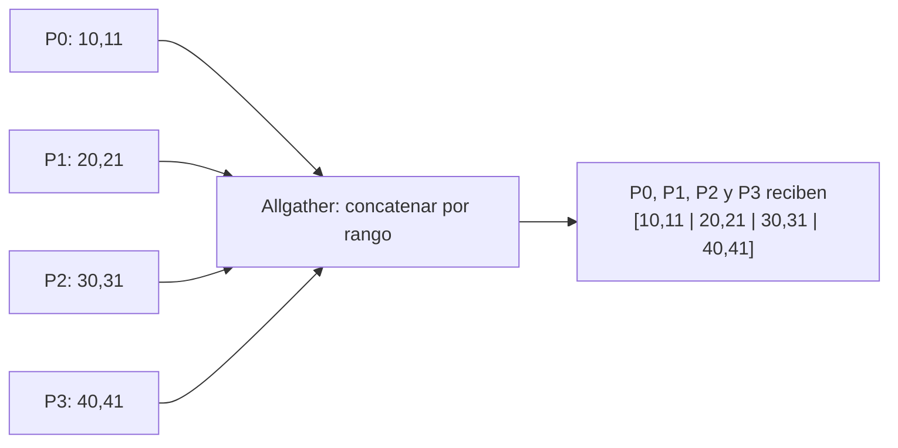

# MPI_Allgather

## Funcionamiento

Todos los procesos aportan el mismo número de elementos; todos reciben la concatenación de los bloques, ordenada por rango. No hay raíz. Con `p` procesos y `n` elementos enviados por proceso, cada `recvbuf` necesita `p*n` elementos. El bloque de Pi queda en `recvbuf + i*n`.



## Argumentos

`sendbuf`, `sendcount` y `sendtype` describen la aportación local. `recvbuf` es el vector completo reunido; `recvcount` es lo que se recibe **de cada origen** y `recvtype` su tipo. Los conteos y tipos de cada pareja emisor-receptor deben concordar. `comm` determina los procesos participantes.

## Equivalente didáctico con `MPI_Send` y `MPI_Recv`

P0 recibe las aportaciones por rango, las coloca en el vector y después lo envía completo a los demás. P0 coordina el algoritmo manual; la operación colectiva original no tiene raíz. Todos ejecutan el mismo programa y participan en las dos fases.

## Código completo

El programa usa cuatro procesos y dos enteros locales por proceso. La salida en cada rango es `[10,11,20,21,30,31,40,41]`.

```c
#include <mpi.h>
#include <stdio.h>

int main(int argc, char **argv) {
    MPI_Init(&argc, &argv);
    int rank, size;
    MPI_Comm_rank(MPI_COMM_WORLD, &rank);
    MPI_Comm_size(MPI_COMM_WORLD, &size);
    if (size != 4) {
        if (rank == 0) fprintf(stderr, "Ejecuta con 4 procesos.\n");
        MPI_Finalize(); return 1;
    }

    int local[2] = {10 * (rank + 1), 10 * (rank + 1) + 1};
    int total[8];
    const int tag = 111;

    if (rank == 0) {
        total[0] = local[0]; total[1] = local[1];
        for (int src = 1; src < size; ++src)
            MPI_Recv(&total[2 * src], 2, MPI_INT, src, tag,
                     MPI_COMM_WORLD, MPI_STATUS_IGNORE);
        for (int dst = 1; dst < size; ++dst)
            MPI_Send(total, 8, MPI_INT, dst, tag, MPI_COMM_WORLD);
    } else {
        MPI_Send(local, 2, MPI_INT, 0, tag, MPI_COMM_WORLD);
        MPI_Recv(total, 8, MPI_INT, 0, tag,
                 MPI_COMM_WORLD, MPI_STATUS_IGNORE);
    }

    printf("P%d:", rank);
    for (int i = 0; i < 8; ++i) printf(" %d", total[i]);
    printf("\n");
    MPI_Finalize();
    return 0;
}
```

## Compilar y ejecutar

```bash
mpicc -std=c99 11_Allgather.c -o 11_Allgather
mpiexec -n 4 ./11_Allgather
```

El envío punto a punto reúne todos los datos en P0 antes de distribuirlos; sirve para estudiar la semántica y no reproduce necesariamente el algoritmo interno ni el rendimiento de `MPI_Allgather`.

[Volver al índice](README.md)
