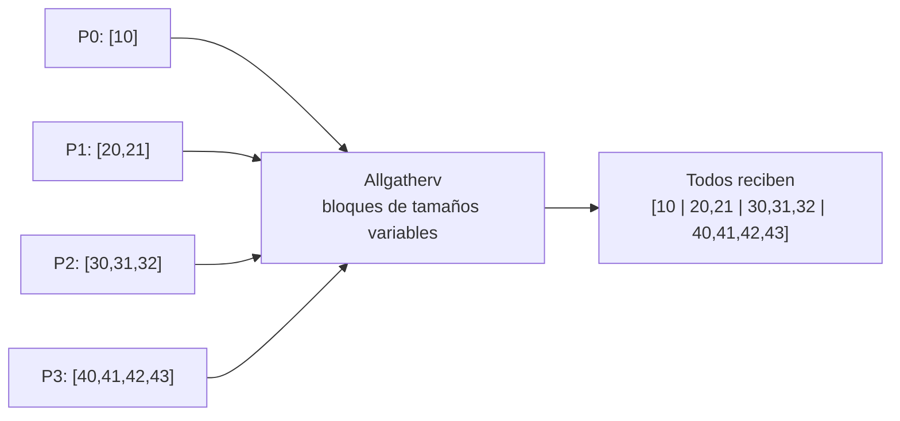

# MPI_Allgatherv

## Funcionamiento

Como `MPI_Allgather`, todos aportan y todos reciben la colección completa. La variante `v` permite que cada proceso aporte una cantidad diferente. Cada receptor utiliza `recvcounts[i]` para el tamaño del bloque del rango `i` y `displs[i]` para indicar su comienzo en `recvbuf`. Los desplazamientos se cuentan en unidades de `recvtype`; no hay `root`.



## Argumentos

`sendbuf`, `sendcount` y `sendtype` describen la contribución local, cuyo conteo puede variar. `recvbuf` debe cubrir todos los bloques. `recvcounts[i]` dice cuánto aporta el rango `i`, y `displs[i]` dónde queda su bloque en el buffer de este receptor. `recvtype` y `comm` son el tipo recibido y el comunicador. Cada receptor proporciona sus propios arrays; los bloques no deben exceder el buffer ni solaparse, y los conteos deben concordar con los envíos correspondientes.

## Equivalente didáctico con `MPI_Send` y `MPI_Recv`

En este ejemplo el tamaño aportado por Pi es `i+1`, así que todos conocen los conteos de antemano. P0 reúne los bloques consecutivamente y luego envía el vector completo a cada proceso. Se usan etiquetas distintas para distinguir la fase de reunión de la distribución.

## Código completo

```c
#include <mpi.h>
#include <stdio.h>

int main(int argc, char **argv) {
    MPI_Init(&argc, &argv);
    int rank, size;
    MPI_Comm_rank(MPI_COMM_WORLD, &rank);
    MPI_Comm_size(MPI_COMM_WORLD, &size);
    if (size != 4) {
        if (rank == 0) fprintf(stderr, "Ejecuta con 4 procesos.\n");
        MPI_Finalize(); return 1;
    }

    int counts[4], displs[4], total_n = 0;
    for (int i = 0; i < size; ++i) {
        counts[i] = i + 1;
        displs[i] = total_n;
        total_n += counts[i];
    }
    int local[4];
    for (int i = 0; i < counts[rank]; ++i)
        local[i] = 10 * (rank + 1) + i;
    int all[10];
    const int gather_tag = 121, share_tag = 122;

    if (rank == 0) {
        for (int i = 0; i < counts[0]; ++i) all[displs[0] + i] = local[i];
        for (int src = 1; src < size; ++src)
            MPI_Recv(&all[displs[src]], counts[src], MPI_INT, src, gather_tag,
                     MPI_COMM_WORLD, MPI_STATUS_IGNORE);
        for (int dst = 1; dst < size; ++dst)
            MPI_Send(all, total_n, MPI_INT, dst, share_tag, MPI_COMM_WORLD);
    } else {
        MPI_Send(local, counts[rank], MPI_INT, 0, gather_tag, MPI_COMM_WORLD);
        MPI_Recv(all, total_n, MPI_INT, 0, share_tag,
                 MPI_COMM_WORLD, MPI_STATUS_IGNORE);
    }

    printf("P%d:", rank);
    for (int i = 0; i < total_n; ++i) printf(" %d", all[i]);
    printf("\n");
    MPI_Finalize();
    return 0;
}
```

## Compilar y ejecutar

```bash
mpicc -std=c99 12_Allgatherv.c -o 12_Allgatherv
mpiexec -n 4 ./12_Allgatherv
```

El resultado en todos los rangos es `[10 | 20,21 | 30,31,32 | 40,41,42,43]`. El algoritmo manual concentra temporalmente los datos en P0; la colectiva no exige hacerlo así.

[Volver al índice](README.md)
