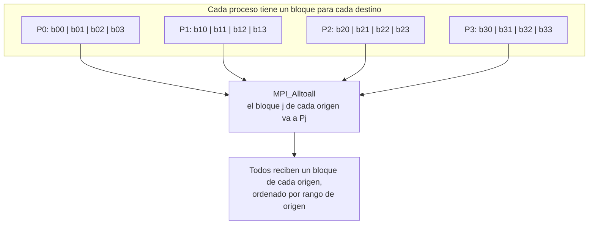

# MPI_Alltoall

## Funcionamiento

Cada proceso divide su buffer de envío en `size` bloques iguales: el bloque `j` va al destino Pj. Cada proceso recibe un bloque de cada origen y los coloca en orden de rango. Es un intercambio personalizado: no combina ni suma los valores y no tiene raíz.



Cada receptor recopila los bloques de todos los orígenes, incluido su propio bloque local. Si hay `k` elementos por pareja, `sendbuf` y `recvbuf` tienen capacidad para `size*k` elementos.

## Argumentos

`sendbuf`, `sendcount` y `sendtype` describen los bloques de envío: `sendcount` elementos por destino. `recvbuf`, `recvcount` y `recvtype` describen el bloque esperado de cada origen; los conteos y tipos deben concordar entre cada pareja. `comm` es el comunicador.

## Equivalente didáctico con `MPI_Send` y `MPI_Recv`

Los procesos recorren las parejas `(i,j)` con `i < j`. Para cada pareja, Pi envía a Pj y luego recibe; Pj recibe primero y después envía su bloque de vuelta. El orden complementario evita que ambos queden esperando dentro de `MPI_Send`. Cada proceso copia localmente el bloque destinado a sí mismo.

## Código completo

Cada pareja intercambia dos enteros. El bloque dirigido de Pi a Pj contiene `[100*(i+1)+10*j, 100*(i+1)+10*j+1]`.

```c
#include <mpi.h>
#include <stdio.h>

int main(int argc, char **argv) {
    MPI_Init(&argc, &argv);
    int rank, size;
    MPI_Comm_rank(MPI_COMM_WORLD, &rank);
    MPI_Comm_size(MPI_COMM_WORLD, &size);
    if (size != 4) {
        if (rank == 0) fprintf(stderr, "Ejecuta con 4 procesos.\n");
        MPI_Finalize(); return 1;
    }

    int sendbuf[8], recvbuf[8];
    for (int dst = 0; dst < size; ++dst) {
        sendbuf[2 * dst] = 100 * (rank + 1) + 10 * dst;
        sendbuf[2 * dst + 1] = sendbuf[2 * dst] + 1;
    }
    const int tag = 133;
    recvbuf[2 * rank] = sendbuf[2 * rank];
    recvbuf[2 * rank + 1] = sendbuf[2 * rank + 1];

    for (int i = 0; i < size; ++i) {
        for (int j = i + 1; j < size; ++j) {
            if (rank == i) {
                MPI_Send(&sendbuf[2 * j], 2, MPI_INT, j, tag, MPI_COMM_WORLD);
                MPI_Recv(&recvbuf[2 * j], 2, MPI_INT, j, tag,
                         MPI_COMM_WORLD, MPI_STATUS_IGNORE);
            } else if (rank == j) {
                MPI_Recv(&recvbuf[2 * i], 2, MPI_INT, i, tag,
                         MPI_COMM_WORLD, MPI_STATUS_IGNORE);
                MPI_Send(&sendbuf[2 * i], 2, MPI_INT, i, tag, MPI_COMM_WORLD);
            }
        }
    }

    printf("P%d recibe:", rank);
    for (int i = 0; i < 2 * size; ++i) printf(" %d", recvbuf[i]);
    printf("\n");
    MPI_Finalize();
    return 0;
}
```

## Compilar y ejecutar

```bash
mpicc -std=c99 13_Alltoall.c -o 13_Alltoall
mpiexec -n 4 ./13_Alltoall
```

El bloque local resultante queda ordenado por origen. Por ejemplo P0 recibe `[100,101 | 200,201 | 300,301 | 400,401]`.

[Volver al índice](README.md)
