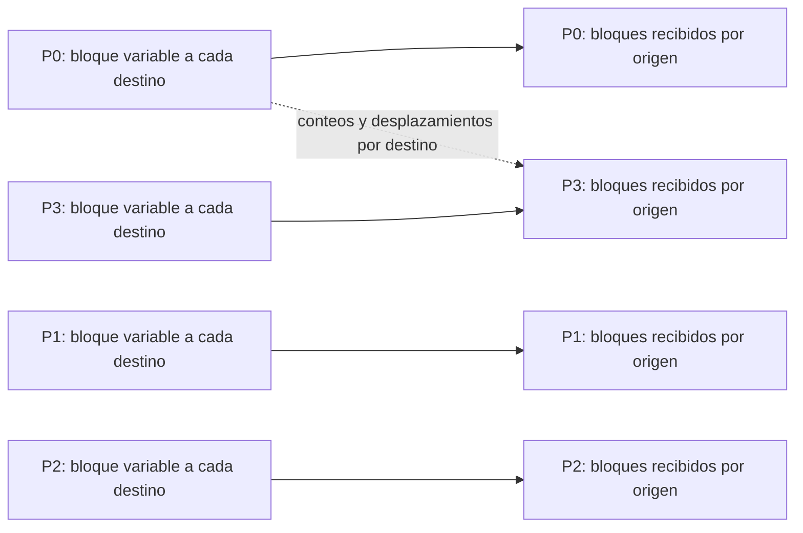

# MPI_Alltoallv

## Funcionamiento

Como `MPI_Alltoall`, cada proceso puede enviar datos a todos y recibir datos de todos, pero el tamaño del bloque puede variar por pareja. `sendcounts[j]` y `sdispls[j]` describen el bloque hacia Pj; `recvcounts[i]` y `rdispls[i]` describen dónde guardar el bloque recibido de Pi. Los desplazamientos se cuentan en unidades del tipo MPI, no en bytes. No hay raíz.



## Argumentos

`sendbuf`/`sendtype` describen los datos salientes y el tipo. `sendcounts[j]` es cuántos elementos enviar a Pj; `sdispls[j]` es dónde empieza ese bloque en el buffer. `recvbuf`/`recvtype` describen la recepción. `recvcounts[i]` es cuántos elementos aceptar de Pi; `rdispls[i]` es su posición inicial. `comm` determina el grupo. Los conteos deben concordar entre emisor y receptor; las regiones de recepción no deben solaparse.

## Equivalente didáctico con `MPI_Send` y `MPI_Recv`

El programa recorre las parejas `(i,j)` en orden. Pi envía a Pj el bloque indicado por sus arrays y recibe la respuesta; Pj recibe primero y luego responde. Los bloques locales a sí mismo se copian directamente. La matriz de conteos es conocida por todos en este ejemplo, pero en el uso general cada proceso puede calcular y almacenar sus propios arrays.

## Código completo

Para ilustrar tamaños distintos y mensajes vacíos, el tamaño del bloque Pi→Pj es `(i + 2*j) % 4`. Los valores enviados codifican origen, destino e índice local.

```c
#include <mpi.h>
#include <stdio.h>

int main(int argc, char **argv) {
    MPI_Init(&argc, &argv);
    int rank, size;
    MPI_Comm_rank(MPI_COMM_WORLD, &rank);
    MPI_Comm_size(MPI_COMM_WORLD, &size);
    if (size != 4) {
        if (rank == 0) fprintf(stderr, "Ejecuta con 4 procesos.\n");
        MPI_Finalize(); return 1;
    }

    int sendcounts[4], sdispls[4], recvcounts[4], rdispls[4];
    int sendbuf[16], recvbuf[16];
    int send_total = 0, recv_total = 0;
    for (int j = 0; j < size; ++j) {
        sendcounts[j] = (rank + 2 * j) % 4;
        sdispls[j] = send_total;
        send_total += sendcounts[j];
        recvcounts[j] = (j + 2 * rank) % 4;
        rdispls[j] = recv_total;
        recv_total += recvcounts[j];
    }
    for (int dst = 0; dst < size; ++dst)
        for (int k = 0; k < sendcounts[dst]; ++k)
            sendbuf[sdispls[dst] + k] = 100 * rank + 10 * dst + k;

    const int tag = 144;
    /* El bloque propio también cuenta como un intercambio de Pi consigo mismo. */
    for (int k = 0; k < sendcounts[rank]; ++k)
        recvbuf[rdispls[rank] + k] = sendbuf[sdispls[rank] + k];

    for (int i = 0; i < size; ++i) {
        for (int j = i + 1; j < size; ++j) {
            if (rank == i) {
                MPI_Send(&sendbuf[sdispls[j]], sendcounts[j], MPI_INT,
                         j, tag, MPI_COMM_WORLD);
                MPI_Recv(&recvbuf[rdispls[j]], recvcounts[j], MPI_INT,
                         j, tag, MPI_COMM_WORLD, MPI_STATUS_IGNORE);
            } else if (rank == j) {
                MPI_Recv(&recvbuf[rdispls[i]], recvcounts[i], MPI_INT,
                         i, tag, MPI_COMM_WORLD, MPI_STATUS_IGNORE);
                MPI_Send(&sendbuf[sdispls[i]], sendcounts[i], MPI_INT,
                         i, tag, MPI_COMM_WORLD);
            }
        }
    }

    printf("P%d recibe:", rank);
    for (int i = 0; i < recv_total; ++i) printf(" %d ", recvbuf[i]);
    printf("\n");
    MPI_Finalize();
    return 0;
}
```

## Compilar y ejecutar

```bash
mpicc -std=c99 14_Alltoallv.c -o 14_Alltoallv
mpiexec -n 4 ./14_Alltoallv
```

Cada receptor imprime sus bloques en orden de origen. Un conteo cero significa que esa pareja no intercambia elementos; no altera la posición de los demás bloques.

[Volver al índice](README.md)
