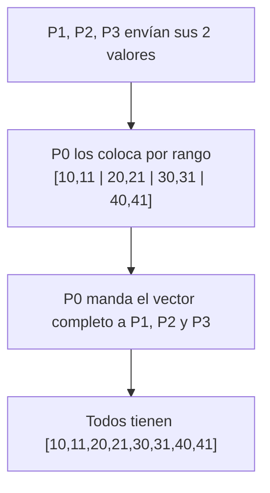

# MPI_Allgather con Send y Recv

## Diagrama



## Funcionamiento punto a punto

La colectiva `MPI_Allgather` no tiene raíz: todos aportan y reciben. En esta implementación manual P0 actúa como coordinador: recibe un bloque de cada proceso, empezando por el rango 1, y después distribuye el vector completo. P0 copia su propio bloque directamente. Se usa `tag = 111` en las dos fases; cada pareja tiene un único mensaje de esa etiqueta en cada fase.

El ejemplo usa dos enteros por proceso. Por ejemplo, P2 aporta `[30,31]`. El buffer reunido ordena los bloques por origen, no por el orden en que lleguen.

## Código

Programa completo: [11_Allgather.c](11_Allgather.c).

```c
MPI_Send(local, 2, MPI_INT, 0, tag, MPI_COMM_WORLD);
MPI_Recv(total, 8, MPI_INT, 0, tag, MPI_COMM_WORLD, MPI_STATUS_IGNORE);
```

En P0, la recepción se hace con `MPI_Recv(&total[2 * src], 2, ...)`; así se coloca cada bloque en el hueco del rango `src`. A continuación, P0 hace `MPI_Send(total, 8, ...)` a cada proceso.

## Comparación con la colectiva

```c
MPI_Allgather(local, 2, MPI_INT, total, 2, MPI_INT, MPI_COMM_WORLD);
```

La llamada colectiva expresa directamente reunión y distribución. La versión manual usa dos fases y centraliza temporalmente los datos en P0; es equivalente para este ejemplo, no necesariamente en algoritmo interno ni rendimiento.

## Compilar

```bash
mpicc -std=c99 11_Allgather.c -o 11_Allgather
mpiexec -n 4 ./11_Allgather
```

[Volver al índice](README.md)
