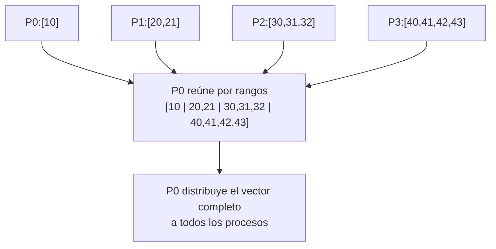

# MPI_Allgatherv con Send y Recv

## Diagrama



## Funcionamiento punto a punto

Cada proceso aporta `rank + 1` enteros. P0 conoce de antemano `counts = [1,2,3,4]` y `displs = [0,1,3,6]`, recibe cada bloque directamente en su posición y envía el vector de diez elementos completo a todos. No hay raíz en `MPI_Allgatherv`; P0 es solo el coordinador de esta implementación manual.

`MPI_Send` usa como conteo el tamaño del bloque local. `MPI_Recv` en P0 usa el tamaño correspondiente al origen. Las dos fases emplean etiquetas distintas para que sus mensajes no se confundan.

## Código

Programa completo: [12_Allgatherv.c](12_Allgatherv.c).

```c
MPI_Send(local, counts[rank], MPI_INT, 0, gather_tag, MPI_COMM_WORLD);
MPI_Recv(all, total_n, MPI_INT, 0, share_tag,
         MPI_COMM_WORLD, MPI_STATUS_IGNORE);
```

El vector final para todos es `[10 | 20,21 | 30,31,32 | 40,41,42,43]`.

## Comparación con la colectiva

```c
MPI_Allgatherv(local, counts[rank], MPI_INT,
               all, counts, displs, MPI_INT, MPI_COMM_WORLD);
```

La versión colectiva permite que MPI elija el algoritmo de comunicación; la versión manual concentra primero los datos en P0.

## Compilar

```bash
mpicc -std=c99 12_Allgatherv.c -o 12_Allgatherv
mpiexec -n 4 ./12_Allgatherv
```

[Volver al índice](README.md)
