# Funciones colectivas

## MPI_Bcast

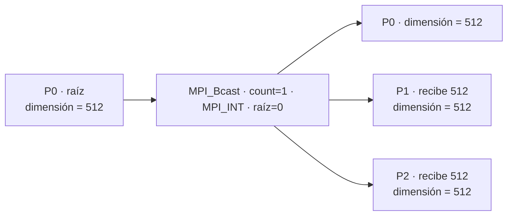
## MPI_Reduce

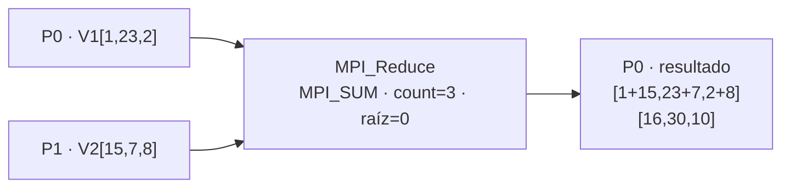

## MPI_Allreduce

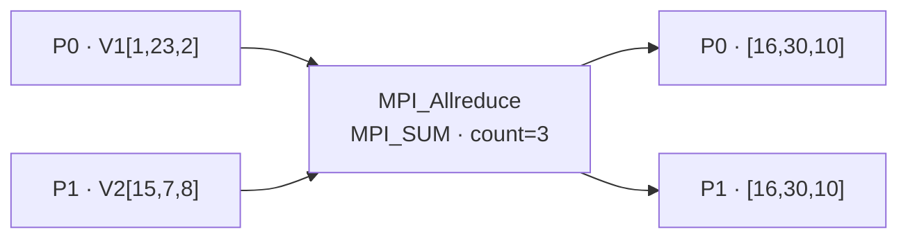

## MPI_Gather

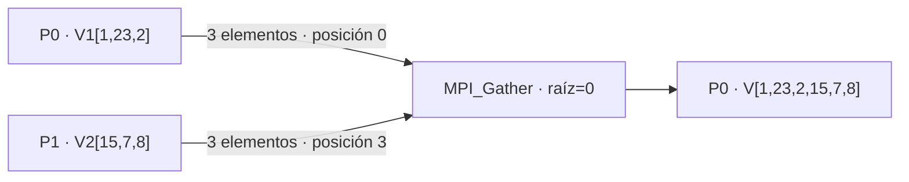

## MPI_Gatherv

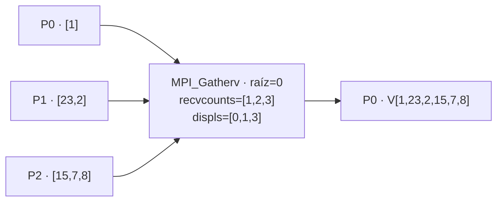

## MPI_Scatter

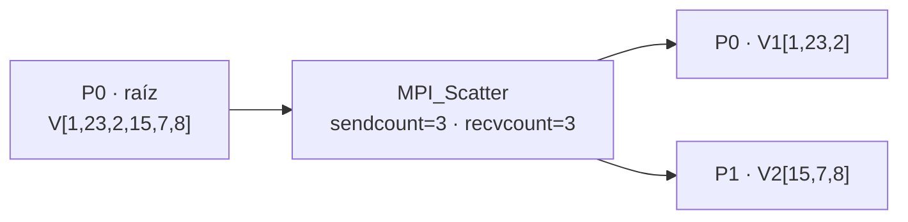

## MPI_Scatterv

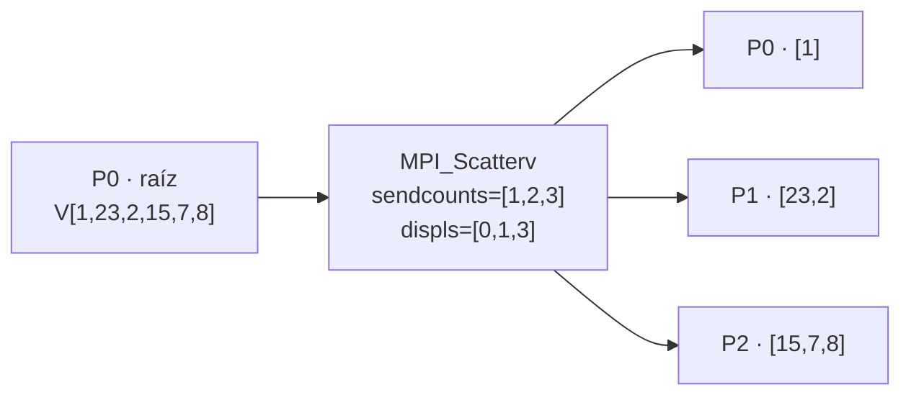

## MPI_Reduce_scatter

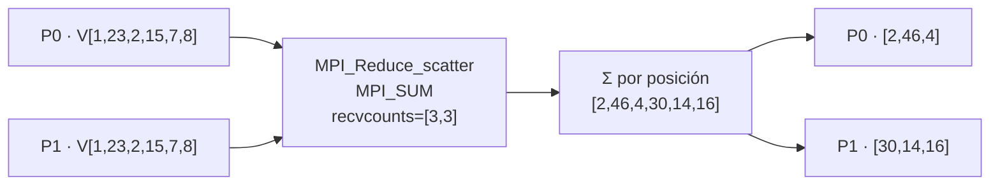

## MPI_Barrier

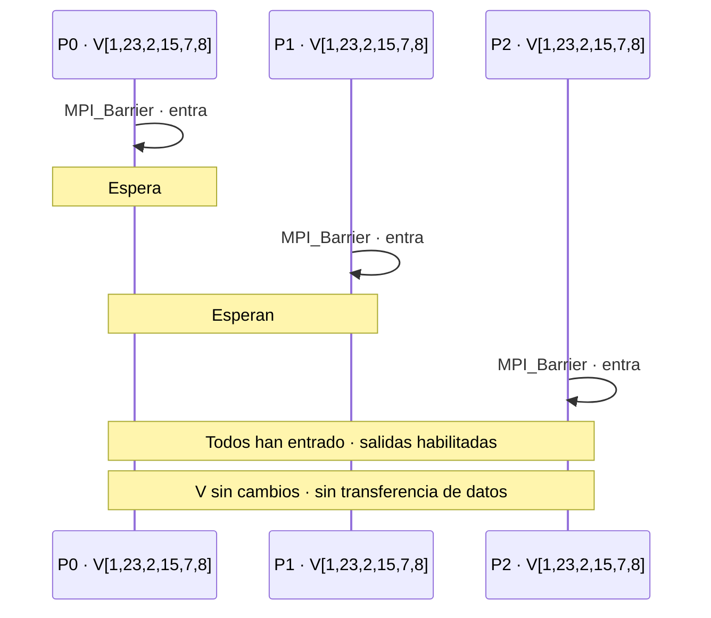

## MPI_Scan

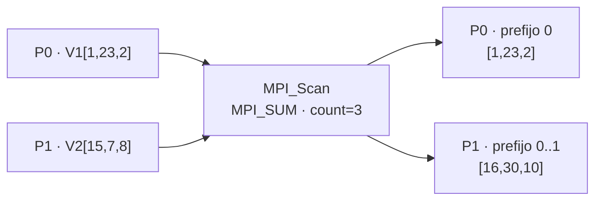

## MPI_Allgather

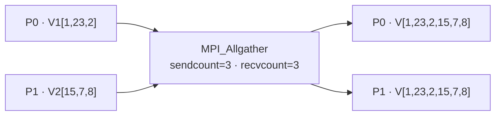

## MPI_Allgatherv

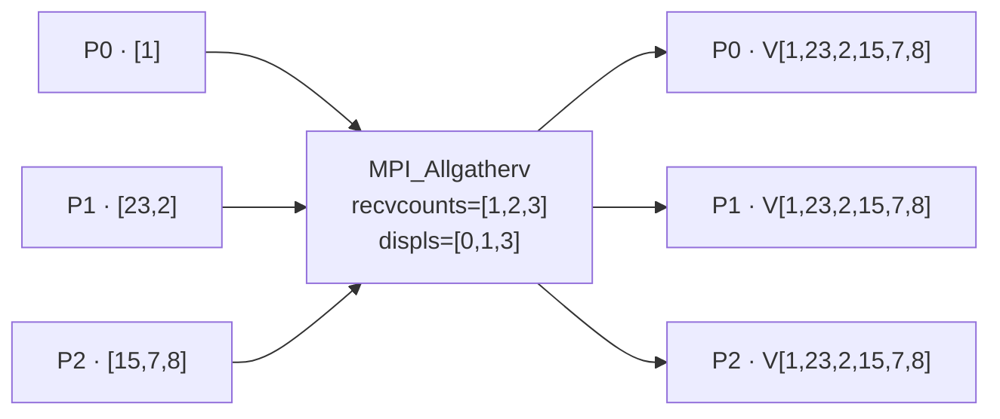

## MPI_Alltoall

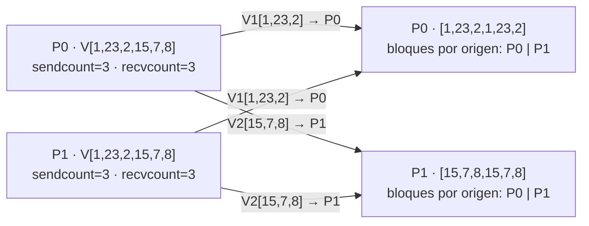
## MPI_Alltoallv

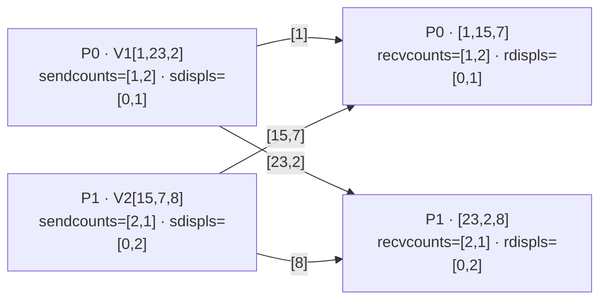

# Comunicación punto a punto

## MPI_Send

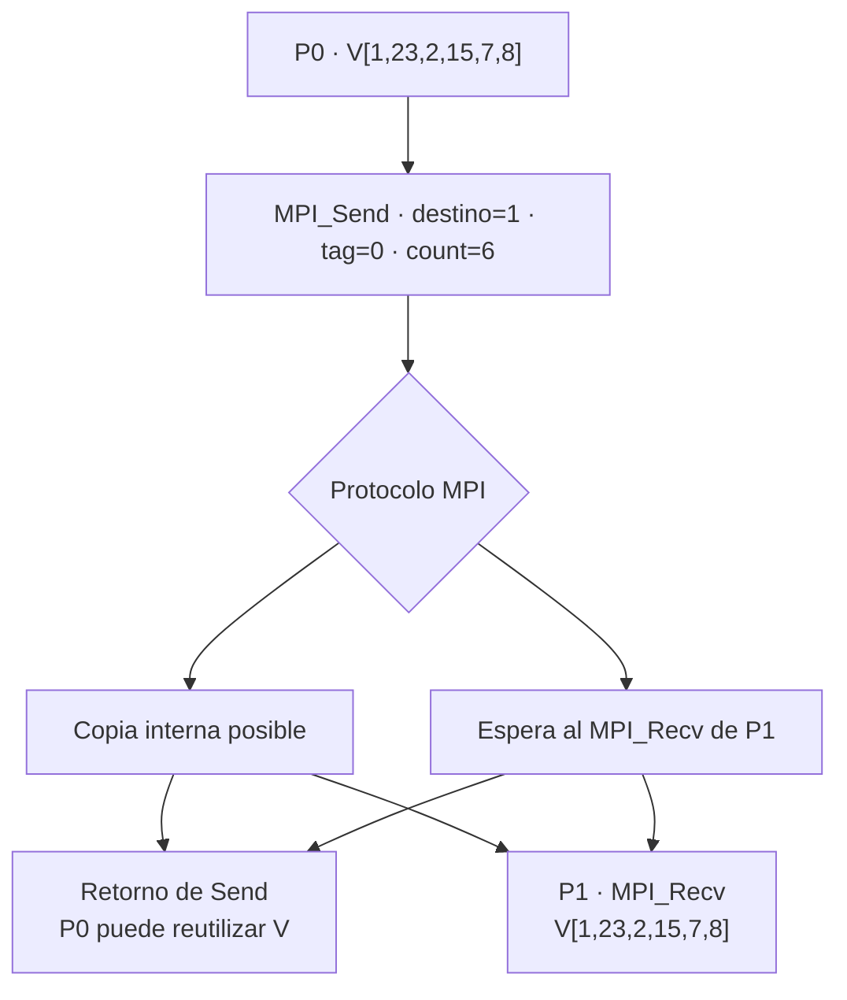

## MPI_Recv

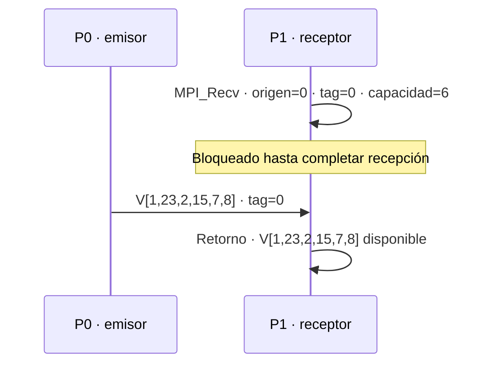

## MPI_Ssend

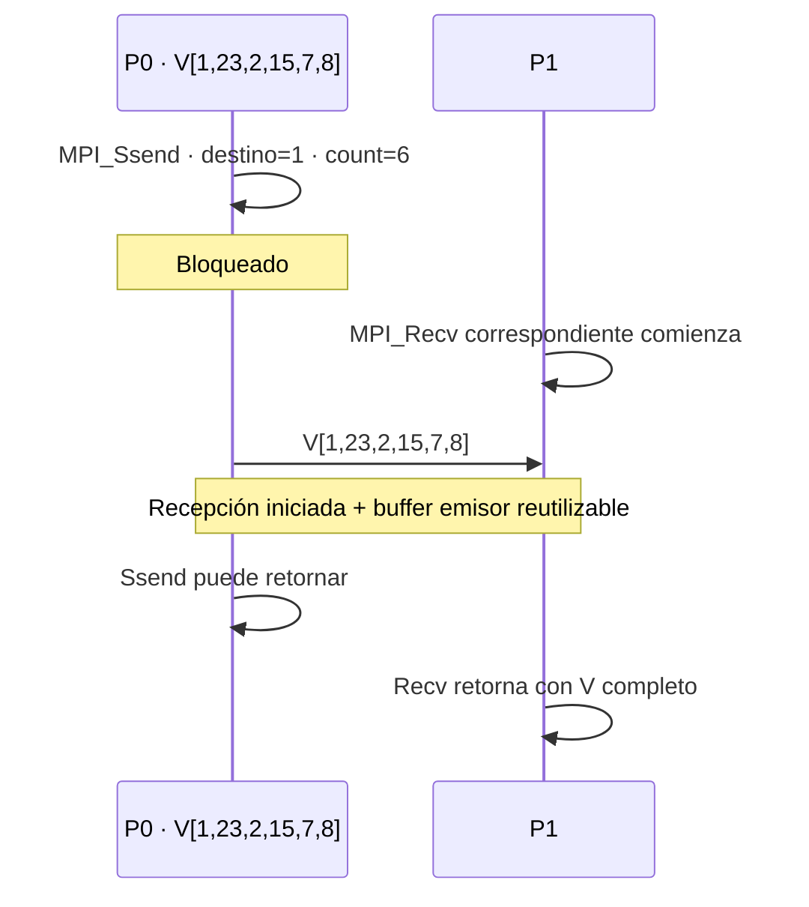

## MPI_Bsend · MPI_Buffer_attach · MPI_Buffer_detach

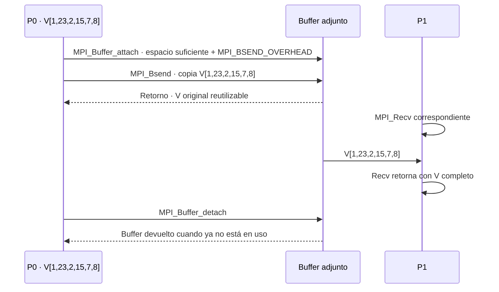

## MPI_Rsend

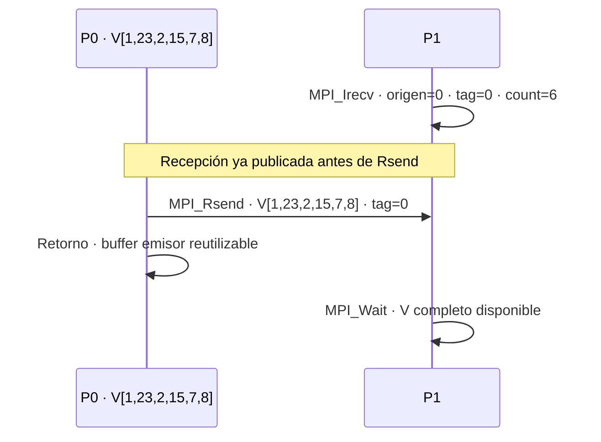

## MPI_Isend

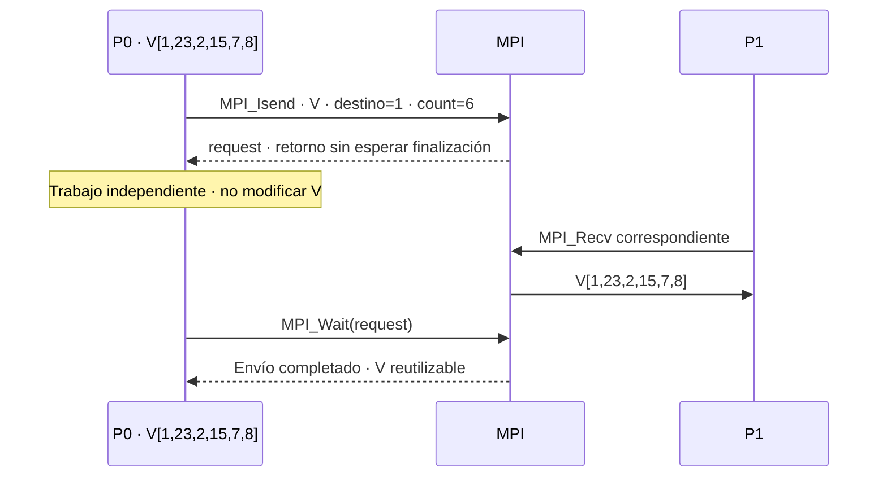

## MPI_Irecv

```mermaid
sequenceDiagram
 participant A as P0 · V[1,23,2,15,7,8]
 participant B as P1
 B->>B: MPI_Irecv · origen=0 · count=6
 B->>B: Retorno con request
 Note over B: Trabajo independiente · no leer ni modificar buffer receptor
 A->>B: V[1,23,2,15,7,8]
 B->>B: MPI_Wait(request)
 Note over B: Recepción completa · V[1,23,2,15,7,8] disponible
```

## MPI_Wait

```mermaid
flowchart TD
 A["MPI_Irecv · request<br/>V esperado: [1,23,2,15,7,8]"] --> B["MPI_Wait(request)"]
 B --> C{"¿Recepción completa?"}
 C -->|No| D["Espera bloqueado"]
 D --> C
 C -->|Sí| E["Retorno<br/>V[1,23,2,15,7,8] disponible"]
```

## MPI_Test

```mermaid
flowchart TD
 A["MPI_Irecv · request<br/>V esperado: [1,23,2,15,7,8]"] --> B["MPI_Test(request, flag)<br/>consulta sin bloquear"]
 B --> C{"flag"}
 C -->|0| D["Trabajo independiente<br/>no acceder al buffer receptor"]
 D --> B
 C -->|1| E["Recepción completa<br/>V[1,23,2,15,7,8] disponible"]
```


