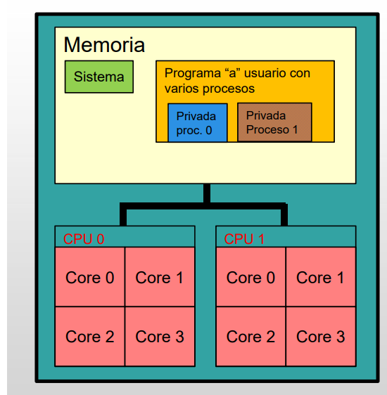
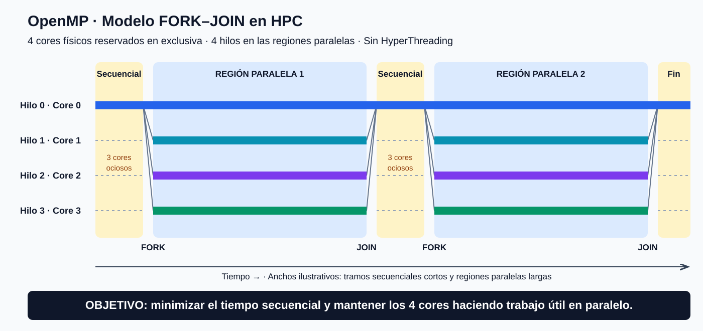
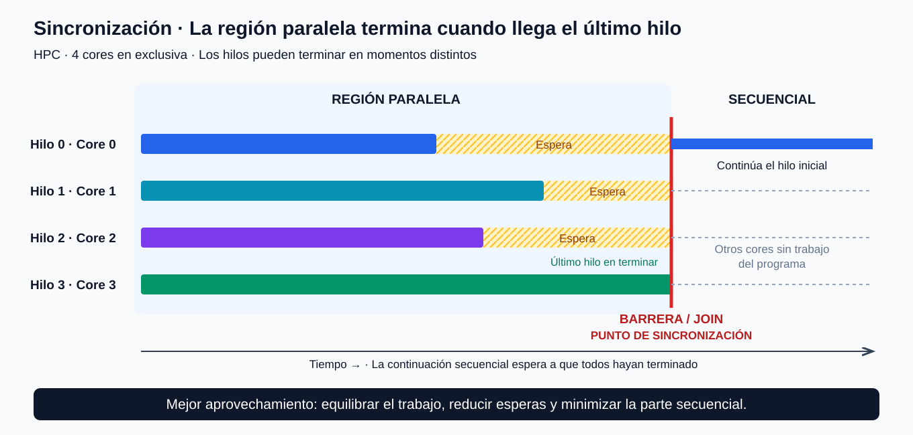
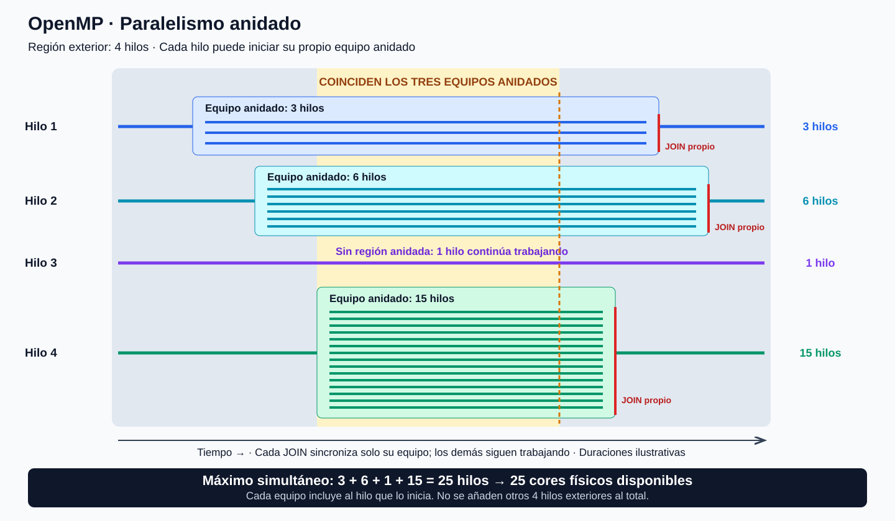

# Arquitecturas de memoria compartida: OpenMP

## 1. Arquitectura multicore y memoria compartida

Una **arquitectura de memoria compartida** es un sistema en el que las unidades de ejecución comparten un espacio de memoria. Las arquitecturas multicore estudiadas en clase forman parte de este modelo.



**OpenMP** es una herramienta de programación que permite explotar el paralelismo en sistemas de memoria compartida mediante hilos de ejecución.

## 2. Comunicación y sincronización

Todo desarrollo paralelo necesita **comunicación y sincronización**, también cuando la memoria es compartida.

### Comunicación

La **comunicación** consiste en compartir información entre las unidades de ejecución.

- En **MPI**, los procesos tienen espacios de memoria separados y se comunican mediante mensajes, utilizando funciones explícitas de MPI.
- En **OpenMP**, los hilos comparten el espacio de memoria del proceso y se comunican leyendo y escribiendo datos compartidos. No se utiliza el modelo de intercambio de mensajes entre procesos de MPI.

Por tanto, desaparece el intercambio explícito de mensajes, pero **no desaparece la comunicación**: esta se realiza a través de la memoria compartida.

### Sincronización

La **sincronización** coordina la ejecución de los hilos para que las operaciones que dependen unas de otras se realicen en el orden necesario.

El profesor destaca su importancia en memoria compartida. Por ejemplo, para obtener el resultado de una reducción es necesario que estén disponibles las contribuciones que se van a combinar.

> La coordinación puede estar incorporada en una operación o requerir mecanismos explícitos. La comparación de clase no debe interpretarse como que toda sincronización en MPI sea implícita y toda sincronización en OpenMP sea explícita.

## 3. Variables compartidas y privadas

En MPI, cada proceso dispone de su propio espacio de memoria. Por eso, una variable como `myrank` puede tener un valor diferente en cada proceso.

En OpenMP hay que distinguir qué datos se comparten y cuáles necesita cada hilo por separado:

- Una **variable compartida** es un mismo dato al que pueden acceder varios hilos.
- Una **variable privada** tiene una copia independiente para cada hilo que la utiliza, de modo que cada uno puede almacenar su propio valor.

Esta distinción es necesaria cuando el algoritmo requiere que los hilos mantengan valores diferentes durante la ejecución concurrente. Para intercambiar los resultados de sus datos privados, los hilos necesitarán los mecanismos adecuados de comunicación y sincronización.

La **gestión de la memoria** es clave tanto para la corrección del programa como para su eficiencia. Hay que decidir qué información se comparte, qué información es privada y cómo se coordinan los accesos a los datos compartidos.

## 4. Modelo de ejecución

El modelo presentado en clase parte de un **nodo de cómputo multicore o multiprocesador**.

Al ejecutar un programa se crea un proceso con su espacio de memoria. Este puede realizar reservas dinámicas de memoria según sus necesidades.

La ejecución de un programa OpenMP comienza de forma **secuencial** y, al llegar a una región paralela, pasa a utilizar varios **hilos**. Estos pertenecen al mismo proceso y comparten su espacio de memoria, aunque pueden trabajar con variables privadas.

> En este contexto conviene distinguir **proceso** de **hilo**: el paralelismo de OpenMP se expresa mediante hilos dentro de un proceso.

Los mecanismos concretos para declarar y gestionar los datos compartidos y privados se estudiarán más adelante.

## 5. Asignación de hilos a núcleos

El **mapeo de hilos a núcleos** consiste en decidir en qué núcleo de la CPU se ejecuta cada hilo.

Héctor indicó que decidiría si ampliaba este tema y explicó las dos alternativas siguientes.

El profesor plantea dos posibilidades:

### Gestión por el sistema operativo

El **sistema operativo (SO)** decide dónde ejecutar los hilos en función de la carga global del sistema y de sus políticas de planificación.

La asignación puede cambiar durante la ejecución: el SO puede trasladar un hilo de un núcleo a otro para repartir la carga. El comportamiento concreto depende del sistema operativo.

### Asignación indicada por el usuario

El usuario puede indicar los núcleos en los que quiere que se ejecuten los hilos y restringir sus desplazamientos. Esta vinculación se conoce como **afinidad de hilos**.

Según lo comentado en clase, controlar esta asignación puede ser útil cuando se busca una eficiencia elevada y se dispone del sistema en exclusiva. Permite planificar dónde se ejecuta cada hilo teniendo en cuenta la organización de los núcleos y la memoria.

La asignación debe considerar la carga del sistema: fijar los hilos a determinados núcleos cuando el equipo se comparte con otras tareas puede perjudicar el rendimiento.

### Influencia de la arquitectura y del uso del sistema

El profesor relacionó esta decisión con la arquitectura multicore: en el ejemplo comentado, los cuatro núcleos comparten un mismo chip de CPU. La organización de los núcleos y de la memoria es importante para el rendimiento y debe tenerse en cuenta al decidir dónde ejecutar cada hilo.

También señaló que hay que considerar si el sistema se utiliza en exclusiva. Si se comparte con otras tareas, fijar la asignación limita la capacidad del SO para mover los hilos y equilibrar la carga, por lo que puede perjudicar el rendimiento.


## Qué es OpenMP y cómo se reparte el trabajo

OpenMP se basa en **hilos de un mismo proceso**. Los hilos ejecutan el código de una región paralela, pero pueden realizar trabajos diferentes mediante condiciones explícitas o mecanismos de reparto de trabajo.

En clase se denominan **automatizadores** a los mecanismos que distribuyen trabajo entre los hilos sin tener que programar manualmente cada asignación. El reparto puede ayudar a equilibrar la carga; su comportamiento depende del mecanismo y de la planificación elegida. Este reparto entre hilos es distinto de la asignación de los hilos a cores que realiza el sistema operativo.

### Contenidos fuera del alcance de la asignatura

- **Tareas (`tasks`)**: introducidas en OpenMP 3.0. No se estudiará su programación en esta asignatura, aunque algunos mecanismos de reparto pueden servir como introducción conceptual.
- **HyperThreading**: permite que un core físico presente varios procesadores lógicos. Estos comparten recursos del core, por lo que no equivalen a cores físicos independientes. En cargas que utilizan intensamente las unidades de cálculo, añadir hilos lógicos no garantiza una mejora. **En el modelo de HPC de esta asignatura utilizaremos un hilo por core físico**; esto es una decisión del curso, no una prohibición general de HyperThreading en HPC.

## Contenidos que vamos a estudiar

- Modelo de ejecución.
- Compilación y ejecución.
- Directivas y cláusulas.
- Funciones de OpenMP y variables de entorno.
- Memoria compartida y variables privadas.

## Modelo de ejecución FORK–JOIN

Partimos de **un mismo código fuente y un ejecutable cuya ejecución comienza con un único hilo**. Al alcanzar una región paralela, OpenMP forma un equipo de hilos para ejecutar ese bloque. Al terminar la región, el hilo inicial continúa la ejecución secuencial.

El número de hilos puede ser diferente entre regiones: por ejemplo, una puede utilizar tres y otra ocho. También puede variar entre distintas entradas a una región situada dentro de un bucle.

**El tamaño efectivo del equipo se determina en ejecución**, según las indicaciones del programa, la configuración de OpenMP y los límites aplicables. Puede solicitarse desde el código o mediante variables de entorno; no tiene por qué ser una constante escrita literalmente en el programa.

### Ejecución FORK–JOIN y aprovechamiento de los recursos en HPC



La ejecución sigue esta secuencia: **ejecución secuencial → región paralela → ejecución secuencial → región paralela → tramo secuencial final y fin del programa**. En cada FORK se inicia una región paralela con un equipo de hilos, incluido el hilo inicial. En el JOIN, los hilos se sincronizan al terminar la región y el hilo inicial continúa la ejecución secuencial.

En el contexto de **HPC que vamos a considerar en la asignatura**, partimos del mismo supuesto de uso de recursos que en MPI: **disponemos de los recursos reservados en exclusiva**. En el ejemplo habitual utilizaremos **cuatro cores físicos y cuatro hilos durante las regiones paralelas**, sin considerar HyperThreading. El diagrama representa un hilo por core para ilustrar este aprovechamiento; la asignación concreta depende de la planificación y de la afinidad.

Reservar cuatro cores no significa que los cuatro estén trabajando durante toda la ejecución. **En los tramos secuenciales solo un hilo realiza el trabajo del programa y los otros tres cores quedan ociosos respecto a ese trabajo**. Aunque los recursos estén disponibles en exclusiva, no se aprovechan para avanzar el cálculo. Cuanto mayor sea el peso de estos tramos en el tiempo total, menor será el aprovechamiento de los cuatro cores y más limitada estará la mejora de rendimiento del programa paralelo.

Por eso, **el tiempo de ejecución secuencial debe ser el mínimo posible y las regiones paralelas deben abarcar la mayor cantidad posible de trabajo útil**. El objetivo es mantener ocupados los cuatro cores durante la mayor parte de la ejecución, con una carga equilibrada y reduciendo las esperas y el coste de entrar y salir de regiones paralelas. No se trata de alargar artificialmente el cálculo, sino de realizar en paralelo la mayor parte del trabajo que lo permita.

**Idea clave: poco tiempo en secuencial y mucho trabajo útil en paralelo.** Los anchos del diagrama muestran este objetivo de forma ilustrativa; no son tiempos medidos.


## Sincronización al final de una región paralela



Los hilos se ejecutan en cores distintos y **no avanzan necesariamente al mismo ritmo**. Incluso con la misma carga de trabajo pueden terminar en momentos diferentes. En un sistema compartido, otros procesos pueden afectar a su ejecución; en el supuesto de HPC de la asignatura seguimos considerando recursos en exclusiva, pero esto tampoco garantiza tiempos idénticos: pueden influir los accesos a memoria y otros efectos del sistema.

Una **barrera** es un punto de sincronización que ningún hilo del equipo puede superar hasta que todos hayan llegado. Los hilos que terminan antes esperan al último: durante esa espera no realizan trabajo útil del programa.

**La barrera del JOIN es el punto de sincronización al final de la región paralela: todos los hilos deben llegar a ese punto antes de que el hilo inicial pueda continuar la ejecución secuencial.**

Al final de una región paralela de OpenMP existe una **barrera implícita**. La región solo puede darse por terminada cuando todos los hilos han completado su trabajo. Entonces se realiza el **JOIN** y el hilo inicial continúa la ejecución secuencial. Terminar la región no implica necesariamente destruir los hilos del sistema operativo: la implementación puede conservarlos para reutilizarlos.

### Relación con la ley de Amdahl

La **ley de Amdahl** establece que la parte del trabajo que debe ejecutarse en secuencial limita la aceleración (**speed-up**) del programa, aunque aumentemos el número de cores.

Si **s** es la fracción del tiempo de la ejecución original con un solo core que debe permanecer secuencial y **p** es el número de cores, el modelo ideal es:

$$
S(p) = \frac{1}{s + \frac{1-s}{p}}
$$

Para **s > 0**, incluso con un número ilimitado de cores, la aceleración no puede superar **1/s**. Por ejemplo, si el 25 % del tiempo original es secuencial, con cuatro cores el speed-up ideal es aproximadamente **2,29**, y su límite al aumentar el número de cores es **4**.

Este modelo supone que el trabajo paralelo se reparte perfectamente y no añade costes. En la práctica, las esperas en las barreras, el desequilibrio de carga y los costes de coordinación también reducen el rendimiento. **Debemos minimizar el trabajo secuencial y equilibrar el trabajo paralelo para reducir el tiempo que los hilos pasan esperando.**


## Paralelismo anidado

El **paralelismo anidado** consiste en iniciar una nueva región paralela desde un hilo que ya está ejecutándose dentro de otra región paralela. Así, una parte del trabajo puede repartirse entre más hilos cuando resulta computacionalmente costosa.

En sistemas con muchos cores, incluso varios centenares, puede interesar dedicar más recursos a determinadas partes del cálculo. Sin embargo, estos recursos tienen un coste y debemos conocer cuántos tenemos disponibles o asignados antes de decidir el número de hilos. La cantidad de cores de la máquina no implica que todos estén disponibles para nuestro programa.

### Ejemplo: una región exterior de cuatro hilos



Partimos de una región paralela con cuatro hilos. Cada uno puede seguir ejecutando su trabajo o iniciar una región paralela anidada con su propio equipo:

| Hilo de la región exterior | Trabajo que realiza | Hilos ejecutando ese trabajo |
| --- | --- | ---: |
| Hilo 1 | Inicia una región anidada de 3 hilos | 3 |
| Hilo 2 | Inicia una región anidada de 6 hilos | 6 |
| Hilo 3 | Continúa sin crear una región anidada | 1 |
| Hilo 4 | Inicia una región anidada de 15 hilos | 15 |

**El tamaño de cada equipo anidado incluye al hilo que inicia esa región.** Por ejemplo, el equipo de tres hilos está formado por el hilo que entra en la región y otros dos; no son tres hilos adicionales al hilo exterior.

### Sincronización independiente de cada región anidada

**Cada región anidada tiene su propio punto de sincronización (barrera del JOIN), que afecta únicamente a los hilos de su equipo.** No es una barrera global para todas las regiones anidadas.

Por ejemplo, los hilos del equipo de tres que llegan al final esperan a los demás integrantes de ese equipo. **Mientras ese equipo se sincroniza, los equipos de seis y quince hilos y el hilo exterior sin región anidada pueden seguir ejecutándose.** No tienen que esperar a esa barrera.

Cuando los tres integrantes llegan a su JOIN, esa región anidada termina y el hilo exterior que la inició continúa su trabajo, aunque las otras regiones anidadas sigan activas.

Al final de la **región exterior** existe otra barrera. Allí deben reunirse los cuatro hilos exteriores, cada uno después de terminar su trabajo y las regiones anidadas que haya iniciado, antes de continuar la ejecución secuencial.

### Máxima necesidad simultánea de cores

El máximo del ejemplo se alcanza **cuando las tres regiones anidadas están activas al mismo tiempo y el hilo 3 sigue trabajando**:

$$
N_{\text{máximo}} = 3 + 6 + 1 + 15 = 25
$$

Por tanto, para que cada hilo que realiza trabajo se ejecute en un core físico distinto, **necesitamos 25 cores disponibles en ese instante**. No sumamos otros cuatro cores por la región exterior, porque sus hilos ya están incluidos en el recuento.

El requisito depende del **solapamiento temporal**: si las regiones anidadas no coinciden, el máximo de recursos simultáneos puede ser menor.

En el modelo de trabajo de la asignatura, utilizaremos esta distribución solo si contamos con los cores necesarios. Si únicamente tenemos cuatro cores asignados, crear más hilos no proporciona más cores y puede introducir competencia por los recursos y costes de planificación. **El objetivo es acelerar el trabajo costoso con recursos disponibles, no simplemente aumentar el número de hilos.**

Este ejemplo supone que el paralelismo anidado está habilitado y que la configuración de ejecución permite formar los equipos con los tamaños indicados.


## Ejemplo de reparto automático de un bucle

El siguiente ejemplo es ilustrativo. Los datos se reservan e inicializan antes de entrar en la región paralela y cada iteración modifica un elemento diferente:

```c
#include <stdio.h>

int main(void) {
    double datos[1000] = {0};

    #pragma omp parallel
    {
        #pragma omp for
        for (int i = 0; i < 1000; ++i) {
            datos[i] = (double)i * i;
        }
    }

    printf("Último resultado: %.0f\n", datos[999]);
    return 0;
}
```

**`parallel` forma el equipo de hilos y `for` reparte las iteraciones entre los hilos de ese equipo.** Un `omp for` aislado no crea por sí solo un equipo paralelo. Las iteraciones deben poder ejecutarse concurrentemente sin dependencias que invaliden el reparto.

El número de hilos lo gestiona el **entorno de ejecución de OpenMP**, de acuerdo con la configuración y las indicaciones del programa. El sistema operativo planifica dónde se ejecutan esos hilos.

Según lo indicado por Héctor, en la práctica tendremos que **implementar explícitamente el reparto del trabajo**. Este automatizador sirve para ilustrar OpenMP, pero no sustituye el reparto manual que se pide en la práctica.

## Directivas, cláusulas, funciones y variables de entorno

- **Directivas**: indican operaciones de OpenMP al compilador, por ejemplo `#pragma omp parallel` o `#pragma omp for`. En C/C++, `#pragma` introduce una directiva y `omp` identifica las de OpenMP.
- **Cláusulas**: modifican el comportamiento de una directiva, por ejemplo `num_threads(4)` para solicitar un equipo de cuatro hilos.
- **Funciones de biblioteca**: permiten consultar o configurar aspectos de la ejecución. Sus declaraciones están en `<omp.h>`. En la asignatura utilizaremos unas pocas.
- **Variables de entorno**: configuran valores de OpenMP sin modificar el código, por ejemplo `OMP_NUM_THREADS`. Su efecto depende de las indicaciones del programa y de los límites de ejecución.

## Compilación y compatibilidad con la ejecución secuencial

El compilador necesita una opción para habilitar OpenMP. Si se compila sin ese soporte y el compilador ignora las directivas `omp`, los bloques y bucles se ejecutan como código secuencial ordinario.

Este carácter **no intrusivo** permite mantener una versión secuencial y otra paralela a partir del mismo código fuente. Para conservar resultados equivalentes, el algoritmo debe ser correcto en ambos casos; añadir directivas no garantiza por sí solo esa equivalencia.

Si se utilizan funciones de la biblioteca de OpenMP, también hay que proteger esas llamadas y, cuando corresponda, la inclusión de `<omp.h>`, para que la versión secuencial no dependa de la biblioteca.

### Compilación condicional con `_OPENMP`

```c
#include <stdio.h>

#ifdef _OPENMP
#include <omp.h>
#endif

int main(void) {
    int np = 1;  // Valor para la compilación sin OpenMP.

    #pragma omp parallel
    {
        #pragma omp single
        {
#ifdef _OPENMP
            np = omp_get_num_threads();
#endif
        }
    }

    printf("Hilos del equipo: %d\n", np);
    return 0;
}
```

**`_OPENMP` es una macro del preprocesador**, definida cuando se habilita OpenMP; tiene un valor numérico que identifica la versión soportada según la especificación. `#ifdef _OPENMP` permite incluir código únicamente en esa compilación. No es una variable del programa.

En el ejemplo, `single` hace que un único hilo consulte y guarde el tamaño del equipo. **`omp_get_num_threads()` se llama dentro de la región paralela**; si se llamara desde la parte secuencial, devolvería 1. Al finalizar la región, el hilo inicial puede imprimir el valor guardado. Sin soporte OpenMP, se conserva el valor inicial `np = 1`.

## Recordatorio de MPI: diseño paralelo y reparto de datos

En MPI, cuando el proceso 0 reparte el trabajo, debemos diseñar también el patrón de comunicaciones. Primero hay que determinar qué datos necesita cada proceso y cuánto espacio debe reservar para recibirlos. La cantidad de mensajes depende de la distribución de los datos, su disposición en memoria y la forma de comunicarlos.

En OpenMP también debemos **diseñar e implementar el reparto del trabajo**. Por ejemplo, podemos asignar cuatro filas al hilo 0, otras cuatro al hilo 1 y otras cuatro al hilo 2.

La diferencia es que, si los datos ya están en memoria compartida, **no hace falta enviarlos a cada hilo mediante mensajes como en MPI**. Cada hilo puede acceder a las filas que le corresponden. Esto simplifica la distribución de los datos, pero no elimina la necesidad de coordinar accesos y sincronizar cuando haya dependencias.

En el esquema de clase, lo habitual es que el hilo inicial —hilo 0 de la región exterior— lea los datos y reserve la memoria compartida antes de entrar en la región paralela. No hace falta una reserva y una copia de entrada independiente por hilo para ese reparto. Aun así, pueden necesitarse datos privados o memoria auxiliar.

La lectura y la gestión de los datos también podrían encargarse a otro hilo, siempre que se garantice que los datos estén disponibles antes de utilizarlos.

### Referencias de consulta

- [Reparto de iteraciones con `for`: especificación de OpenMP](https://www.openmp.org/spec-html/5.2/openmpse66.html).
- [Referencia oficial de OpenMP: funciones y configuración de equipos](https://www.openmp.org/wp-content/uploads/OpenMPRefCard-5-2-web.pdf).

