# TODOS LOS APUNTES DE LA ASIGNATURA

**Computación Paralela · curso 2026–2027 · teoría disponible hasta el 20 de octubre de 2026.**

> **Prácticas:** únicamente se utilizarán las funciones de MPI-1 vistas en clase. Todo el contenido del capítulo «MPI-2 y posteriores» es informativo. Pertenecer a MPI-1 no implica que cualquier función del estándar esté autorizada en las prácticas: debe haberse visto en la asignatura.

Este documento reúne las explicaciones de los apuntes de clase disponibles y las revisiones temáticas de fundamentos, C y MPI. Incluye teoría, diagramas y ejemplos que permiten estudiarla sin abrir cada archivo por separado. Las indicaciones de ampliación de la clase del 20 de octubre están desarrolladas en su capítulo. Los originales por fecha y los programas completos se mantienen como referencias.

Los capítulos siguen los temas de estudio; algunos conceptos se retoman en el repaso de clase. Las correcciones aclaran simplificaciones de la transcripción. No se añaden capítulos de desarrollo de OpenMP o CUDA porque todavía no constan en estos apuntes de clase; sí se conserva su presentación como modelos y objetivos de la asignatura.

## Índice

- [1. Fundamentos de arquitectura y paralelismo](#fundamentos)
- [2. Arquitectura, memoria, afinidad y rendimiento](#arquitectura)
- [3. Programación secuencial en C](#c-secuencial)
- [4. Procesos, modelos y diseño paralelo](#modelos)
- [5. Descomposición de dominio y funcional](#reparto)
- [6. MPI-1: ejecución y mensajes básicos](#entorno-mpi)
- [7. MPI-1: emparejamiento, tipos y reducciones](#repaso-mpi)
- [8. MPI-1: modos de envío y peticiones](#punto-a-punto)
- [9. MPI-1: comunicaciones colectivas](#colectivas)
- [10. MPI-1: grupos, comunicadores y rangos](#grupos)
- [11. MPI-1: medición de tiempos](#tiempo)
- [12. MPI-1: colectivas con Send y Recv](#colectivas-manuales)
- [13. MPI-2 y posteriores: informativo](#mpi2)
- [14. Objetivos, evaluación y bibliografía](#contexto)
- [Fuentes y correspondencia con las clases](#fuentes)

[Guía exclusivamente visual de funciones](MPI/apuntes_visuales.md).


<a id="fundamentos"></a>

## 1. Fundamentos de arquitectura y paralelismo

<!-- Fuente integrada: Apuntes/01_fundamentos.md -->

<a id="fundamentos-1-para-que-paralelizamos"></a>

### 1. Para qué paralelizamos

La meta habitual es reducir el tiempo de ejecución repartiendo trabajo entre varios recursos de cómputo. El código paralelo debe producir un resultado correcto y equivalente al del programa secuencial de referencia.

El rendimiento depende del conjunto completo: algoritmo, programa, compilador, procesadores, memoria, red y forma de lanzar el trabajo. Añadir procesadores por sí solo no garantiza acelerar una aplicación.


<a id="fundamentos-2-arquitectura-basica"></a>

### 2. Arquitectura básica

En el modelo clásico de von Neumann encontramos procesador, memoria, entrada/salida y las vías que los conectan. Dentro del procesador hay unidades de control, unidades aritmético-lógicas y registros.

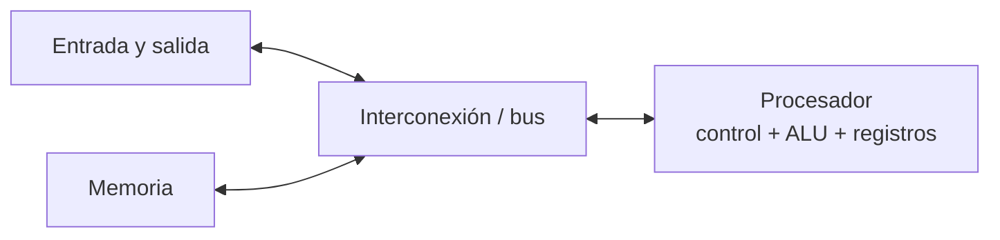

Una arquitectura paralela dispone de varios elementos de procesamiento capaces de ejecutar trabajo simultáneamente. Hay sistemas con varios núcleos en un nodo, varios nodos conectados por red y sistemas híbridos que combinan ambas cosas.


<a id="fundamentos-3-concurrencia-paralelismo-y-segmentacion"></a>

### 3. Concurrencia, paralelismo y segmentación

- **Concurrencia:** varias tareas progresan durante periodos que se solapan. En un único núcleo, el sistema puede alternarlas.
- **Paralelismo:** varias tareas se ejecutan al mismo tiempo en elementos de procesamiento diferentes.
- **Multitarea:** el sistema operativo reparte tiempo y recursos entre procesos; no implica que dos instrucciones se ejecuten simultáneamente.
- **Segmentación (pipeline):** distintas fases de instrucciones diferentes se solapan dentro del procesador. Mejora el rendimiento sostenido, pero no significa que toda instrucción individual tarde menos ni que siempre se completen varias instrucciones por ciclo.


<a id="fundamentos-4-medidas-de-rendimiento"></a>

### 4. Medidas de rendimiento

Se compara la versión paralela con una versión secuencial correcta, usando el mismo problema y condiciones comparables.

| Medida | Fórmula | Lectura |
|---|---|---|
| Aceleración (speed-up) | `S(P) = T(1) / T(P)` | Cuántas veces reduce el tiempo usar `P` procesos o procesadores. |
| Eficiencia | `E(P) = S(P) / P` | Aceleración por recurso respecto a la referencia; no mide directamente la ocupación de CPU. |
| Escalabilidad | Se estudia al variar problema y recursos | Describe cómo cambia el rendimiento; no es un único número universal. |

`T(1)` es el tiempo de la referencia secuencial y `T(P)` el tiempo con `P` recursos. Indica qué referencia usas: el mejor algoritmo secuencial y el programa paralelo ejecutado con un proceso pueden tener tiempos distintos. Si `S(P) = P`, la aceleración es ideal y la eficiencia vale 1. Comunicación, sincronización, desequilibrio y partes secuenciales reducen la ganancia.


<a id="fundamentos-ley-de-amdahl"></a>

#### Ley de Amdahl

Si `f` es la fracción paralelizable del trabajo y `1-f` queda secuencial, una cota ideal es:

```text
S(P) = 1 / ((1 - f) + f/P)
```

Cuando `P` crece mucho y `f < 1`, el límite es `1/(1-f)`. Para `f = 1`, este modelo ideal da `S(P)=P`, sin límite finito al aumentar recursos. El modelo no incluye los costes adicionales de comunicación y coordinación.

En coma flotante, cambiar el orden de operaciones puede modificar el redondeo. La validación debe establecer la tolerancia adecuada; equivalencia matemática no garantiza identidad de bits.


<a id="fundamentos-5-memoria-compartida-y-distribuida"></a>

### 5. Memoria compartida y distribuida

En **memoria compartida**, los hilos pueden acceder al mismo espacio de direcciones. En **memoria distribuida**, cada proceso tiene memoria propia y los datos se intercambian mediante comunicaciones. Un clúster une nodos por una red y suele combinar varios núcleos dentro de cada nodo.

MPI está diseñado para el paso de mensajes y se usa principalmente para memoria distribuida. Puede ejecutarse también en un solo equipo. OpenMP se usa para paralelismo de memoria compartida; CUDA permite programar GPUs.


<a id="fundamentos-6-diseno-antes-de-codificar"></a>

### 6. Diseño antes de codificar

Antes de escribir comunicaciones, concreta:

1. Qué trabajo hace el programa secuencial y cuál es su resultado de referencia.
2. Cómo se divide el dominio de datos.
3. Qué proceso obtiene y distribuye los datos.
4. Qué comunicación necesita cada parte y cuándo se sincroniza.
5. Cómo se combinan los resultados parciales.
6. Qué memoria necesita cada proceso y cómo se mide el rendimiento.

El **reparto por dominio** aplica la misma operación a partes diferentes de los datos. El **reparto funcional** asigna operaciones distintas a recursos distintos. Bloques por filas o columnas y reparto cíclico son estrategias de dominio; la mejor depende del coste y la forma de los datos.

<a id="arquitectura"></a>

## 2. Arquitectura, memoria, afinidad y rendimiento: ampliación de clase

<!-- Fuente integrada: Apuntes Clase/UD1/11_septiembre_revisado.md -->

Versión revisada de los conceptos del [PDF original](UD1/11_septiembre.pdf). Se conserva el PDF con las notas tal como se registraron en clase.


<a id="arquitectura-arquitectura-y-objetivo"></a>

### Arquitectura y objetivo

Paralelizar busca reducir el tiempo de una aplicación repartiendo trabajo entre recursos. Un computador clásico contiene control, unidades aritmético-lógicas, registros, memoria, interconexión y entrada/salida. Una arquitectura paralela incorpora varios elementos de procesamiento capaces de ejecutar trabajo simultáneamente.


<a id="arquitectura-memoria-automatica-y-dinamica"></a>

### Memoria automática y dinámica

malloc, calloc y realloc proporcionan almacenamiento dinámico. No es correcto afirmar que esa reserva se hace en la pila: habitualmente se gestiona en una zona denominada heap. El estándar de C distingue duración automática y almacenamiento asignado dinámicamente, sin exigir una organización física concreta.

Un array local puede tener duración automática; su dirección y su tiempo de vida no se deben confundir con los de un bloque obtenido mediante malloc.


<a id="arquitectura-que-hace-realloc"></a>

#### Qué hace realloc

realloc intenta cambiar el tamaño de una reserva y puede moverla. Para un tamaño nuevo positivo, si falla devuelve NULL y la reserva anterior sigue siendo válida. Usa un puntero temporal para no perderla:

```c
/* v ya apunta a una reserva; nuevo_tam > 0 y multiplicacion sin desbordar. */
int *nuevo = realloc(v, (size_t)nuevo_tam * sizeof *v);
if (nuevo != NULL) {
    v = nuevo;
} else {
    /* v conserva la reserva anterior: gestionar el fallo. */
}
```

Si la reserva cambia, hay que recalcular cualquier puntero interior derivado de ella. Por ejemplo, tras ampliar el bloque datos para dos vectores, se reconstruyen v1 y v2 con la nueva dirección y los tamaños adecuados.


<a id="arquitectura-segmentacion"></a>

### Segmentación

Un pipeline solapa fases de instrucciones diferentes. Tres fases ocupadas a la vez no significan que se completen tres instrucciones por ciclo.

```text
Ciclo     1       2       3       4       5
Instr. A  buscar  ejecutar guardar
Instr. B          buscar  ejecutar guardar
Instr. C                  buscar  ejecutar guardar
```

En este esquema ideal, tras llenar el pipeline se completa una instrucción por ciclo. Dependencias, conflictos de recursos y saltos pueden introducir esperas. Un procesador superescalar puede emitir más de una instrucción por ciclo; eso es otra característica, no una consecuencia automática de tener tres fases.


<a id="arquitectura-concurrencia-paralelismo-y-multitarea"></a>

### Concurrencia, paralelismo y multitarea

La concurrencia permite que varias tareas progresen en intervalos solapados, incluso alternándose en un núcleo. El paralelismo implica ejecución simultánea en recursos distintos. La multitarea del sistema operativo puede coexistir con una aplicación paralela; no hace falta que esta tenga el procesador en exclusiva para ser paralela.


<a id="arquitectura-afinidad-y-cache"></a>

### Afinidad y caché

La afinidad fija o restringe los procesadores donde puede ejecutarse un trabajador. Puede reducir migraciones y mejorar la localidad, pero no fusiona las cachés L2 de dos CPU en una única caché ni garantiza una aceleración.

La topología de memoria y cachés depende del hardware. Repartir datos y trabajadores con buena localidad requiere considerar esa topología.


<a id="arquitectura-tiempo-aceleracion-y-eficiencia"></a>

### Tiempo, aceleración y eficiencia

Primero mide los tiempos con un reloj apropiado. Después calcula:

| Medida | Expresión | Interpretación |
|---|---|---|
| Aceleración | S(P) = T(1) / T(P) | Relación entre el tiempo de referencia y el paralelo. |
| Eficiencia | E(P) = S(P) / P | Aceleración por recurso utilizado. |
| Escalabilidad | Variar recursos y/o problema | Estudiar cómo cambian tiempo, aceleración y eficiencia. |

La eficiencia no es una lectura directa del porcentaje de CPU ocupado. La escalabilidad puede analizarse con métricas y curvas; no hay una sola cifra universal que la describa en cualquier situación.

Si T(1)=12 s y T(4)=4 s, S(4)=3 y E(4)=0.75, es decir 75 % de eficiencia según esta definición.


<a id="arquitectura-aclaraciones-respecto-al-pdf"></a>

### Aclaraciones respecto al PDF

- Memoria dinámica: almacenamiento asignado, no una reserva en la pila.
- Pipeline: fases solapadas, no tres instrucciones completadas por ciclo de forma automática.
- Afinidad: ubicación de la ejecución, no suma física de las cachés.
- Rendimiento: se miden tiempos y después se calculan aceleración y eficiencia.

Referencias: [WG14, reglas de almacenamiento de C](https://www.open-std.org/jtc1/sc22/wg14/www/docs/n2772.pdf) y [afinidad de CPU en Linux](https://www.kernel.org/doc/html/latest/admin-guide/cgroup-v1/cpusets.html).

[Resumen de fundamentos](../Apuntes/01_fundamentos.md).

<a id="c-secuencial"></a>

## 3. Programación secuencial en C

<!-- Fuente integrada: Apuntes/02_programacion_secuencial.md -->

La versión secuencial permite entender el problema, validar su resultado y medir una referencia antes de repartir el trabajo entre procesos.


<a id="c-secuencial-1-vectores-y-posiciones"></a>

### 1. Vectores y posiciones

Un vector de `n` elementos tiene índices de `0` a `n-1`. Si `v` es `int*`, `v[i]` accede al entero de índice `i`.

```text
índice:  0      1      2      3
        +------+------+------+
v  ---> | v[0] | v[1] | v[2] | ...
        +------+------+------+
```

No accedas a `v[n]`: queda justo después del vector y no es un elemento válido.


<a id="c-secuencial-2-argumentos-de-la-linea-de-comandos"></a>

### 2. Argumentos de la línea de comandos

En `int main(int argc, char *argv[])`, `argc` cuenta los argumentos y `argv` contiene sus textos. `argv[0]` suele ser el nombre del programa; el primer argumento del usuario está en `argv[1]`.

Si se esperan un fichero y un tamaño, se necesitan `argc >= 3`: nombre del programa, nombre del fichero y tamaño. Comprueba los argumentos antes de acceder a `argv[1]` y `argv[2]`. `atoi` convierte texto a entero, pero no informa bien de errores de formato; para programas más robustos puede usarse `strtol`.


<a id="c-secuencial-3-ficheros-binarios-y-fread"></a>

### 3. Ficheros binarios y `fread`

En texto, los números se representan con caracteres y separadores. El número de bytes depende de sus dígitos y del formato. En binario se guarda la representación de los objetos; cada valor ocupa el tamaño correspondiente a su tipo en ese formato y plataforma.

```c
FILE *f = fopen(nombre, "rb");
```

`"rb"` abre para lectura binaria. Si `fopen` falla devuelve `NULL`; no uses `fread` con ese valor.

```c
fread(destino, tamaño_de_elemento, cantidad, f);
```

El primer argumento es la **dirección de memoria** donde escribir. Si el bucle lee un entero por iteración, el patrón es:

```c
for (int i = 0; i < tam; i++) {
    fread(v + i, sizeof *v, 1, f);
}
```

`v + i` señala el destino del entero `i`. Si se hace una lectura por llamada, `cantidad` es 1. En código robusto se compara el valor devuelto por `fread` con la cantidad esperada.

La posición del fichero avanza tras cada lectura correcta. Si el fichero almacena primero todos los elementos de `V1` y luego los de `V2`, se leen ambos vectores en ese orden. Si solo lees un prefijo de V1, debes saltar o consumir el resto de V1 antes de leer V2: el segundo vector comienza tras el bloque completo del fichero, no tras el prefijo solicitado. Si los datos están intercalados, el orden de lectura debe reflejarlo.


<a id="c-secuencial-4-cuanto-cabe-en-un-fichero"></a>

### 4. Cuánto cabe en un fichero

Si el fichero contiene únicamente dos vectores iguales y ocupa 400 bytes, cada vector recibe 200 bytes. Si cada `int` ocupa 4 bytes, caben 50 enteros por vector, 100 enteros en total.

```text
400 bytes
┌───────────────────────┬───────────────────────┐
│ V1: 200 bytes         │ V2: 200 bytes         │
│ 50 int de 4 bytes     │ 50 int de 4 bytes     │
└───────────────────────┴───────────────────────┘
```

Usa `sizeof(int)` en la máquina y comprueba que coincide con el formato del fichero. El enunciado P0_T2 indica hasta 200 enteros, cifra que hay que reconciliar con los 400 bytes y con el tamaño real de cada entero. No leas más elementos de los que contiene el fichero.


<a id="c-secuencial-5-memoria-automatica-y-memoria-dinamica"></a>

### 5. Memoria automática y memoria dinámica

Una declaración como `int v[tam]` crea un array de longitud variable con duración automática: deja de existir al salir de su bloque. Su soporte depende del estándar y del compilador.

`malloc` reserva almacenamiento dinámico que permanece disponible hasta llamar a `free`. Suele decirse que se asigna en el heap, aunque el estándar de C lo describe como almacenamiento asignado dinámicamente.

```c
int *v = malloc((size_t)tam * sizeof *v);
/* usar v[0] ... v[tam - 1] */
free(v);
```

La expresión `sizeof *v` ayuda a mantener el tamaño correcto si cambia el tipo de `v`. Cada bloque reservado se libera una sola vez. Estos fragmentos suponen `tam > 0` y un tamaño que no desborda `size_t`; antes de usar el resultado hay que comprobar `v != NULL`. Incluye `stdlib.h` para malloc/free.


<a id="c-secuencial-dos-reservas-o-una-reserva"></a>

#### Dos reservas o una reserva

Dos bloques independientes:

```c
int *v1 = malloc((size_t)tam * sizeof *v1);
int *v2 = malloc((size_t)tam * sizeof *v2);
/* ... */
free(v1);
free(v2);
```

Un bloque contiguo para los dos:

```c
int *datos = malloc((size_t)2 * tam * sizeof *datos);
int *v1 = datos;
int *v2 = datos + tam;
/* ... */
free(datos);
```

```text
datos ──> [ V1[0] ... V1[tam-1] | V2[0] ... V2[tam-1] ]
          ^ v1                  ^ v2 = datos + tam
```

`v1` apunta al inicio y `v2` a una posición interior del mismo bloque; se libera solo `datos`, no cada vista por separado. Comprueba `datos != NULL` antes de calcular `datos + tam`; el tamaño de la reserva conjunta también debe ser representable sin desbordamiento.


<a id="c-secuencial-6-encontrar-maximos-y-comparar-vectores"></a>

### 6. Encontrar máximos y comparar vectores

Para hallar el máximo conjunto, se puede recorrer cada vector y mantener el mayor valor visto, o recorrer todo el bloque contiguo. Inicializar el máximo con `v1[0]` es más general que inventar un límite como `-999999`; requiere que el tamaño sea mayor que cero.

Para contar posiciones en las que `V1` es estrictamente mayor que `V2`, compara parejas con el mismo índice. Los empates no cuentan. Al final el contador está entre 0 y `tam`.


<a id="c-secuencial-7-indices-y-aritmetica-de-punteros"></a>

### 7. Índices y aritmética de punteros

Para un puntero `v` a elementos `int`:

```c
v[i]       /* valor de la posición i */
*(v + i)   /* el mismo valor */
&v[i]      /* dirección de la posición i */
v + i      /* la misma dirección */
```

`v[i]` se define como `*(v + i)`. El operador `&` obtiene la dirección del elemento. Por eso `&v[i]` y `v + i` sirven ambos como destino para `fread`. Si el ejercicio pide no usar corchetes, expresa accesos como `*(v+i)`; si pide la variante con índices, usa `v[i]` y, cuando una función necesita la dirección, `&v[i]`.

Sumar uno a un puntero avanza un elemento del tipo apuntado: `int* + 1` avanza `sizeof(int)` bytes; `char* + 1`, un byte. C estándar no permite aritmética sobre `void*`.


<a id="c-secuencial-8-punteros-de-tipos-distintos-y-representacion"></a>

### 8. Punteros de tipos distintos y representación

Se puede inspeccionar o modificar la representación en bytes de un objeto mediante `char*` o `unsigned char*`. Si `pcharV1` apunta al comienzo de un `int`, cambiar `*pcharV1` modifica un byte del entero; no garantiza que el entero completo pase a cero. El valor visible depende de la representación y el orden de bytes.

Con `int*`, `*pintV1 = 0` escribe el primer entero completo.

Convertir la dirección de un vector `int` a `double*` no hace que allí exista un objeto `double`. Desreferenciarlo para leer o escribir puede infringir la alineación y las reglas de tipo efectivo; además `double` puede ocupar varios `int`. La práctica, tal como está redactada, pide un acceso que no es portable ni definido por C estándar. Conviene pedir al profesor qué resultado espera como demostración y no presentar esa operación como segura.


<a id="c-secuencial-9-lista-de-comprobacion-secuencial"></a>

### 9. Lista de comprobación secuencial

- ¿He validado `argc` antes de leer `argv`?
- ¿He abierto el fichero y comprobado que `f != NULL`?
- ¿La memoria reservada alcanza para todos los elementos que leeré?
- ¿La disposición real de los datos coincide con el orden de lectura?
- ¿Cada `fread` escribe en una dirección válida y solicita la cantidad correcta?
- ¿Estoy dentro de los índices `0` a `tam-1`?
- ¿He cerrado el fichero y liberado exactamente cada bloque reservado?
- ¿Puedo contrastar el resultado con un ejemplo pequeño calculado a mano?

<a id="modelos"></a>

## 4. Procesos, modelos de programación y diseño paralelo

<!-- Fuente integrada: Apuntes Clase/MPI/15_septiembre.md -->

MPI permite que procesos con memoria propia intercambien datos. Antes de programar las comunicaciones, necesitamos una versión secuencial correcta, un reparto del trabajo y una descripción de los datos que necesita cada proceso.


<a id="modelos-procesos-hilos-y-recursos-de-computo"></a>

### Procesos, hilos y recursos de cómputo

Un proceso tiene su propio espacio de direcciones. Los hilos de un mismo proceso comparten ese espacio, aunque cada hilo mantiene su ejecución y variables locales propias.

Un ejemplo de reparto consiste en dividir mil sumas entre dos trabajadores: cada uno calcula una parte y después se combinan los resultados. La comunicación o sincronización necesaria depende de las dependencias del algoritmo. No toda tarea paralela requiere comunicarse en cada paso, ni toda comunicación sincroniza a todos los participantes.

El resultado paralelo debe corresponder al resultado secuencial de referencia. Con enteros se puede exigir igualdad exacta si no hay desbordamiento; con punto flotante, un orden de suma diferente puede producir pequeñas diferencias de redondeo y conviene definir una tolerancia.


<a id="modelos-memoria-distribuida"></a>

### Memoria distribuida


Los procesos pueden estar en nodos distintos conectados por una red o en un mismo equipo. Cada uno conserva su memoria local. Tener una variable con el mismo nombre en varios procesos no la convierte en compartida; incluso una dirección numérica igual pertenece al espacio de su proceso.

Un clúster suele reunir nodos con varios núcleos. MPI puede ejecutar varios procesos en los distintos núcleos de un nodo. También se puede combinar MPI entre procesos con OpenMP entre los hilos de cada proceso. No hay una regla que obligue a usar un solo proceso MPI por computador.

Para estudiar el algoritmo suponemos que los datos están disponibles en memoria; cuando un ejemplo incluye lectura de ficheros, esa lectura también forma parte del programa y puede influir en el tiempo total.


<a id="modelos-un-ejecutable-y-varios-procesos"></a>

### Un ejecutable y varios procesos

En los ejemplos de la asignatura se usa el modelo SPMD: se compila un programa y se lanza en varios procesos. Todos ejecutan ese programa, pero sus rangos y condiciones determinan qué parte del trabajo realiza cada uno.

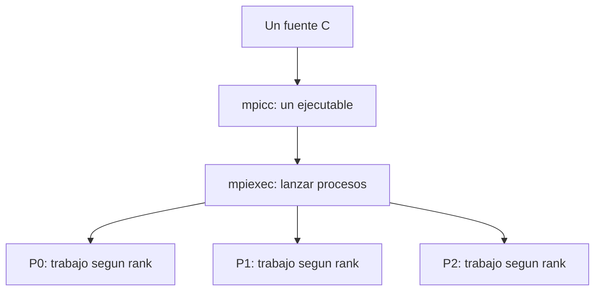

Compilar no inicia la ejecución paralela. El lanzador y el entorno MPI ponen en marcha los procesos y hacen posible su comunicación.

Es frecuente elegir P0 para leer la entrada y reunir resultados porque el rango 0 existe en cualquier comunicador no vacío. Es una decisión de diseño; MPI no exige un coordinador central y también permite otros patrones.


<a id="modelos-modelos-de-programacion"></a>

### Modelos de programación


<a id="modelos-paso-de-mensajes"></a>

#### Paso de mensajes

Los procesos comunican datos explícitamente. En la comunicación punto a punto, un emisor hace Send y un receptor hace Recv. Podemos ver en el programa qué se transmite, a quién y en qué momento.


<a id="modelos-paralelismo-de-datos"></a>

#### Paralelismo de datos

Se aplica una operación a porciones diferentes de un conjunto de datos. Puede implementarse sobre memoria distribuida o compartida: no es una propiedad exclusiva de una arquitectura ni una alternativa incompatible con MPI.

HPF significa **High Performance Fortran** y es un ejemplo histórico de lenguaje orientado al paralelismo de datos. No se puede afirmar que Fortran sea siempre más eficiente que C: influyen el algoritmo, el compilador y la representación de los datos.


<a id="modelos-espacio-de-direcciones-global-sobre-memoria-distribuida"></a>

#### Espacio de direcciones global sobre memoria distribuida

Modelos como PGAS presentan un espacio de direcciones global particionado. UPC significa **Unified Parallel C** y es un ejemplo de este enfoque.

Cuatro nodos con 64 GB cada uno tienen 256 GB de capacidad agregada, pero eso no crea automáticamente una memoria de acceso uniforme. Acceder a datos remotos puede necesitar comunicación y ser más costoso que un acceso local. La localidad y el balanceo siguen siendo importantes.

La abstracción facilita algunos programas, pero puede ocultar costes si el diseño no considera dónde residen los datos. Su conveniencia depende del problema; no es correcto declarar que siempre será un modelo no óptimo.


<a id="modelos-herramientas-de-menor-nivel"></a>

#### Herramientas de menor nivel

Podrían usarse protocolos como TCP/UDP y herramientas del sistema operativo, pero habría que gestionar más detalles del transporte y la ejecución. MPI proporciona una interfaz de comunicación de nivel superior. La afinidad indica en qué recursos puede ejecutarse un trabajador; no sustituye al diseño del reparto.


<a id="modelos-que-es-mpi-y-que-garantiza"></a>

### Qué es MPI y qué garantiza

MPI significa **Message Passing Interface**. Es un estándar desarrollado por el **MPI Forum**, no simplemente una biblioteca sin organismo responsable. Implementaciones como MPICH y Open MPI ofrecen esa interfaz. Microsoft MPI es una implementación para Windows; LAM/MPI es una referencia histórica.

El estándar define bindings para C y Fortran. Python puede utilizar MPI mediante bibliotecas como mpi4py; eso no convierte Python en un binding normativo equivalente al de C.

MPI abstrae detalles de la red y facilita escribir programas portables. La portabilidad presupone tipos, búferes, llamadas y patrones de comunicación válidos.

Los mensajes no se pierden arbitrariamente en una ejecución correcta, pero eso no elimina los errores: pueden existir rangos inválidos, tipos incompatibles, falta de memoria, bloqueos o fallos del entorno. Las funciones devuelven códigos de error y el manejador predeterminado puede abortar. No hay que suponer que toda aplicación MPI se recupera de la caída de un proceso.


<a id="modelos-rendimiento-y-escalabilidad"></a>

#### Rendimiento y escalabilidad

La escalabilidad depende del algoritmo, tamaño del problema, número de recursos, balanceo, memoria y red. No basta con comparar cuántos equipos se pueden conectar.

Una red de barras cruzadas puede ser costosa al crecer; una red Ethernet también puede sufrir congestión y limitaciones de ancho de banda. No se puede concluir que una sea siempre más escalable ni que añadir conexiones no degrade las prestaciones.


<a id="modelos-mensajes-y-sincronizacion"></a>

### Mensajes y sincronización

En los ejemplos con tipos básicos, un mensaje transmite una secuencia de elementos contiguos. MPI también permite tipos derivados que describen posiciones no contiguas; no los necesitamos para estos primeros ejercicios.

El nombre de la variable no identifica el mensaje. Para emparejarlo importan emisor, destinatario, etiqueta y contexto del comunicador. Los tipos deben ser compatibles y la recepción debe tener capacidad suficiente.

Send y Recv no tienen que empezar al mismo instante. Un Send estándar bloqueante puede usar almacenamiento interno o esperar una recepción, según la implementación y el mensaje. No se debe depender de que siempre exista espacio en un búfer interno.

Al terminar Send, el emisor puede reutilizar su búfer; no significa que el receptor ya haya completado todo su cálculo. Al terminar Recv, el receptor tiene los datos recibidos en su búfer.


<a id="modelos-comunicacion-unilateral"></a>

#### Comunicación unilateral

Las operaciones one-sided de MPI permiten acceder a una ventana de memoria de otro proceso sin un Recv por cada transferencia. Siguen necesitando creación de ventanas y reglas de sincronización/completado. No significan que nunca haya espera ni que el otro proceso no participe en la preparación.

Este tema se menciona para distinguir modelos; aquí trabajamos los algoritmos con comunicación explícita Send/Recv.


<a id="modelos-diseno-paralelo-y-descomposicion-de-dominio"></a>

### Diseño paralelo y descomposición de dominio

El diseño debe responder:

1. ¿Qué datos y operaciones se reparten?
2. ¿Qué proceso necesita cada dato?
3. ¿Cuándo deben intercambiarse datos o resultados?
4. ¿Qué memoria necesita cada participante?
5. ¿Cómo se valida y mide el resultado?

Podemos distribuir una matriz por bloques de filas, bloques de columnas, filas cíclicas o bloques cíclicos. El reparto cíclico bidimensional aparece en bibliotecas de álgebra paralela. Ninguna distribución garantiza por sí sola el balanceo: importan los costes de las operaciones y la naturaleza de los datos.

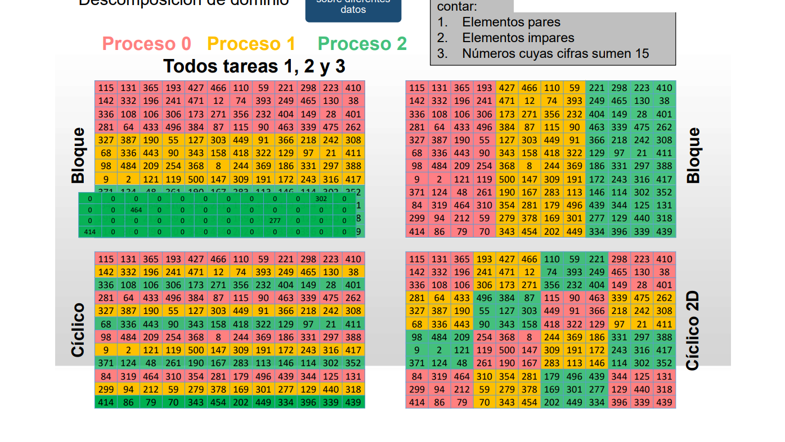


<a id="modelos-ejemplo-contar-elementos-pares"></a>

#### Ejemplo: contar elementos pares

P0 puede leer una matriz y distribuir bloques. Cada proceso cuenta los pares de su bloque y se combinan los contadores:

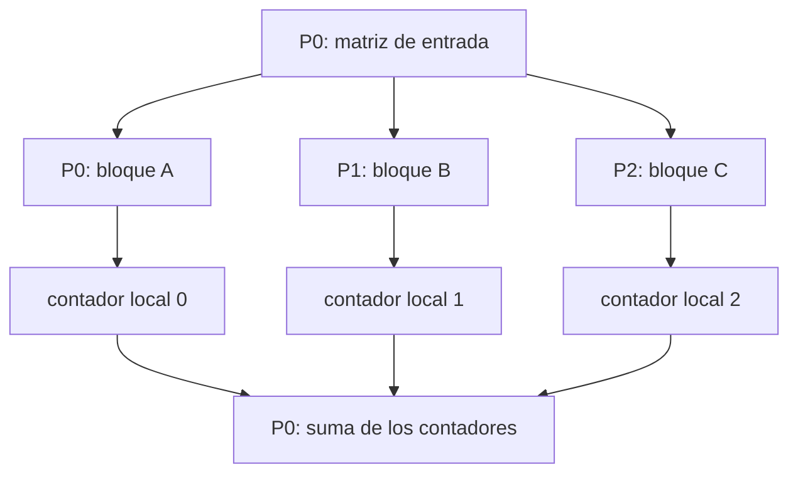

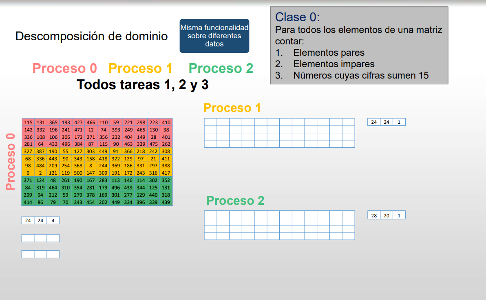

Cada proceso puede empezar su cómputo cuando tenga sus propios datos y se cumplan sus dependencias; no siempre hace falta esperar a que todos hayan recibido sus bloques.

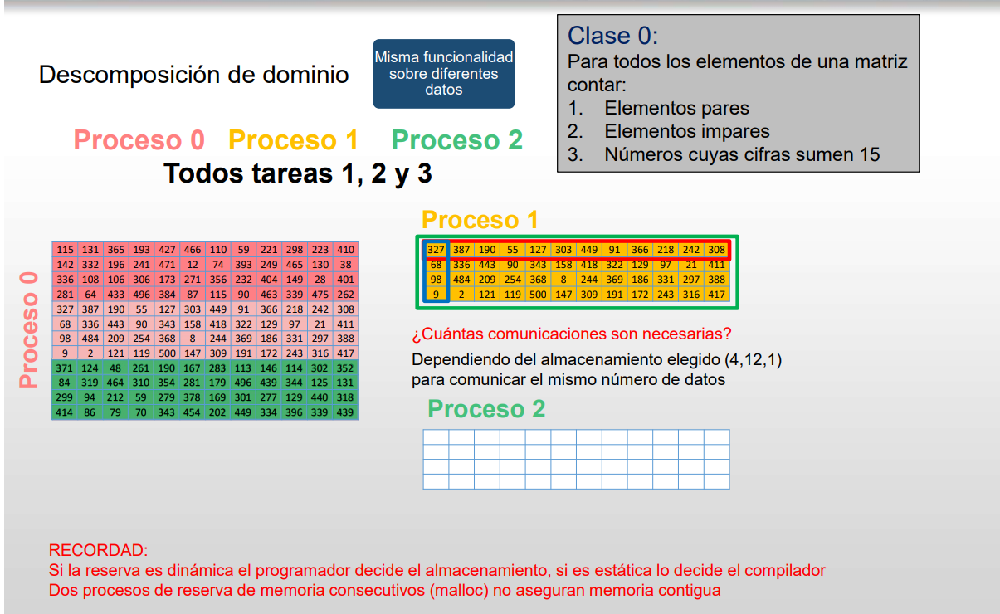

Para sumar contadores, P0 solo necesita un acumulador y una variable temporal para las recepciones. No está obligado a guardar todos los bloques ni todos los resultados parciales a la vez. Si también lee la matriz completa, la reserva de entrada es otra necesidad distinta.

La ley de Amdahl describe una cota ideal debida a la parte secuencial. Los costes de comunicación y coordinación pueden hacer que el tiempo deje de mejorar o incluso aumente con más procesos.


<a id="modelos-repaso"></a>

### Repaso

- MPI trabaja con procesos; OpenMP, con hilos dentro de memoria compartida.
- El proceso 0 puede coordinar un ejemplo, pero no es una exigencia del estándar.
- El patrón de comunicación determina parte de las necesidades de memoria.
- Un tamaño de mensaje se expresa mediante cantidad de elementos y tipo.
- El cómputo secuencial sirve como referencia; el resultado y el rendimiento se comprueban por separado.

Referencia: [MPI Forum](https://www.mpi-forum.org/docs/) y [sincronización one-sided](https://www.mpi-forum.org/docs/mpi-2.2/mpi22-report/node238.htm).

[Siguiente clase: 22 de septiembre](MPI/22_septiembre.md).

<a id="reparto"></a>

## 5. Descomposición de dominio y funcional

<!-- Fuente integrada: Apuntes Clase/MPI/concepto_de_repartir_trabajo.md -->

Queremos recorrer una matriz para contar elementos pares, elementos impares y números cuyas cifras suman 15. Podemos repartir los datos o repartir las operaciones.


<a id="reparto-descomposicion-de-dominio"></a>

### Descomposición de dominio

Cada proceso recibe una parte de la matriz y realiza las mismas tres operaciones sobre su bloque.

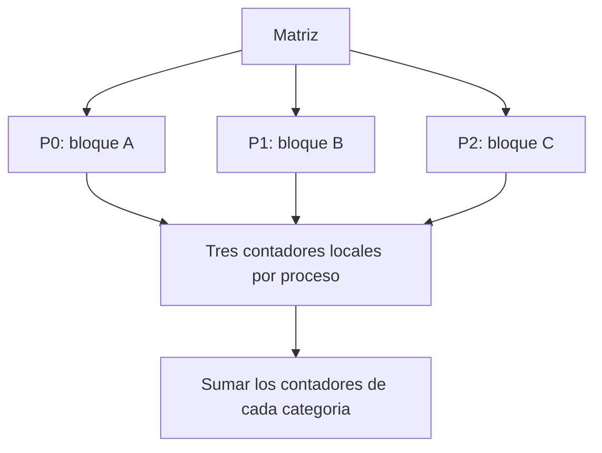

Al final se suman por separado los contadores de pares, impares y suma de cifras 15. Las categorías no tienen por qué ser excluyentes: un número puede ser impar y, además, tener suma de cifras 15.

Este modelo puede implementarse con MPI o con hilos de memoria compartida. No es exclusivo de MPI.

**Balanceo:** tener la misma cantidad de elementos da cargas parecidas solo si el coste de procesarlos es parecido y los recursos son comparables. Calcular la suma de cifras puede requerir más trabajo para números con más dígitos. Hay que considerar también comunicaciones y sincronización.


<a id="reparto-descomposicion-funcional"></a>

### Descomposición funcional

Cada trabajador ejecuta una operación distinta sobre los datos que necesita:

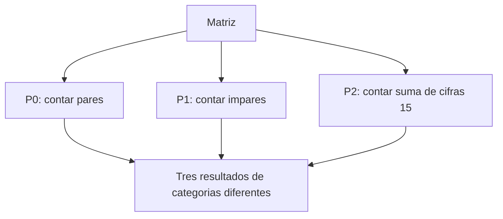

Con procesos MPI, si todos necesitan la matriz completa, habrá que proporcionarles esos datos; con hilos pueden consultar una matriz compartida.

Asignar una función fija a cada uno de tres procesos limita ese reparto concreto a tres tareas y puede crear desequilibrio si una función tarda más. No significa que toda descomposición funcional carezca de escalabilidad: se puede combinar con reparto por dominio o diseñar otras tareas.


<a id="reparto-como-elegir"></a>

### Cómo elegir

Compara el número de tareas disponibles, el coste de cada operación, las dependencias, la memoria y la cantidad de datos que hay que comunicar. Primero verifica una versión secuencial y después comprueba que los contadores paralelos coinciden.

[Ejemplo de reparto en MPI](MPI/15_septiembre.md#ejemplo-contar-elementos-pares).

<a id="entorno-mpi"></a>

## 6. MPI-1: ejecución, procesos y mensajes básicos

<!-- Fuente integrada: Apuntes Clase/MPI/22_septiembre.md -->

Partimos de un programa secuencial correcto. El diseño paralelo fija el reparto del trabajo, las comunicaciones y la memoria de cada proceso. Los ejemplos de esta página distinguen lo que MPI devuelve como código de error de los resultados que escribe mediante punteros.


<a id="entorno-mpi-compilar-lanzar-e-inicializar"></a>

### Compilar, lanzar e inicializar

```text
fuente.c --mpicc--> ejecutable --mpiexec -n 4--> P0, P1, P2, P3
```

- **mpicc** compila y enlaza el programa con MPI.
- **mpiexec/mpirun** lanza los procesos.
- **MPI_Init** inicializa el entorno MPI dentro de cada proceso.
- **MPI_Finalize** finaliza su uso de MPI cuando se ha completado la participación del programa en las comunicaciones.

MPI_Init se ejecuta antes de las operaciones de comunicación de estos ejemplos. Puede haber código C antes o después del uso de MPI; no es obligatorio que Init sea literalmente la primera instrucción de main.

MPI_Finalize es colectiva en este modelo, pero no sustituye a MPI_Barrier ni corrige mensajes mal emparejados. Antes de finalizar debemos completar la participación en las comunicaciones; no hay que confiar en que Finalize descarte datos pendientes o detecte todos los errores del programa.


<a id="entorno-mpi-numero-de-procesos-y-rango"></a>

### Número de procesos y rango

```c
int nproces, myrank;
int ierr = MPI_Comm_size(MPI_COMM_WORLD, &nproces);
ierr = MPI_Comm_rank(MPI_COMM_WORLD, &myrank);
```

Cada función devuelve un **código de error**. El resultado consultado se escribe en la variable cuya dirección se pasa:

| Consulta con cuatro procesos | P0 | P1 | P2 | P3 |
|---|---:|---:|---:|---:|
| nproces, escrito por Comm_size | 4 | 4 | 4 | 4 |
| myrank, escrito por Comm_rank | 0 | 1 | 2 | 3 |

Por tanto, **no** se debe escribir `int myrank = MPI_Comm_rank(..., &myrank)`: se sobrescribiría el rango escrito con el código de retorno.

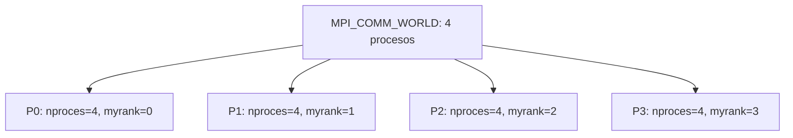


<a id="entorno-mpi-que-es-mpi_comm_world"></a>

### Qué es MPI_COMM_WORLD

Es el comunicador predefinido de los procesos de la ejecución inicial en este modelo. Cada comunicador relaciona un grupo de procesos con un contexto de comunicación, para que sus mensajes no se confundan con los de otro contexto.

Podemos crear comunicadores para subconjuntos; un proceso puede pertenecer a varios y tener un rango diferente en cada uno. Crear un subgrupo no crea por sí mismo nuevos procesos. Los ejemplos de clase mantienen fijo el número de procesos, aunque otras funciones de MPI permiten gestión dinámica.


<a id="entorno-mpi-ejemplo-completo-memoria-local-y-salida"></a>

### Ejemplo completo: memoria local y salida

```c
#include <mpi.h>
#include <stdio.h>

int main(int argc, char **argv) {
    int nproces, myrank;
    int i = 0;

    MPI_Init(&argc, &argv);
    MPI_Comm_size(MPI_COMM_WORLD, &nproces);
    MPI_Comm_rank(MPI_COMM_WORLD, &myrank);

    i++;
    printf("Soy el proceso %d de %d procesos. Mi i vale %d.\n",
           myrank, nproces, i);

    MPI_Finalize();
    return 0;
}
```

Con cuatro procesos se ejecutan cuatro printf: uno por proceso. En todos, i vale 1 porque cada uno incrementa su propia variable. La salida puede aparecer, por ejemplo, en orden 0, 3, 1, 2 o 2, 0, 3, 1. El orden y la agrupación de las líneas de consola no están garantizados.

Modificar una variable local no modifica automáticamente la variable del mismo nombre en otro proceso. Incluye el rango en los mensajes de depuración para reconocer el origen.


<a id="entorno-mpi-mpi_send-que-se-envia"></a>

### MPI_Send: qué se envía

```c
err = MPI_Send(DatosEnv, NumDatos, TipoDatos, Destino, tag, comunicador);
```

| Argumento | Significado |
|---|---|
| DatosEnv | Dirección de inicio de los datos. |
| NumDatos | Número de elementos del tipo, **no número de bytes**, salvo que el tipo sea de byte. |
| TipoDatos | Tipo MPI compatible con el dato C. |
| Destino | Rango del receptor dentro del comunicador. |
| tag | Etiqueta para distinguir comunicaciones. |
| comunicador | Contexto donde se identifica al destinatario y se empareja el mensaje. |

En C, usa MPI_INT para int y MPI_DOUBLE para double. MPI_INTEGER corresponde al binding de Fortran y no debe emplearse como sustituto general de MPI_INT en estos ejemplos.

```c
/* vector contiene al menos 16 enteros inicializados. */
MPI_Send(vector, 16, MPI_INT, destino, 99, MPI_COMM_WORLD);
```

La biblioteca recibe una dirección para leer los datos del emisor. No transmite el puntero como una dirección válida en el receptor. Este debe tener su propio búfer.

Un destino fuera de 0..nproces-1, salvo destinos especiales definidos por MPI, es inválido. Enviar más elementos de los que existen en el búfer es un error de memoria; no hay garantía de que siempre produzca un segmentation fault visible.

MPI_Send es bloqueante: cuando termina se puede reutilizar el búfer enviado. El modo estándar puede almacenar datos internamente o esperar al receptor. No garantiza que el receptor ya haya terminado su Recv o su cómputo, y no debemos depender de almacenamiento interno ilimitado.


<a id="entorno-mpi-mpi_recv-donde-se-recibe"></a>

### MPI_Recv: dónde se recibe

```c
err = MPI_Recv(DatosRec, Capacidad, TipoDatos, Origen, tag,
               comunicador, &status);
```

- DatosRec señala el búfer local donde se escribirá.
- Capacidad indica cuántos elementos caben en la recepción.
- Origen identifica el emisor esperado; MPI_ANY_SOURCE permite cualquiera.
- La etiqueta puede ser concreta o MPI_ANY_TAG.
- status informa del origen y etiqueta del mensaje recibido. La función devuelve un código de error, no el dato del mensaje.

MPI_Recv bloquea hasta completar la recepción de un mensaje compatible. El mensaje puede tener menos elementos que la capacidad: enviar dos enteros y recibir con capacidad cuatro es válido si el búfer tiene espacio. Las posiciones restantes no se rellenan automáticamente.

Si el mensaje contiene más datos que la capacidad, se produce truncamiento y un error MPI. Los tipos deben ser compatibles; tener igual cantidad de bytes no basta para justificar cualquier mezcla de tipos.

El emparejamiento se hace mediante emisor/destinatario, etiqueta y contexto del comunicador. Cantidad y tipo son condiciones de validez del contenido, no un mecanismo para seleccionar entre dos mensajes con el mismo sobre.


<a id="entorno-mpi-enviar-y-recibir-no-requiere-coincidir-en-el-tiempo"></a>

#### Enviar y recibir no requiere coincidir en el tiempo

Las dos llamadas no tienen que comenzar simultáneamente. Lo importante es que cada envío tenga la recepción correcta y que el orden no cree un ciclo de esperas. Si no existe un mensaje que corresponda a una recepción, esta puede esperar indefinidamente.

Enviar a uno mismo está permitido por MPI. Sin embargo, un proceso con un único hilo que hace un Send bloqueante y solo después un Recv para ese mensaje puede bloquearse. En los ejemplos con raíz copiamos los datos locales directamente.


<a id="entorno-mpi-ejemplo-completo-un-double-desde-p0-hasta-p3"></a>

### Ejemplo completo: un double desde P0 hasta P3

Se necesitan al menos cuatro procesos:

```c
#include <mpi.h>
#include <stdio.h>

int main(int argc, char **argv) {
    int nproces, myrank;
    double data1 = 0.0, data2 = 0.0;
    MPI_Status status;

    MPI_Init(&argc, &argv);
    MPI_Comm_size(MPI_COMM_WORLD, &nproces);
    MPI_Comm_rank(MPI_COMM_WORLD, &myrank);

    if (nproces < 4) {
        if (myrank == 0) fprintf(stderr, "Se necesitan al menos 4 procesos.\n");
        MPI_Finalize();
        return 1;
    }

    if (myrank == 0) {
        data1 = 47645.3; /* En C el separador decimal es el punto. */
        MPI_Send(&data1, 1, MPI_DOUBLE, 3, 99, MPI_COMM_WORLD);
    } else if (myrank == 3) {
        MPI_Recv(&data2, 1, MPI_DOUBLE, 0, 99, MPI_COMM_WORLD, &status);
        printf("P3 recibe %.1f desde P%d.\n", data2, status.MPI_SOURCE);
    }

    MPI_Finalize();
    return 0;
}
```


P1 y P2 también ejecutan el programa, pero no realizan ese intercambio. Los nombres data1 y data2 pueden ser diferentes: los nombres de variables no emparejan mensajes.


<a id="entorno-mpi-casos-incorrectos-para-trazar-a-mano"></a>

#### Casos incorrectos para trazar a mano

Partiendo del ejemplo anterior, cambia **una sola condición** y analiza el resultado:

| Cambio | Qué ocurre |
|---|---|
| Send usa tag 99 y P3 espera tag 88. | P3 no encuentra el envío; el mensaje 99 no satisface la recepción 88. |
| Send tiene destino 2, pero solo P3 recibe. | P3 espera un mensaje para él que nunca se envió y P2 no publica la recepción correspondiente. |
| P0 envía a P3, pero P3 espera origen 1. | La recepción espera a P1, no a P0. |
| La recepción se coloca en if (myrank == 100) al ejecutar cuatro procesos. | Ningún proceso ejecuta ese Recv; el Send a P3 queda sin recepción correspondiente. |

En cualquiera de estos casos el programa es incorrecto y puede bloquearse. Send puede esperar desde el principio o retornar tras almacenar datos: no se puede predecir una finalización válida basándose en el tamaño pequeño del mensaje. Finalize no garantiza vaciar automáticamente el búfer ni emitir un aviso que arregle la ejecución.

Estos casos son ejemplos de errores intencionados, no programas que deban ejecutarse sin una forma de cancelar una espera.


<a id="entorno-mpi-difundir-un-vector-desde-p1-con-sendrecv"></a>

### Difundir un vector desde P1 con Send/Recv

Se necesitan al menos dos procesos. P1 inicializa los dieciséis enteros antes de enviarlos:

```c
#include <mpi.h>
#include <stdio.h>

int main(int argc, char **argv) {
    int nproces, myrank;
    int vector[16];

    MPI_Init(&argc, &argv);
    MPI_Comm_size(MPI_COMM_WORLD, &nproces);
    MPI_Comm_rank(MPI_COMM_WORLD, &myrank);

    if (nproces < 2) {
        if (myrank == 0) fprintf(stderr, "Se necesitan al menos 2 procesos.\n");
        MPI_Finalize();
        return 1;
    }

    if (myrank == 1) {
        for (int j = 0; j < 16; j++) vector[j] = j;
        for (int destino = 0; destino < nproces; destino++) {
            if (destino != 1)
                MPI_Send(vector, 16, MPI_INT, destino, 99, MPI_COMM_WORLD);
        }
    } else {
        MPI_Recv(vector, 16, MPI_INT, 1, 99, MPI_COMM_WORLD,
                 MPI_STATUS_IGNORE);
    }

    printf("P%d: primero=%d, ultimo=%d\n", myrank, vector[0], vector[15]);
    MPI_Finalize();
    return 0;
}
```

Cada proceso termina con [0,1,...,15]. vector y &vector[0] expresan la misma dirección inicial al pasarlos a estas funciones. El código repite los envíos en P1, mientras cada otro proceso ejecuta una recepción.

La colectiva equivalente sería MPI_Bcast(vector, 16, MPI_INT, 1, MPI_COMM_WORLD), llamada por todos, una vez que P1 ha preparado los datos. La misma funcionalidad no implica el mismo algoritmo interno.


<a id="entorno-mpi-comprobaciones-antes-de-comunicar"></a>

### Comprobaciones antes de comunicar

1. ¿Existen el emisor y el receptor dentro del comunicador?
2. ¿Coinciden origen/destino, etiqueta y contexto?
3. ¿Son compatibles los tipos y hay capacidad suficiente?
4. ¿Se han inicializado los elementos enviados?
5. ¿Puede completarse cada envío sin una espera circular?
6. ¿Se completa la participación en las comunicaciones antes de Finalize?

Referencias: [sobre del mensaje](https://www.mpi-forum.org/docs/mpi-4.1/mpi41-report/node58.htm), [capacidad y tipos](https://www.mpi-forum.org/docs/mpi-4.1/mpi41-report/node107.htm) y [MPI_Finalize](https://docs.open-mpi.org/en/v5.0.0/man-openmpi/man3/MPI_Finalize.3.html).

[Repaso de la clase del 29 de septiembre](MPI/29_septiembre_revisado.md) · [Clase del 6 de octubre](MPI/06_octubre.md).

<a id="repaso-mpi"></a>

## 7. MPI-1: emparejamiento, tipos y reducciones

<!-- Fuente integrada: Apuntes Clase/MPI/29_septiembre_revisado.md -->

Versión revisada del [PDF original](MPI/29_septiembre.pdf). El archivo se llama 29_septiembre.pdf, aunque su cabecera interna muestra una fecha distinta; se conserva ese nombre para mantener la referencia existente.


<a id="repaso-mpi-funciones-basicas-y-mayusculas"></a>

### Funciones básicas y mayúsculas

En C, los nombres correctos son MPI_Comm_size y MPI_Comm_rank. Las versiones MPI_Comm_Size y MPI_Comm_Rank del PDF no son los nombres de la API.

```c
int nproces, rank;
MPI_Init(&argc, &argv);
MPI_Comm_size(MPI_COMM_WORLD, &nproces);
MPI_Comm_rank(MPI_COMM_WORLD, &rank);
/* Operaciones MPI. */
MPI_Finalize();
```

El código de retorno no es el resultado consultado: size y rank escriben mediante los punteros pasados. Para los enteros de C se emplea MPI_INT.

MPI_Finalize finaliza el entorno cuando se ha completado la participación en las comunicaciones. No es una herramienta para descartar envíos sin recepción ni para resolver un bloqueo del programa. Para una barrera explícita dentro del cómputo se usa MPI_Barrier.


<a id="repaso-mpi-bcast-no-identifica-variables-por-su-nombre"></a>

### Bcast no identifica variables por su nombre

Todos los procesos del comunicador llaman a Bcast en un orden compatible, con la misma raíz y datos compatibles. Sus variables pueden tener nombres y direcciones distintos en cada proceso.

```c
/* En P0, entrada tiene el dato; en los demas, salida es su bufer local. */
if (rank == 0) {
    MPI_Bcast(&entrada, 1, MPI_INT, 0, MPI_COMM_WORLD);
} else {
    MPI_Bcast(&salida, 1, MPI_INT, 0, MPI_COMM_WORLD);
}
```

Es una única operación colectiva en la secuencia de cada proceso, aunque se haya escrito en dos ramas y con nombres diferentes. entrada y salida deben estar declaradas; entrada debe estar inicializada en P0.

Si solo participa un subconjunto, puede crearse un comunicador de ese grupo o usar mensajes punto a punto. No se debe llamar a una colectiva solo desde una parte de su comunicador.


<a id="repaso-mpi-reduce-y-allreduce"></a>

### Reduce y Allreduce

Reduce combina aportaciones y entrega el resultado a una raíz, que también aporta. Todos los participantes llaman a la operación; no es una función que solo deba ejecutar la raíz.

Allreduce entrega el resultado a todos, sin parámetro raíz. Es equivalente conceptualmente a reducir y difundir, pero su implementación no necesita usar literalmente esas dos llamadas ni una raíz central.

Para count elementos, la reducción combina las posiciones correspondientes de las aportaciones:

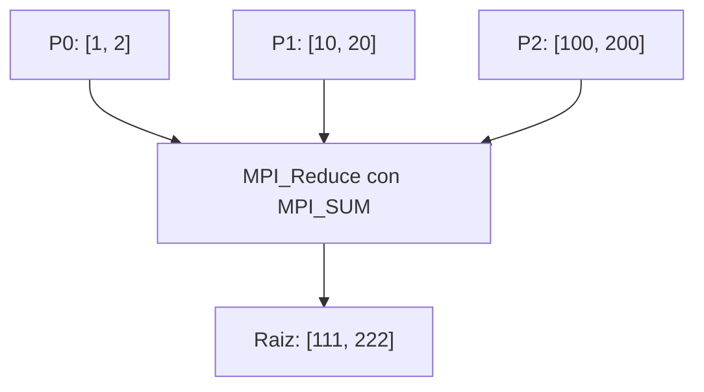

Reducir un vector no lo transforma automáticamente en un único escalar. Si quieres un contador total, cada proceso puede calcular primero un contador local y reducir esos escalares.


<a id="repaso-mpi-operaciones"></a>

#### Operaciones

MPI_SUM suma, MPI_PROD multiplica, MPI_MAX obtiene máximos y MPI_MIN obtiene mínimos. Hay operaciones lógicas, de bits y de localización, con restricciones sobre los tipos admitidos.

El PDF etiqueta MPI_MINLOC como máximo y localización: es **mínimo y localización**. MPI_MAXLOC es máximo y localización. Estas operaciones trabajan con pares compatibles, por ejemplo valor e índice/rango, y requieren el tipo MPI de pares adecuado, como MPI_DOUBLE_INT para double/int. No basta con declarar cualquier struct y enviarlo como MPI_DOUBLE.

Los diagramas de [Reduce](MPI/Funciones%20colectivas/02_Reduce.md) y [Allreduce](MPI/Funciones%20colectivas/03_Allreduce.md) muestran ejemplos completos sencillos.


<a id="repaso-mpi-comodines-y-estado-de-recepcion"></a>

### Comodines y estado de recepción

MPI_ANY_SOURCE permite cualquier emisor y MPI_ANY_TAG cualquier etiqueta. Aun así, el destinatario y el comunicador deben corresponder, y los datos han de ser compatibles.

```c
int recibido;
MPI_Status status;
MPI_Recv(&recibido, 1, MPI_INT, MPI_ANY_SOURCE, MPI_ANY_TAG,
         MPI_COMM_WORLD, &status);
/* status.MPI_SOURCE y status.MPI_TAG indican lo que llego. */
```

El tamaño y el tipo no se usan para escoger otro mensaje con el mismo sobre. Una recepción con capacidad mayor que el mensaje es válida; con capacidad menor hay truncamiento. El contenido no recibido no pasa a constituir automáticamente otro mensaje independiente.


<a id="repaso-mpi-datos-buffers-y-punto-decimal"></a>

### Datos, buffers y punto decimal

El ejemplo del PDF escribe data1 = 47645,3. En C, para asignar el número decimal correcto hay que usar:

```c
data1 = 47645.3;
```

La coma se interpreta como un operador, no como separador decimal.

Send puede esperar o usar almacenamiento interno. Su retorno permite reutilizar el búfer local; no garantiza que el receptor ya haya acabado. No se debe asumir que todo envío se vuelca inmediatamente en un búfer del receptor.

Para un ejemplo completo P0→P3 y los casos de etiquetas/orígenes incorrectos, consulta [la clase del 22 de septiembre](MPI/22_septiembre.md).


<a id="repaso-mpi-aclaraciones-respecto-al-pdf"></a>

### Aclaraciones respecto al PDF

| Página del original | Aclaración |
|---|---|
| 1 | Nombres size/rank, MPI_INT, participación de todos en las colectivas y nombres de variables independientes. |
| 2 | MINLOC, tipos de pares, Allreduce conceptual, comodines, buffers, capacidad de recepción y punto decimal. |
| 3 | La reducción de vectores es elemento a elemento; el contador escalar total requiere aportaciones escalares. |

Referencias: [MPI Forum, colectivas](https://www.mpi-forum.org/docs/mpi-3.1/mpi31-report/node95.htm), [tipos y capacidad](https://www.mpi-forum.org/docs/mpi-4.1/mpi41-report/node107.htm) y [finalización](https://docs.open-mpi.org/en/v5.0.0/man-openmpi/man3/MPI_Finalize.3.html).

<a id="punto-a-punto"></a>

## 8. MPI-1: modos de envío, recepción y peticiones

<!-- Fuente integrada: Apuntes Clase/MPI/13_octubre.md -->

Puede salir en traza. La recepción puede ser bloqueante.


<a id="punto-a-punto-mpi_send"></a>

### MPI_Send

Envío estándar bloqueante: el proceso puede continuar cuando MPI ya permite reutilizar el buffer de envío. Esto **no garantiza** que el receptor ya haya terminado su `MPI_Recv`; MPI puede copiar el mensaje a un buffer interno o esperar a que el receptor lo publique.

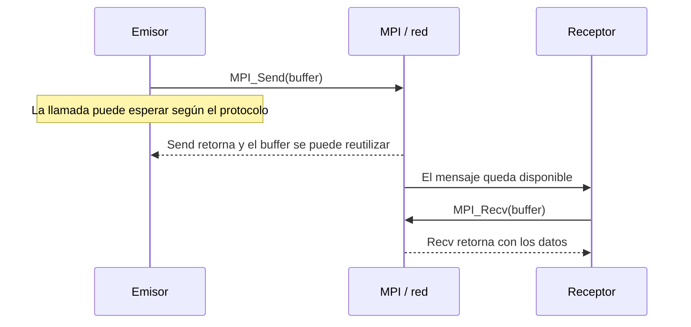


<a id="punto-a-punto-mpi_ssend"></a>

### MPI_Ssend
Un envío síncrono bloqueante completa cuando la recepción correspondiente ha comenzado y el búfer del emisor puede reutilizarse. No exige que el receptor haya terminado su llamada ni su cómputo posterior.

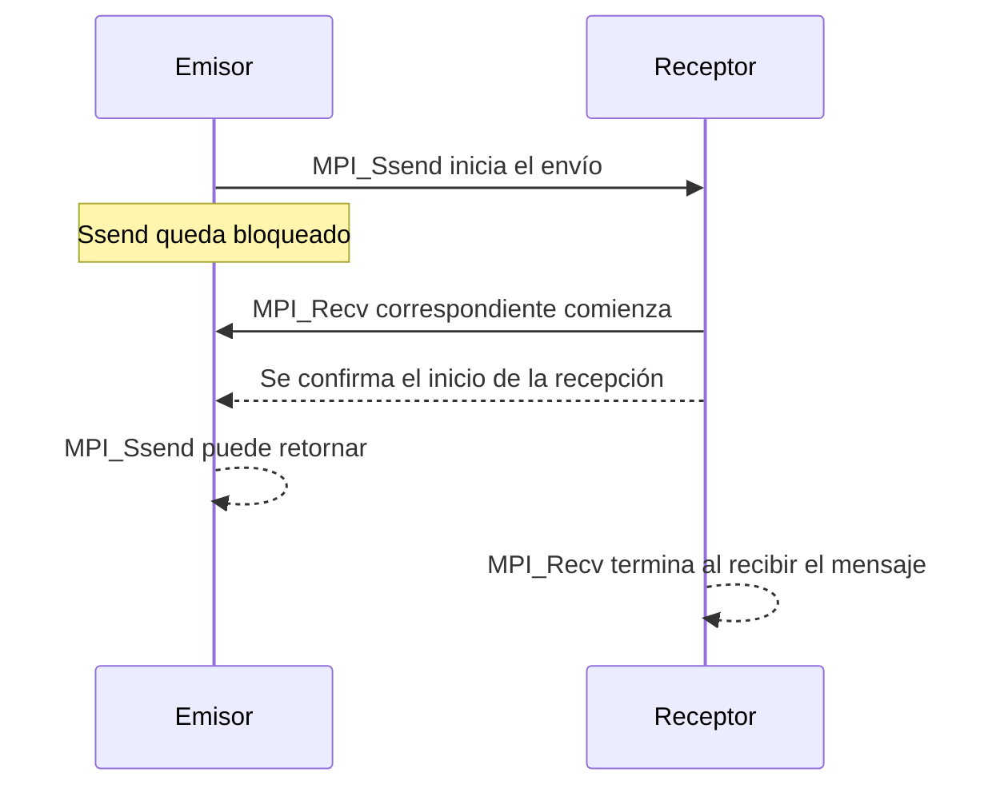


<a id="punto-a-punto-mpi_bsend"></a>

### MPI_Bsend
Envío basado en buffer, acaba independientemente del receptor cuando la información está en el buffer.
Los problemas los podemos tener en el buffer.

```mermaid
sequenceDiagram
    participant A as Emisor
    participant M as Buffer adjunto a MPI
    participant B as Receptor
    A->>M: MPI_Bsend copia el mensaje al buffer
    M-->>A: Bsend retorna; ya se puede reutilizar el buffer original
    Note over M: Hace falta espacio adjunto suficiente
    M->>B: MPI puede entregar el mensaje
    B->>M: MPI_Recv correspondiente
```

Antes de usar `MPI_Bsend`, el programa debe adjuntar memoria con `MPI_Buffer_attach`; debe liberarla después de que las operaciones hayan terminado y separar el buffer con `MPI_Buffer_detach`.


<a id="punto-a-punto-mpi_rsend"></a>

### MPI_Rsend
Acaba independiente de lo que pasa en recepción, es la función que más errores puede provocar y por tanto optimizar. Tenemos que estar seguros de que el receptor está preparado para recibir.

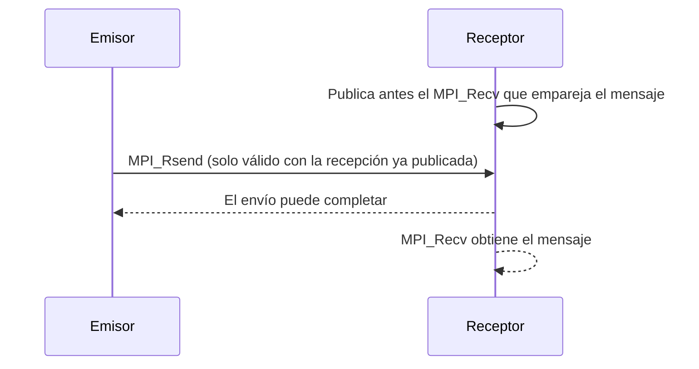

La recepción correspondiente debe estar ya publicada cuando se inicia `MPI_Rsend`; incumplir esa condición hace que el programa sea incorrecto.


<a id="punto-a-punto-mpi_recv"></a>

### MPI_Recv
Cuando se llama a esta función no se retorna hasta que se ha recibido el mensaje (si no llega nunca no retorna nunca)

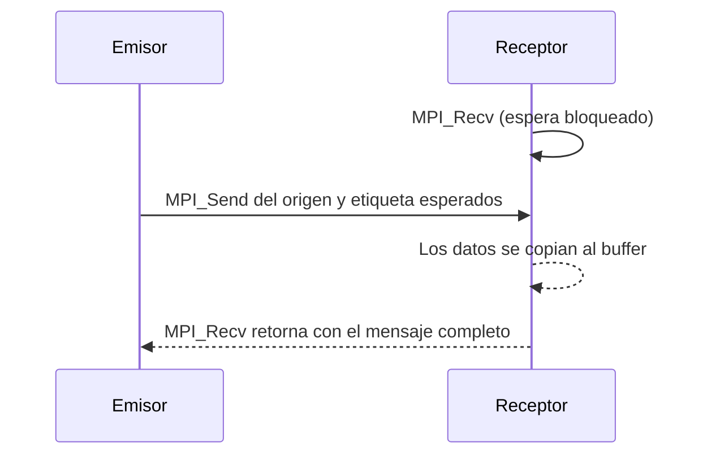

La llamada selecciona el mensaje por comunicador, origen (o `MPI_ANY_SOURCE`), etiqueta (o `MPI_ANY_TAG`) y destinatario. El tipo compatible y la capacidad suficiente son condiciones de transferencia correcta, no filtros que seleccionen otro mensaje. Si nunca llega un mensaje que coincida, la recepción puede esperar indefinidamente.


<a id="punto-a-punto-mpi_isend"></a>

### MPI_Isend

Una opción para intentar simultanear cómputo y comunicaciones son las funciones asíncronas (se intenta evitar que los procesos estén ociosos mientras se espera un proceso de envío o de recepción)

```mermaid
sequenceDiagram
    participant A as Proceso emisor
    participant M as MPI
    A->>M: MPI_Isend(buffer, &request)
    M-->>A: Retorna enseguida con una petición
    A->>A: Puede calcular usando otras variables
    A->>M: MPI_Wait(&request)
    M-->>A: Envío completado; ya puede reutilizar buffer
```

`MPI_Isend` no permite modificar ni reutilizar el buffer de envío hasta completar la petición con `MPI_Wait`, `MPI_Test` u otra finalización válida.


<a id="punto-a-punto-mpi_irecv"></a>

### MPI_Irecv

```mermaid
sequenceDiagram
    participant A as Emisor
    participant B as Proceso receptor
    B->>B: MPI_Irecv(buffer, &request)
    B-->>B: Retorna enseguida; la recepción queda publicada
    B->>B: Puede hacer trabajo independiente
    A->>B: El mensaje llega y se copia en buffer
    B->>B: MPI_Wait(&request) confirma la finalización
    Note over B: Ahora puede leer o reutilizar buffer
```

Hasta completar la petición, el programa no debe leer ni modificar la zona del buffer reservada para esa recepción.


<a id="punto-a-punto-mpi_wait"></a>

### MPI_Wait

`MPI_Wait` bloquea hasta que la operación no bloqueante asociada a la petición se completa. Después, el buffer puede reutilizarse según fuera de envío o recepción. 

```c
MPI_Wait(
    MPI_Request *request,
    MPI_Status *status
)
```

Nos devuelve el status para saber que es lo que ha pasado.

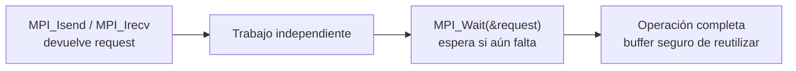


<a id="punto-a-punto-mpi_test"></a>

### MPI_Test

`MPI_Test` consulta una petición sin esperar: devuelve en `flag` si la operación ya se completó. Si `flag` es falso, se puede seguir trabajando y volver a consultar; si es verdadero, la operación terminó y se puede usar el buffer.

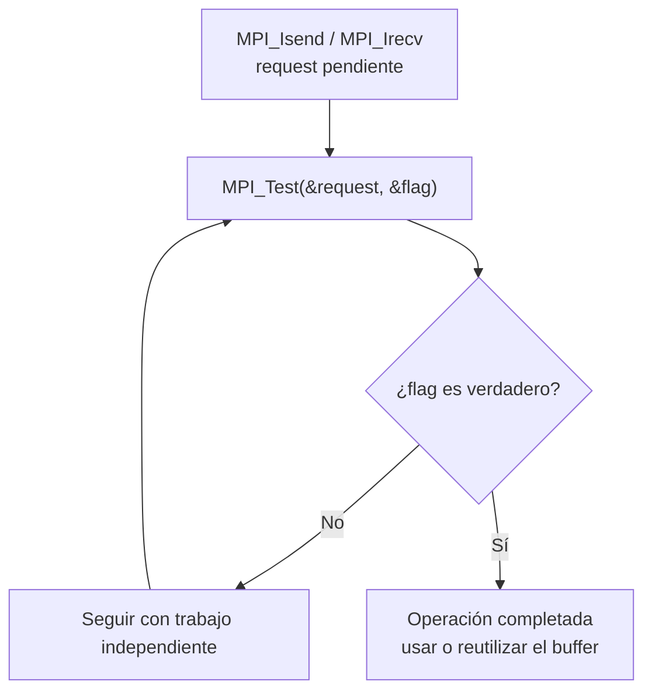

Cuando necesitamos enviar tipos de datos complejos podemos optar por dos opciones

1. Crear un tipo de datos derivado
2. empaquetar los datos

Si se ceea un tipo derivado en la creación se asegura la contigüidad de los datos en memoria.

<a id="colectivas"></a>

## 9. MPI-1: comunicaciones colectivas

<!-- Fuente integrada: Apuntes Clase/MPI/Funciones colectivas/README.md -->

Todas las colectivas de este capítulo pertenecen a MPI-1. Todos los miembros del intracomunicador deben participar en un orden compatible. La raíz también participa. El retorno de una colectiva bloqueante permite reutilizar los búferes locales correspondientes, pero no implica una barrera global salvo las garantías de la operación concreta.

El orden de los bloques es el orden de rango, no el orden de llegada ni el orden numérico de los valores. `count` expresa elementos, no bytes. Las firmas de tipos entre aportaciones y recepciones deben ser compatibles. Las variantes `v` permiten cantidades y desplazamientos diferentes; no transmiten automáticamente a cada proceso cuánto debe reservar.

Los algoritmos con mensajes punto a punto son implementaciones didácticas. MPI define el efecto de cada colectiva, sin imponer esos algoritmos internos.

<a id="colectiva-01_Bcast-mpi_bcast"></a>

## MPI_Bcast


<a id="colectiva-01_Bcast-diagrama"></a>

### Diagrama

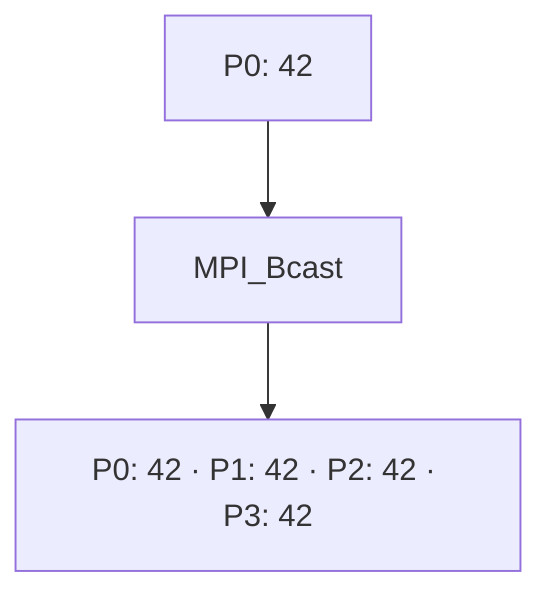

**Lectura del diagrama:** P0: 42. Después: P0: 42 · P1: 42 · P2: 42 · P3: 42.


<a id="colectiva-01_Bcast-funcionamiento"></a>

### Funcionamiento

Difunde el mismo dato desde la raíz a todos los procesos.

Todos llaman a la función, incluida la raíz (P0). `1` es la cantidad de elementos, `MPI_INT` su tipo y `0` el rango de la raíz. Al regresar, cada proceso tiene una copia de 42.

El diagrama representa el efecto de la operación, no el algoritmo interno de MPI. El ejemplo usa cuatro procesos en un intracomunicador, `MPI_COMM_WORLD`.

<a id="colectiva-02_Reduce-mpi_reduce"></a>

## MPI_Reduce


<a id="colectiva-02_Reduce-diagrama"></a>

### Diagrama

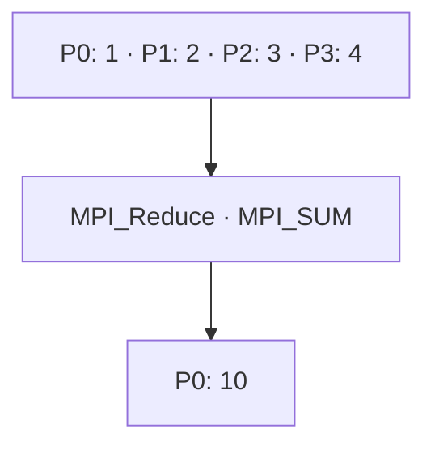

**Lectura del diagrama:** P0: 1 · P1: 2 · P2: 3 · P3: 4. Después: P0: 10.


<a id="colectiva-02_Reduce-funcionamiento"></a>

### Funcionamiento

Combina las contribuciones mediante una operación y deja el resultado en la raíz.

`local` es la aportación de cada proceso; `total` es el búfer de salida, significativo solo en la raíz. `MPI_SUM` suma 1 + 2 + 3 + 4. También se pueden reducir vectores elemento a elemento y usar operaciones como `MPI_MAX` o `MPI_MIN`.

El diagrama representa el efecto de la operación, no el algoritmo interno de MPI. El ejemplo usa cuatro procesos en un intracomunicador, `MPI_COMM_WORLD`.

<a id="colectiva-03_Allreduce-mpi_allreduce"></a>

## MPI_Allreduce


<a id="colectiva-03_Allreduce-diagrama"></a>

### Diagrama

```mermaid
flowchart TD
    A["P0: 1 · P1: 2 · P2: 3 · P3: 4"] --> B["MPI_Allreduce · MPI_SUM"]
    B --> C["P0: 10 · P1: 10 · P2: 10 · P3: 10"]
```

**Lectura del diagrama:** P0: 1 · P1: 2 · P2: 3 · P3: 4. Después: P0: 10 · P1: 10 · P2: 10 · P3: 10.


<a id="colectiva-03_Allreduce-funcionamiento"></a>

### Funcionamiento

Reduce las contribuciones y devuelve el resultado a todos.

No hay parámetro raíz. Cada proceso aporta `local` y recibe el total en `total`. Conceptualmente es una reducción seguida de una difusión; eso no determina su implementación interna.

El diagrama representa el efecto de la operación, no el algoritmo interno de MPI. El ejemplo usa cuatro procesos en un intracomunicador, `MPI_COMM_WORLD`.

<a id="colectiva-09_Barrier-mpi_barrier"></a>

## MPI_Barrier


<a id="colectiva-09_Barrier-diagrama"></a>

### Diagrama

```mermaid
flowchart TD
    A["P0 llega"] --> E["MPI_Barrier: esperar a todos"]
    B["P1 llega"] --> E
    C["P2 llega"] --> E
    D["P3 llega"] --> E
    E --> F["P0, P1, P2 y P3 pueden continuar"]
```

**Lectura del diagrama:** P0, P1, P2 y P3 llegan en momentos distintos. Después: Todos han llegado → cada proceso puede continuar.


<a id="colectiva-09_Barrier-funcionamiento"></a>

### Funcionamiento

Sincroniza: nadie termina la llamada hasta que todos han entrado en ella.

No intercambia datos del programa ni tiene raíz. Un proceso que llega pronto espera a los demás. Una vez que todos han entrado, pueden continuar; no tienen que salir en el mismo instante. El orden visible de los mensajes de consola puede variar por el almacenamiento y transporte de la salida.

El diagrama representa el efecto de la operación, no el algoritmo interno de MPI. El ejemplo usa cuatro procesos en un intracomunicador, `MPI_COMM_WORLD`.

### Scan, Gather, Gatherv, Scatter, Scatterv y memoria

El objetivo es entender el efecto de cada colectiva y poder construir una implementación concreta con `MPI_Send` y `MPI_Recv`. Por ejemplo, se puede implementar Allreduce recogiendo las aportaciones en P0, reduciéndolas y enviando el resultado a todos.

Los diagramas muestran resultados o algoritmos didácticos. No describen necesariamente el algoritmo interno de una biblioteca MPI. Cada sección indica el número de procesos usado en su ejemplo.

<a id="clase06-navegacion"></a>

<a id="clase06-mpi_scan"></a>


<a id="clase06-mpi_scan-reduccion-acumulada-inclusiva"></a>

### MPI_Scan: reducción acumulada inclusiva


<a id="clase06-diagrama-con-tres-procesos"></a>

#### Diagrama con tres procesos

Con suma, cada proceso recibe el resultado de combinar las aportaciones desde P0 hasta su propio rango, incluida su aportación.

```mermaid
flowchart LR
    A["P0 aporta 2"] --> R0["P0 obtiene 2"]
    A --> R1["P1 obtiene 2 + 10 = 12"]
    B["P1 aporta 10"] --> R1
    A --> R2["P2 obtiene 2 + 10 + 100 = 112"]
    B --> R2
    C["P2 aporta 100"] --> R2
```

**Lectura:** P0 obtiene su propio valor; P1 combina P0 y P1; P2 combina P0, P1 y P2.

Todos aportan la misma cantidad de elementos, indicada por `NumDatos`. Lo que aumenta con el rango es el número de aportaciones combinadas: Pi obtiene una reducción de i + 1 aportaciones. No significa que cada proceso deba enviar un vector de tamaño diferente.


<a id="clase06-llamada-y-ejemplo"></a>

#### Llamada y ejemplo

```c
err = MPI_Scan(
    Operando, Resultado, NumDatos,
    TipoDatos, Operacion, comunicador
);
```

- `Operando`: dirección del dato o vector local.
- `Resultado`: búfer donde este proceso recibe su prefijo.
- `NumDatos`: elementos aportados por cada proceso.
- `TipoDatos`: tipo de esos elementos.
- `Operacion`: operación de reducción, por ejemplo `MPI_SUM`.
- `comunicador`: grupo de procesos que participa.

Con tres procesos, dentro de un programa que ya ha inicializado MPI y obtenido `rank`:

```c
int aportaciones[3] = {2, 10, 100};
int local = aportaciones[rank];
int prefijo;

MPI_Scan(&local, &prefijo, 1, MPI_INT, MPI_SUM, MPI_COMM_WORLD);
printf("P%d obtiene %d\n", rank, prefijo);
```

P0 obtiene 2, P1 obtiene 12 y P2 obtiene 112. Scan no tiene un parámetro raíz: cada proceso obtiene su resultado.


<a id="clase06-diagrama-con-vectores"></a>

#### Diagrama con vectores

La reducción se hace **elemento a elemento**:

```mermaid
flowchart TD
    A["P0: [2, 3, 5]"] --> R0["Resultado P0: [2, 3, 5]"]
    A --> R1["Resultado P1: [12, 14, 17]"]
    B["P1: [10, 11, 12]"] --> R1
    A --> R2["Resultado P2: [112, 124, 137]"]
    B --> R2
    C["P2: [100, 110, 120]"] --> R2
```

Por ejemplo, la segunda posición de P2 contiene 3 + 11 + 110 = 124. No se suman entre sí las posiciones del mismo vector.

```c
int entradas[3][3] = {
    {2, 3, 5},
    {10, 11, 12},
    {100, 110, 120}
};
int resultado[3];

MPI_Scan(entradas[rank], resultado, 3, MPI_INT, MPI_SUM,
         MPI_COMM_WORLD);
```

**Aclaración sobre los mensajes:** en una implementación en cadena, P0 inicia sin recibir, Pi recibe el prefijo anterior, añade su aportación y lo envía a Pi+1. No es necesario recibir por separado los datos de todos los rangos anteriores. La colectiva garantiza el resultado; no obliga a usar esa cadena.


<a id="clase06-mpi_gather"></a>


<a id="clase06-mpi_gather-reunir-bloques-del-mismo-tamano"></a>

### MPI_Gather: reunir bloques del mismo tamaño


<a id="clase06-diagrama-con-tres-procesos-y-raiz-p0"></a>

#### Diagrama con tres procesos y raíz P0

```mermaid
flowchart TD
    A["P0 aporta [10, 11]"] -->|"bloque del rango 0"| R["P0 recibe [10, 11, 20, 21, 30, 31]"]
    B["P1 aporta [20, 21]"] -->|"bloque del rango 1"| R
    C["P2 aporta [30, 31]"] -->|"bloque del rango 2"| R
```

Gather reúne los datos sin sumarlos ni reducirlos. En el búfer de la raíz, los bloques quedan colocados por rango: primero P0, después P1 y después P2. Los datos de distintos procesos pueden ser iguales; no tienen que ser valores diferentes.

La raíz también llama a Gather y aporta su bloque. En una implementación didáctica con Send/Recv, puede copiar su bloque localmente, sin enviarse un mensaje a sí misma.


<a id="clase06-llamada-y-ejemplo-2"></a>

#### Llamada y ejemplo

```c
err = MPI_Gather(
    DatosEnvio, NumDatosEnvio, TipoDatosEnvio,
    DatosRecepcion, NumDatosRecepcion, TipoDatosRecepcion,
    Raiz, comunicador
);
```

`NumDatosRecepcion` es la cantidad que la raíz recibe **de cada proceso**, no la cantidad total. Si tres procesos aportan diez enteros cada uno, la raíz necesita espacio para treinta, pero ese argumento vale diez.

Con tres procesos y dos enteros por proceso:

```c
int local[2] = {(rank + 1) * 10, (rank + 1) * 10 + 1};
int reunidos[6];

MPI_Gather(local, 2, MPI_INT, reunidos, 2, MPI_INT,
           0, MPI_COMM_WORLD);

if (rank == 0) {
    for (int i = 0; i < 6; i++) printf("%d ", reunidos[i]);
    printf("\n");
}
```

El resultado en P0 es `[10, 11, 20, 21, 30, 31]`. El búfer de recepción solo es significativo en la raíz.


<a id="clase06-orden-de-llegada-y-mpi_any_source"></a>

#### Orden de llegada y MPI_ANY_SOURCE

El orden final por rango no depende de quién llega antes. Gather coloca los bloques en las posiciones que corresponden a cada proceso; no ordena los valores numéricamente.

En una implementación propia, `MPI_ANY_SOURCE` permite recibir un mensaje de cualquier origen. **No lo coloca automáticamente por rango**: necesitas consultar `status.MPI_SOURCE` y copiarlo en la posición correcta.

Ejemplo de la recogida en P0 para tres procesos:

```c
/* Dentro de la rama rank == 0; local y reunidos son los de arriba. */
reunidos[0] = local[0];
reunidos[1] = local[1];

for (int k = 1; k < 3; k++) {
    int recibido[2];
    MPI_Status status;

    MPI_Recv(recibido, 2, MPI_INT, MPI_ANY_SOURCE, 200,
             MPI_COMM_WORLD, &status);

    int origen = status.MPI_SOURCE;
    reunidos[2 * origen] = recibido[0];
    reunidos[2 * origen + 1] = recibido[1];
}

/* En cada proceso distinto de P0 se ejecutaria:
   MPI_Send(local, 2, MPI_INT, 0, 200, MPI_COMM_WORLD);
*/
```

Esto supone un mensaje por emisor y que no hay mensajes ajenos con esa etiqueta y comunicador. Recibir de cualquier origen puede evitar esperar primero a un proceso concreto, pero no garantiza que siempre sea más rápido.


<a id="clase06-mpi_gatherv"></a>


<a id="clase06-mpi_gatherv-reunir-bloques-de-tamanos-distintos"></a>

### MPI_Gatherv: reunir bloques de tamaños distintos


<a id="clase06-diagrama-con-cuatro-procesos-y-raiz-p0"></a>

#### Diagrama con cuatro procesos y raíz P0

```mermaid
flowchart TD
    A["P0: [10, 11, 12, 13]"] -->|"4 enteros desde indice 0"| R["P0: [10,11,12,13 | 20,21 | 30,31,32,33,34,35 | 40,41,42]"]
    B["P1: [20, 21]"] -->|"2 enteros desde indice 4"| R
    C["P2: [30, 31, 32, 33, 34, 35]"] -->|"6 enteros desde indice 6"| R
    D["P3: [40, 41, 42]"] -->|"3 enteros desde indice 12"| R
```

Gatherv permite que cada proceso aporte una cantidad diferente y que la raíz elija dónde guardar cada bloque. Usa dos tablas con una entrada por proceso:

| Rango | NumDatosRecepcion | Desplazamientos | Posiciones ocupadas |
|---|---:|---:|---|
| P0 | 4 | 0 | 0–3 |
| P1 | 2 | 4 | 4–5 |
| P2 | 6 | 6 | 6–11 |
| P3 | 3 | 12 | 12–14 |

```c
int cantidades[4] = {4, 2, 6, 3};
int desplazamientos[4] = {0, 4, 6, 12};
```

Estas tablas son significativas en la raíz. Para cada Pi, su cantidad y tipo de envío deben ser compatibles con la entrada i de recepción. Los desplazamientos se miden en **extensiones del tipo de recepción**, no directamente en bytes. Con `MPI_INT`, se interpretan como posiciones de enteros.


<a id="clase06-llamada-completa-y-ejemplo"></a>

#### Llamada completa y ejemplo

La función tiene nueve argumentos; entre la cantidad enviada y el búfer de recepción está el **tipo de envío**:

```c
err = MPI_Gatherv(
    DatosEnvio, NumDatosEnvio, TipoDatosEnvio,
    DatosRecepcion, NumDatosRecepcion, Desplazamientos,
    TipoDatosRecepcion, Raiz, comunicador
);
```

Con cuatro procesos:

```c
int cantidades[4] = {4, 2, 6, 3};
int desplazamientos[4] = {0, 4, 6, 12};
int n = cantidades[rank];
int local[6];
int reunidos[15];

for (int i = 0; i < n; i++)
    local[i] = (rank + 1) * 10 + i;

MPI_Gatherv(local, n, MPI_INT,
            reunidos, cantidades, desplazamientos, MPI_INT,
            0, MPI_COMM_WORLD);

if (rank == 0) {
    for (int i = 0; i < 15; i++) printf("%d ", reunidos[i]);
    printf("\n");
}
```

La raíz obtiene los quince enteros del diagrama. Gatherv también funciona con cantidades iguales; lo que añade respecto a Gather son las tablas para controlar cantidades y posiciones.


<a id="clase06-tamano-del-bufer-y-huecos"></a>

#### Tamaño del búfer y huecos

Para bloques contiguos de `MPI_INT` y desplazamientos no negativos, considera todos los rangos con cantidad positiva:

```text
elementos necesarios = max(desplazamientos[i] + cantidades[i])
```

En el ejemplo anterior: max(0+4, 4+2, 6+6, 12+3) = **15 enteros**. Esa cifra es el final exclusivo del último bloque, no su último índice, que es 14.

Si hay huecos, sumar las cantidades puede quedarse corto. Ejemplo con tres procesos:

```mermaid
flowchart TD
    A["P0: [10, 11]"] -->|"cantidad 2, inicio 0"| R["P0: [10,11 | hueco,hueco | 20,21 | 30,31]"]
    B["P1: [20, 21]"] -->|"cantidad 2, inicio 4"| R
    C["P2: [30, 31]"] -->|"cantidad 2, inicio 6"| R
```

```c
int cantidades[3] = {2, 2, 2};
int desplazamientos[3] = {0, 4, 6};
int reunidos[8] = {0}; /* Inicializar antes permite mostrar ceros en los huecos. */
```

Hay seis enteros aportados, pero se necesita espacio para ocho posiciones. Si se usa esa configuración en Gatherv, el resultado será:

```text
indices:   0  1  2  3  4  5  6  7
valores:  10 11  0  0 20 21 30 31
```

**Los ceros proceden de la inicialización**, no de Gatherv. La operación no escribe en los huecos.

Los bloques de recepción no deben solaparse ni salir de la reserva. Es responsabilidad del programa calcular cantidades, posiciones y capacidad correctamente. No hay que confiar en que MPI detecte todos los accesos fuera de la memoria reservada.


<a id="clase06-mpi_scatter"></a>


<a id="clase06-mpi_scatter-repartir-bloques-del-mismo-tamano"></a>

### MPI_Scatter: repartir bloques del mismo tamaño


<a id="clase06-diagrama-con-cuatro-procesos-y-raiz-p0-2"></a>

#### Diagrama con cuatro procesos y raíz P0

```mermaid
flowchart TD
    R["P0 tiene [10,11 | 12,13 | 14,15 | 16,17]"] -->|"bloque del rango 0"| A["P0 recibe [10,11]"]
    R -->|"bloque del rango 1"| B["P1 recibe [12,13]"]
    R -->|"bloque del rango 2"| C["P2 recibe [14,15]"]
    R -->|"bloque del rango 3"| D["P3 recibe [16,17]"]
```

Scatter reparte el búfer de la raíz en bloques iguales, uno por rango. Es la operación inversa a Gather en estos ejemplos: Gather reúne y Scatter reparte. Los bloques pueden contener valores distintos o iguales; la función no exige que los valores sean diferentes.

**Lectura:** con dos enteros por bloque, P0 recibe las posiciones 0–1, P1 las 2–3, P2 las 4–5 y P3 las 6–7. La raíz también participa y recibe su bloque.

Cada proceso guarda su bloque al comienzo del búfer local de recepción. No tiene que desplazar ese búfer según su rango: el rango determina qué bloque le corresponde del búfer de envío.


<a id="clase06-llamada-y-ejemplo-3"></a>

#### Llamada y ejemplo

```c
err = MPI_Scatter(
    DatosEnvio, NumDatosEnvio, TipoDatosEnvio,
    DatosRecepcion, NumDatosRecepcion, TipoDatosRecepcion,
    Raiz, comunicador
);
```

- `DatosEnvio`: búfer de la raíz con todos los bloques.
- `NumDatosEnvio`: elementos enviados **a cada proceso**, no el total.
- `TipoDatosEnvio`: tipo MPI de los elementos enviados.
- `DatosRecepcion`: búfer local donde cada proceso recibe su bloque.
- `NumDatosRecepcion`: elementos recibidos por ese proceso.
- `TipoDatosRecepcion`: tipo MPI de los elementos recibidos.
- `Raiz`: rango del proceso que tiene y reparte los datos.
- `comunicador`: grupo de procesos participante.

Con cuatro procesos y dos enteros por proceso, dentro de un programa que ya ha inicializado MPI y obtenido `rank`:

```c
int datos[8];
int local[2];

if (rank == 0) {
    for (int i = 0; i < 8; i++) datos[i] = 10 + i;
}

MPI_Scatter(datos, 2, MPI_INT, local, 2, MPI_INT,
            0, MPI_COMM_WORLD);

printf("P%d recibe [%d, %d]\n", rank, local[0], local[1]);
```

El resultado es el del diagrama, aunque las líneas de printf pueden aparecer en otro orden. Los argumentos de envío solo son significativos en la raíz; todos llaman a Scatter y usan la misma raíz y comunicador.


<a id="clase06-cantidades-tipos-y-tamano-de-la-reserva"></a>

#### Cantidades, tipos y tamaño de la reserva

Para estos ejemplos con `MPI_INT` en ambos lados, las cantidades de envío y recepción coinciden: dos enteros por proceso. Con cuatro procesos, la raíz necesita **4 × 2 = 8 enteros** y cada receptor necesita dos.

**No basta con que los tipos ocupen los mismos bytes.** No es válido enviar enteros con `MPI_INT` y recibirlos como `MPI_DOUBLE` suponiendo que MPI convierte los valores. Los tamaños tampoco son universalmente iguales; en C se usa `MPI_INT` para int, mientras que `MPI_INTEGER` corresponde al enlace Fortran.

La regla general es que la secuencia de tipos básicos descrita por la cantidad y el tipo de envío coincida con la de recepción. Con tipos derivados pueden diferir la distribución en memoria y las cantidades numéricas si describen la misma secuencia de tipos. Si se quieren bloques de tamaños distintos, se utiliza [MPI_Scatterv](MPI/Funciones%20colectivas/07_Scatterv.md).


<a id="clase06-que-cambia-si-la-raiz-es-p1"></a>

#### ¿Qué cambia si la raíz es P1?

P1 debe tener el búfer de envío inicializado y todos deben usar `Raiz = 1`. Los bloques siguen asignándose por rango, empezando por P0; no se empieza a repartir por el rango de la raíz.

```mermaid
flowchart TD
    R["P1 tiene [20,21 | 22,23 | 24,25 | 26,27]"] -->|"bloque del rango 0"| A["P0 recibe [20,21]"]
    R -->|"bloque del rango 1"| B["P1 recibe [22,23]"]
    R -->|"bloque del rango 2"| C["P2 recibe [24,25]"]
    R -->|"bloque del rango 3"| D["P3 recibe [26,27]"]
```

```c
int datos[8];
int local[2];

if (rank == 1) {
    for (int i = 0; i < 8; i++) datos[i] = 20 + i;
}

MPI_Scatter(datos, 2, MPI_INT, local, 2, MPI_INT,
            1, MPI_COMM_WORLD);

printf("P%d recibe [%d, %d]\n", rank, local[0], local[1]);
```

Todos reciben, incluida P1. El ejemplo utiliza ocho enteros porque hay cuatro bloques de dos; diez enteros requerirían otra distribución.


<a id="clase06-relacion-con-send-y-recv"></a>

#### Relación con Send y Recv

Una implementación didáctica con raíz P0 copia su propio bloque y envía los otros:

```c
/* Alternativa a la llamada colectiva del primer ejemplo. */
if (rank == 0) {
    local[0] = datos[0];
    local[1] = datos[1];

    for (int destino = 1; destino < 4; destino++)
        MPI_Send(datos + 2 * destino, 2, MPI_INT, destino, 210,
                 MPI_COMM_WORLD);
} else {
    MPI_Recv(local, 2, MPI_INT, 0, 210, MPI_COMM_WORLD,
             MPI_STATUS_IGNORE);
}
```

El desplazamiento `2 * destino` selecciona el bloque de cada rango. La copia local evita que la raíz tenga que enviarse un mensaje. Este es un algoritmo posible, no una descripción obligatoria del algoritmo interno de MPI.

Consulta el [ejemplo completo de Scatter con Send/Recv](MPI/Funciones%20colectivas/Send_Recv/06_Scatter.md).


<a id="clase06-mpi_scatterv"></a>


<a id="clase06-mpi_scatterv-repartir-bloques-de-tamanos-distintos"></a>

### MPI_Scatterv: repartir bloques de tamaños distintos


<a id="clase06-diagrama-con-cuatro-procesos-y-raiz-p0-3"></a>

#### Diagrama con cuatro procesos y raíz P0

```mermaid
flowchart TD
    R["P0 tiene [10 | 20,21 | 30,31,32 | 40,41,42,43]"] -->|"1 entero desde indice 0"| A["P0 recibe [10]"]
    R -->|"2 enteros desde indice 1"| B["P1 recibe [20,21]"]
    R -->|"3 enteros desde indice 3"| C["P2 recibe [30,31,32]"]
    R -->|"4 enteros desde indice 6"| D["P3 recibe [40,41,42,43]"]
```

Scatterv permite elegir la cantidad y la posición inicial del bloque que recibe cada rango. La raíz utiliza dos tablas, con una entrada por proceso:

| Rango destinatario | Cantidad enviada | Desplazamiento | Posiciones en la raíz |
|---|---:|---:|---|
| P0 | 1 | 0 | 0 |
| P1 | 2 | 1 | 1–2 |
| P2 | 3 | 3 | 3–5 |
| P3 | 4 | 6 | 6–9 |

**Lectura:** cada proceso recibe su bloque al inicio del búfer local. Los desplazamientos se aplican al búfer de envío de la raíz, no al de recepción.


<a id="clase06-llamada-y-ejemplo-4"></a>

#### Llamada y ejemplo

```c
err = MPI_Scatterv(
    DatosEnvio, NumDatosEnvio, Desplazamientos, TipoDatosEnvio,
    DatosRecepcion, NumDatosRecepcion, TipoDatosRecepcion,
    Raiz, comunicador
);
```

Aquí `NumDatosEnvio` y `Desplazamientos` son arrays; `NumDatosRecepcion` es un entero local. Los argumentos de envío solo son significativos en la raíz. Todos llaman a la operación con la misma raíz y comunicador.

Con cuatro procesos, MPI inicializado y `rank` obtenido:

```c
int cantidades[4] = {1, 2, 3, 4};
int desplazamientos[4] = {0, 1, 3, 6};
int datos[10];
int local[4]; /* Capacidad maxima; cada rango utiliza solo n posiciones. */
int n = rank + 1;

if (rank == 0) {
    int entrada[10] = {10, 20, 21, 30, 31, 32, 40, 41, 42, 43};
    for (int i = 0; i < 10; i++) datos[i] = entrada[i];
}

MPI_Scatterv(datos, cantidades, desplazamientos, MPI_INT,
             local, n, MPI_INT, 0, MPI_COMM_WORLD);

printf("P%d recibe:", rank);
for (int i = 0; i < n; i++) printf(" %d", local[i]);
printf("\n");
```

En este ejemplo, cada rango conoce su cantidad por la regla `n = rank + 1`. Si las cantidades las decide la raíz durante la ejecución, primero debe comunicar a cada receptor cuántos elementos recibirá para que prepare su búfer. Scatterv no comunica esa información automáticamente.


<a id="clase06-desplazamientos-huecos-y-tipos"></a>

#### Desplazamientos, huecos y tipos

Los desplazamientos se expresan en extensiones de `TipoDatosEnvio`; con MPI_INT son posiciones de enteros. Para este caso, con desplazamientos no negativos, la reserva debe cubrir hasta `max(desplazamientos[i] + cantidades[i])`, considerando cantidades positivas.

Por ejemplo, si tres procesos reciben dos enteros cada uno y los desplazamientos son `{0, 4, 6}`:

```text
indices en la raiz:  0  1  2  3  4  5  6  7
datos:             10 11 99 99 20 21 30 31
destinatario:        P0   hueco   P1    P2
```

Se necesitan ocho posiciones para enviar seis enteros. Las posiciones 2 y 3 no se envían; sus valores no aparecen en los receptores. Los bloques deben quedar dentro de la reserva y no provocar lecturas repetidas de una misma posición.

La cantidad y el tipo de cada envío deben describir la misma secuencia de tipos básicos que la recepción correspondiente. Con MPI_INT en ambos lados, `n` coincide con `cantidades[rank]`. Una reserva local de cuatro enteros permite recibir un bloque menor, pero el argumento de cantidad de esta colectiva debe describir ese bloque, no toda la capacidad reservada.


<a id="clase06-relacion-con-send-y-recv-2"></a>

#### Relación con Send y Recv

Como alternativa a la llamada anterior, usando los mismos datos y cuatro procesos:

```c
if (rank == 0) {
    for (int i = 0; i < cantidades[0]; i++)
        local[i] = datos[desplazamientos[0] + i];

    for (int destino = 1; destino < 4; destino++)
        MPI_Send(datos + desplazamientos[destino],
                 cantidades[destino], MPI_INT, destino, 211,
                 MPI_COMM_WORLD);
} else {
    MPI_Recv(local, n, MPI_INT, 0, 211, MPI_COMM_WORLD,
             MPI_STATUS_IGNORE);
}
```

La raíz copia su bloque y envía a cada rango la cantidad indicada desde su desplazamiento. Cada receptor espera su bloque de la raíz. Esta alternativa muestra la funcionalidad; la biblioteca MPI puede utilizar otro algoritmo interno.

Cambiar la raíz a P1 exige inicializar los datos allí, cambiar las ramas y los orígenes de los mensajes, y usar raíz 1 en la colectiva. Las tablas siguen indexadas por el rango destinatario: la entrada 0 corresponde a P0.

Consulta el [ejemplo completo de Scatterv con Send/Recv](MPI/Funciones%20colectivas/Send_Recv/07_Scatterv.md). La definición y las reglas de tipos están en [MPI_Scatterv de Open MPI](https://docs.open-mpi.org/en/main/man-openmpi/man3/MPI_Scatterv.3.html).


<a id="clase06-memoria"></a>


<a id="clase06-una-reserva-de-memoria-para-dos-vectores"></a>

### Una reserva de memoria para dos vectores


<a id="clase06-diagrama-de-la-reserva"></a>

#### Diagrama de la reserva

Con `tam = 3`, una sola reserva puede alojar dos vectores contiguos:

```mermaid
flowchart TD
    A["malloc: una reserva de 6 enteros"] --> B["datos: indices 0,1,2,3,4,5"]
    B --> V1["v1 = datos: indices 0,1,2"]
    B --> V2["v2 = datos + 3: indices 3,4,5"]
```

```text
datos, v1
   |
   v
[ v1[0] v1[1] v1[2] | v2[0] v2[1] v2[2] ]
                      ^
                      |
                    v2 = datos + tam
```

Los dos punteros apuntan a zonas de **un mismo bloque de memoria**. `datos + tam` avanza tam enteros, no tam bytes.


<a id="clase06-reserva-correcta"></a>

#### Reserva correcta

En C, con `#include <stdlib.h>`, no hace falta convertir el resultado de malloc:

```c
/* Fragmento dentro de main: tam positivo y tamaño de reserva sin desbordar. */
int *datos = malloc(2 * (size_t)tam * sizeof *datos);
if (datos == NULL) {
    fprintf(stderr, "No se pudo reservar memoria\n");
    MPI_Abort(MPI_COMM_WORLD, 1);
    return 1;
}

int *v1 = datos;
int *v2 = datos + tam;

/* Trabajar con v1[0..tam-1] y v2[0..tam-1]. */

free(datos); /* Una reserva, una liberacion. */
```

No se debe liberar v1 ni v2 además de datos. v1 es otro nombre para la misma dirección inicial; v2 apunta al interior del bloque y no es una reserva independiente.


<a id="clase06-bloque-de-memoria-y-mensaje-son-conceptos-distintos"></a>

#### Bloque de memoria y mensaje son conceptos distintos

Una reserva no crea un mensaje. Las llamadas a MPI definen qué datos se comunican. Tras inicializar los elementos y antes de liberar la reserva, puedes elegir:

```c
/* Una llamada: enviar los dos vectores contiguos como un bloque. */
MPI_Send(datos, 2 * tam, MPI_INT, destino, 300, MPI_COMM_WORLD);
```

O bien:

```c
/* Dos llamadas: enviar cada vector por separado. */
MPI_Send(v1, tam, MPI_INT, destino, 301, MPI_COMM_WORLD);
MPI_Send(v2, tam, MPI_INT, destino, 302, MPI_COMM_WORLD);
```

Estos bloques son alternativas; no se ejecutan ambos para transmitir una sola vez. El receptor debe usar los tamaños, orígenes y etiquetas correspondientes.

**Relación con Gatherv:** que los vectores de distintos procesos estén en memorias diferentes no obliga a reservar un bloque por vector en la raíz. Puedes reservar un único búfer de recepción y situar cada aportación mediante los desplazamientos.


<a id="clase06-punto-a-punto"></a>


<a id="clase06-relacion-con-las-implementaciones-sendrecv"></a>

### Relación con las implementaciones Send/Recv

Un ejemplo de Allreduce mediante un coordinador:

```mermaid
flowchart TD
    A["P1 aporta 2"] -->|"Send / Recv"| R["P0 aporta 1 y suma: 1+2+3 = 6"]
    B["P2 aporta 3"] -->|"Send / Recv"| R
    R --> C["P0 conserva 6"]
    R -->|"Send / Recv"| D["P1 recibe 6"]
    R -->|"Send / Recv"| E["P2 recibe 6"]
```

Primero se recogen las aportaciones; después se distribuye el resultado. P0 es el coordinador elegido por esta implementación, aunque la llamada MPI_Allreduce no tiene parámetro raíz.

Para estudiar los algoritmos completos, consulta:

- [Scan con Send/Recv](MPI/Funciones%20colectivas/Send_Recv/10_Scan.md).
- [Gather con Send/Recv](MPI/Funciones%20colectivas/Send_Recv/04_Gather.md).
- [Gatherv con Send/Recv](MPI/Funciones%20colectivas/Send_Recv/05_Gatherv.md).
- [Scatter con Send/Recv](MPI/Funciones%20colectivas/Send_Recv/06_Scatter.md).
- [Scatterv con Send/Recv](MPI/Funciones%20colectivas/Send_Recv/07_Scatterv.md).
- [Allreduce con Send/Recv](MPI/Funciones%20colectivas/Send_Recv/03_Allreduce.md).
- [Índice de funciones colectivas](MPI/Funciones%20colectivas/README.md).

Todos los miembros del comunicador deben participar en las colectivas en un orden compatible. Los algoritmos punto a punto necesitan tamaños y etiquetas coherentes y un orden de envíos/recepciones que no forme ciclos de espera.


<a id="clase06-referencias"></a>


<a id="clase06-referencias-2"></a>

### Referencias

Semántica contrastada con MPI Forum: [Scan](https://www.mpi-forum.org/docs/mpi-1.1/mpi-11-html/node84.html) y [Gather/Gatherv](https://www.mpi-forum.org/docs/mpi-4.1/mpi41-report/node122.htm). Los ejemplos con huecos siguen las reglas de [MPI_Gatherv en Open MPI](https://docs.open-mpi.org/en/v5.0.7/man-openmpi/man3/MPI_Gatherv.3.html).

Para Scatter, consulta la [documentación de Open MPI](https://docs.open-mpi.org/en/main/man-openmpi/man3/MPI_Scatter.3.html).

Los fragmentos suponen MPI inicializado, el número de procesos indicado y las cabeceras correspondientes: mpi.h, stdio.h y, para malloc/free, stdlib.h. No sustituyen los programas completos enlazados.

### Reduce_scatter, Allgather, Allgatherv, Alltoall y Alltoallv

Seguimos con las funciones colectivas


<a id="colectivas13-mpi_reduce_scatter"></a>

### MPI_Reduce_scatter

`MPI_Reduce_scatter(send, receive, recv_cnt, MPI_INTEGER, MPI_SUM, MPI_COMM_WORLD)`


**Reduce y reparte:** cada proceso aporta un vector; MPI combina los valores posición a posición y distribuye el resultado en bloques consecutivos entre los procesos.

```c
int MPI_Reduce_scatter(const void *sendbuf, void *recvbuf,
                       const int recvcounts[], MPI_Datatype datatype,
                       MPI_Op op, MPI_Comm comm);

// Ejemplo de llamada en C:
MPI_Reduce_scatter(send, receive, recv_cnt,
                   MPI_INT, MPI_SUM, MPI_COMM_WORLD);
```

> En C, para elementos `int` usamos `MPI_INT`. El `MPI_INTEGER` del apunte inicial corresponde al tipo `INTEGER` de Fortran.


<a id="colectivas13-que-es-cada-argumento"></a>

#### Qué es cada argumento

| Argumento | Significado | Ejemplo con 3 procesos |
|---|---|---|
| `send` (`sendbuf`) | Vector de entrada local de cada proceso. Contiene tantos elementos como la suma de `recv_cnt`. | Cada proceso aporta 4 enteros. |
| `receive` (`recvbuf`) | Buffer local donde se escribe el bloque que recibe ese proceso. Debe tener capacidad para `recv_cnt[rank]` elementos. | P0 recibe 1; P1, 2; P2, 1. |
| `recv_cnt` (`recvcounts`) | Array con una entrada por proceso: la entrada `i` indica cuántos elementos recibe el rango `i`. Debe ser idéntico en todos. | `{1, 2, 1}`; cuenta elementos, no bytes. |
| `MPI_INT` (`datatype`) | Tipo MPI de los elementos. | Enteros `int` en C. |
| `MPI_SUM` (`op`) | Operación que combina valores de la misma posición. | Suma. |
| `MPI_COMM_WORLD` (`comm`) | Comunicador que determina el grupo participante. | Los 3 procesos del programa. |

Es **colectiva**: todos los procesos del comunicador deben llamarla en el mismo orden de llamadas colectivas. **No hay `root`**. La función devuelve un código de estado (`MPI_SUCCESS` si tiene éxito); el bloque recibido se guarda en `receive`.


<a id="colectivas13-ejemplo-paso-a-paso"></a>

#### Ejemplo paso a paso

Tenemos 3 procesos y `recv_cnt = {1, 2, 1}`. Cada uno aporta **1 + 2 + 1 = 4 elementos**, aunque luego reciba menos.

| Entrada | Posición 0 | Posición 1 | Posición 2 | Posición 3 |
|---|---:|---:|---:|---:|
| P0 | 1 | 2 | 3 | 4 |
| P1 | 10 | 20 | 30 | 40 |
| P2 | 100 | 200 | 300 | 400 |
| **Resultado de sumar por columna** | **111** | **222** | **333** | **444** |

Por ejemplo, la posición 0 se calcula como `1 + 10 + 100 = 111`. Se suman las columnas entre procesos, no los elementos de cada fila.

```mermaid
flowchart TB
    subgraph entrada["1 · Vectores locales de entrada"]
        direction LR
        A["P0 · send<br/>[1, 2, 3, 4]"]
        B["P1 · send<br/>[10, 20, 30, 40]"]
        C["P2 · send<br/>[100, 200, 300, 400]"]
    end
    A --> R
    B --> R
    C --> R
    R["2 · REDUCE · MPI_SUM<br/>Sumar posición a posición<br/>[111, 222, 333, 444]"]
    R --> S["3 · SCATTER · recv_cnt = [1, 2, 1]<br/>Separar en bloques consecutivos<br/>[111] │ [222, 333] │ [444]"]
    subgraph salida["4 · Resultado local en receive"]
        direction LR
        D["P0<br/>[111]"]
        E["P1<br/>[222, 333]"]
        F["P2<br/>[444]"]
    end
    S -->|"1 elemento"| D
    S -->|"2 elementos"| E
    S -->|"1 elemento"| F
    classDef input fill:#dbeafe,stroke:#2563eb,color:#172554,stroke-width:2px;
    classDef reduce fill:#ede9fe,stroke:#7c3aed,color:#2e1065,stroke-width:2px;
    classDef scatter fill:#ffedd5,stroke:#ea580c,color:#431407,stroke-width:2px;
    classDef output fill:#dcfce7,stroke:#16a34a,color:#052e16,stroke-width:2px;
    class A,B,C input;
    class R reduce;
    class S scatter;
    class D,E,F output;
```

El diagrama representa el resultado lógico; MPI puede usar distintos algoritmos internos y no necesita reunir primero el vector en un proceso central.

El reparto sigue el orden de los rangos: P0 recibe la posición 0, P1 las posiciones 1 y 2, y P2 la posición 3. El bloque del rango `i` empieza en la suma de los tamaños de los bloques anteriores. En su buffer local, cada bloque se guarda desde `receive[0]`.


<a id="colectivas13-programa-completo-en-c"></a>

#### Programa completo en C

```c
#include <mpi.h>
#include <stdio.h>

int main(int argc, char **argv)
{
    MPI_Init(&argc, &argv);
    int rank, size;
    MPI_Comm_rank(MPI_COMM_WORLD, &rank);
    MPI_Comm_size(MPI_COMM_WORLD, &size);

    if (size != 3) {
        if (rank == 0)
            fprintf(stderr, "Ejecuta con 3 procesos.\n");
        MPI_Finalize();
        return 1;
    }

    int recv_cnt[3] = {1, 2, 1};
    int factor = (rank == 0) ? 1 : (rank == 1) ? 10 : 100;
    int send[4];
    for (int j = 0; j < 4; ++j)
        send[j] = factor * (j + 1);

    // Capacidad para el mayor bloque: 2 enteros.
    // Cada proceso utiliza solo recv_cnt[rank] posiciones.
    int receive[2];
    MPI_Reduce_scatter(send, receive, recv_cnt,
                       MPI_INT, MPI_SUM, MPI_COMM_WORLD);

    printf("P%d recibe:", rank);
    for (int j = 0; j < recv_cnt[rank]; ++j)
        printf(" %d", receive[j]);
    printf("\n");

    MPI_Finalize();
    return 0;
}
```

Si guardas el código en `reduce_scatter.c`, en un entorno con MPI:

```bash
mpicc reduce_scatter.c -o reduce_scatter
mpirun -np 3 ./reduce_scatter
```

Resultado esperado (las líneas pueden aparecer en otro orden o intercalarse):

```text
P0 recibe: 111
P1 recibe: 222 333
P2 recibe: 444
```

**Para recordarlo:** todos aportan un vector completo de contribuciones, se reduce por posiciones y cada uno recibe un trozo. `MPI_Reduce` entrega el resultado completo a un `root`; `MPI_Allreduce`, completo a todos; `MPI_Reduce_scatter`, repartido entre todos.

Referencia: [documentación oficial de Open MPI](https://docs.open-mpi.org/en/v5.0.10/man-openmpi/man3/MPI_Reduce_scatter.3.html).


<a id="colectivas13-mpi_allgather"></a>

### MPI_Allgather

`MPI_Allgather` recopila una cantidad **igual** de datos de cada proceso y deja la concatenación ordenada por rango en el buffer de **todos** los procesos. No hay `root`: todos aportan y todos reciben.

```c
int MPI_Allgather(const void *sendbuf, int sendcount,
                  MPI_Datatype sendtype, void *recvbuf, int recvcount,
                  MPI_Datatype recvtype, MPI_Comm comm);
```

| Argumento | Significado |
|---|---|
| `sendbuf`, `sendcount`, `sendtype` | Buffer local, cantidad enviada por este proceso y tipo de esos elementos. Todos envían la misma cantidad y tipo compatible. |
| `recvbuf` | Buffer local con espacio para un bloque recibido de cada proceso. |
| `recvcount`, `recvtype` | Cantidad y tipo que se reciben **de cada proceso**; deben concordar con lo que envía cada origen. |
| `comm` | Comunicador del grupo participante. |

Con `p` procesos, cada `recvbuf` necesita `p * recvcount` elementos. El bloque del rango `i` queda en la posición `i * recvcount` (en unidades del tipo recibido). Todos deben llamar a la colectiva en el mismo orden.

Ejemplo

```Text

P0 -> 10 , 11
P1 -> 20 , 21
P2 -> 30 , 31
P3 -> 40 , 41

primero hacemos la recoleción según rango

10 , 11 , 20 , 21 , 30 , 31 , 40 , 41

PERO all ser un MPI_Allgather todos recibirán el resultado, por lo tanto

P0 -> 10 , 11 , 20 , 21 , 30 , 31 , 40 , 41
P1 -> 10 , 11 , 20 , 21 , 30 , 31 , 40 , 41
P2 -> 10 , 11 , 20 , 21 , 30 , 31 , 40 , 41
P3 -> 10 , 11 , 20 , 21 , 30 , 31 , 40 , 41

```


<a id="colectivas13-diagrama-de-mpi_allgather"></a>

#### Diagrama de `MPI_Allgather`

Cada proceso aporta el mismo número de elementos (en este ejemplo, dos). MPI los coloca en el resultado siguiendo el rango de los procesos y entrega el vector completo a **todos**.

```mermaid
flowchart TB
    subgraph envios["1 · Cada proceso envía 2 valores"]
        direction LR
        A["P0<br/>[10, 11]"]
        B["P1<br/>[20, 21]"]
        C["P2<br/>[30, 31]"]
        D["P3<br/>[40, 41]"]
    end
    A --> G
    B --> G
    C --> G
    D --> G
    G["2 · ALLGATHER<br/>Concatenar por rango<br/>[10, 11 | 20, 21 | 30, 31 | 40, 41]"]
    G --> O
    subgraph copias["3 · Todos reciben el vector completo"]
        direction LR
        O["P0, P1, P2 y P3<br/>[10, 11, 20, 21, 30, 31, 40, 41]"]
    end
    classDef input fill:#dbeafe,stroke:#2563eb,color:#172554,stroke-width:2px;
    classDef gather fill:#ede9fe,stroke:#7c3aed,color:#2e1065,stroke-width:2px;
    classDef output fill:#dcfce7,stroke:#16a34a,color:#052e16,stroke-width:2px;
    class A,B,C,D input;
    class G gather;
    class O output;
```


<a id="colectivas13-mpi_allgatherv"></a>

### MPI_Allgatherv

`MPI_Allgatherv` hace lo mismo que `MPI_Allgather`, pero cada proceso puede aportar una cantidad distinta de elementos. Cada proceso receptor proporciona sus propios arrays para describir cómo ordenar los bloques en su buffer. No hay `root` del que dependan los desplazamientos.

```c
int MPI_Allgatherv(const void *sendbuf, int sendcount,
                   MPI_Datatype sendtype, void *recvbuf,
                   const int recvcounts[], const int displs[],
                   MPI_Datatype recvtype, MPI_Comm comm);
```

| Argumento | Significado |
|---|---|
| `sendbuf`, `sendcount`, `sendtype` | Datos que aporta este proceso, número de elementos y tipo. `sendcount` puede variar por proceso. |
| `recvbuf` | Buffer local que reúne todos los bloques. Debe tener capacidad suficiente para cubrir los desplazamientos y tamaños. |
| `recvcounts[i]` | Cuántos elementos recibir del rango `i`. En cada receptor, debe concordar con lo que ese rango envía. |
| `displs[i]` | Posición inicial del bloque de rango `i` en `recvbuf`, medida en unidades de `recvtype`. |
| `recvtype`, `comm` | Tipo de los datos recibidos y comunicador participante. |

Todos envían y todos reciben la colección completa, pero cada proceso decide localmente sus `recvcounts` y `displs`. En una disposición compacta, `displs[i]` suele ser la suma de los conteos anteriores. Los huecos son válidos si hay espacio; las regiones escritas no deben solaparse.

Para calcular conteos y desplazamientos, cada proceso puede construir arrays como estos:

```c
for(int i = 0 ; i < 3 ; i++){
    recv_cnt[i] = 2 + i;
    desp_cnt[i] = 4*i + 1; // posiciones iniciales en el buffer receptor
}
```
Los conteos pueden ser distintos entre rangos, por eso se pasa un array `recvcounts`, incluso cuando casualmente todos los bloques tengan tamaño 2. En ese caso los conteos podrían ser `{2, 2, 2, ...}`. La llamada lleva el conteo local enviado (`sendcount`) y cada receptor describe los bloques entrantes con su array.


<a id="colectivas13-diagrama-de-mpi_allgatherv"></a>

#### Diagrama de `MPI_Allgatherv`

Aquí cada proceso puede enviar una cantidad distinta. En el ejemplo, los tamaños recibidos por rango son `recvcounts = [1, 2, 3, 1]` y los desplazamientos en el buffer son `displs = [0, 1, 3, 6]`. MPI coloca cada bloque en su posición y todos los procesos obtienen el mismo vector final.

```mermaid
flowchart TB
    subgraph enviosv["1 · Cada proceso envía una cantidad variable"]
        direction LR
        A["P0 · 1 valor<br/>[10]"]
        B["P1 · 2 valores<br/>[20, 21]"]
        C["P2 · 3 valores<br/>[30, 31, 32]"]
        D["P3 · 1 valor<br/>[40]"]
    end
    A --> G
    B --> G
    C --> G
    D --> G
    G["2 · ALLGATHERV<br/>recvcounts = [1, 2, 3, 1]<br/>displs = [0, 1, 3, 6]<br/>Colocar cada bloque según su desplazamiento"]
    G --> O
    subgraph resultados["3 · Cada proceso recibe el mismo buffer"]
        direction LR
        O["P0, P1, P2 y P3<br/>[10 | 20, 21 | 30, 31, 32 | 40]"]
    end
    classDef input fill:#dbeafe,stroke:#2563eb,color:#172554,stroke-width:2px;
    classDef gather fill:#ede9fe,stroke:#7c3aed,color:#2e1065,stroke-width:2px;
    classDef output fill:#dcfce7,stroke:#16a34a,color:#052e16,stroke-width:2px;
    class A,B,C,D input;
    class G gather;
    class O output;
```

Los arrays `recvcounts` y `displs` describen, para cada rango, cuántos elementos colocar y desde qué posición del buffer receptor. En este ejemplo, el bloque de P2 comienza en la posición 3 y ocupa las posiciones 3, 4 y 5. Los desplazamientos se cuentan en unidades del tipo de recepción (`MPI_Datatype`); los huecos son posibles si los desplazamientos elegidos los dejan.


<a id="colectivas13-mpi_alltoall"></a>

### `MPI_Alltoall`

`MPI_Alltoall` realiza un intercambio personalizado entre todos los procesos. Cada proceso divide su vector de envío en bloques iguales, uno para cada destino. El bloque número `j` se envía al proceso de rango `j`. A su vez, cada proceso recibe un bloque de cada origen y los guarda en orden de rango de origen. No reduce ni suma los datos.

```c
int MPI_Alltoall(const void *sendbuf, int sendcount,
                 MPI_Datatype sendtype, void *recvbuf, int recvcount,
                 MPI_Datatype recvtype, MPI_Comm comm);
```

| Argumento | Significado |
|---|---|
| `sendbuf` | Buffer local dividido en bloques, uno para cada destino. |
| `sendcount` | Elementos que este proceso envía a **cada** destino. Es el mismo tamaño para todos los destinos y procesos de esta llamada. |
| `sendtype` | Tipo MPI de cada elemento enviado. |
| `recvbuf` | Buffer que recibe un bloque de cada origen. |
| `recvcount` | Elementos que se reciben de **cada** origen; debe coincidir con lo que cada origen envía a este proceso. |
| `recvtype` | Tipo MPI de cada elemento recibido. |
| `comm` | Comunicador cuyos procesos participan en el intercambio. |

Todos los procesos llaman a la operación. Si hay `p` procesos y `sendcount = k`, cada proceso necesita espacio para `p × k` elementos en ambos buffers. Puede enviar un bloque a sí mismo también. La recepción queda ordenada por rango de origen: el bloque del origen `i` empieza en `recvbuf + i × recvcount` (teniendo en cuenta el tipo de dato).


<a id="colectivas13-ejemplo-con-4-procesos"></a>

#### Ejemplo con 4 procesos

Cada proceso envía dos enteros a cada destino. Por ejemplo, P0 envía `[10, 11]` a P0, `[12, 13]` a P1, `[14, 15]` a P2 y `[16, 17]` a P3. P1 recibe el segundo bloque de cada origen, P2 el tercero, etc.

```mermaid
flowchart LR
    subgraph envios["Bloques de salida (dos valores a cada destino)"]
        A["P0<br/>P0:[10,11] · P1:[12,13]<br/>P2:[14,15] · P3:[16,17]"]
        B["P1<br/>P0:[20,21] · P1:[22,23]<br/>P2:[24,25] · P3:[26,27]"]
        C["P2<br/>P0:[30,31] · P1:[32,33]<br/>P2:[34,35] · P3:[36,37]"]
        D["P3<br/>P0:[40,41] · P1:[42,43]<br/>P2:[44,45] · P3:[46,47]"]
    end
    A --> X
    B --> X
    C --> X
    D --> X
    A --> Y
    B --> Y
    C --> Y
    D --> Y
    A --> Z
    B --> Z
    C --> Z
    D --> Z
    A --> W
    B --> W
    C --> W
    D --> W
    subgraph recepciones["Cada proceso recibe un bloque de cada origen, en orden"]
        direction TB
        X["P0 recibe<br/>[10,11 | 20,21 | 30,31 | 40,41]"]
        Y["P1 recibe<br/>[12,13 | 22,23 | 32,33 | 42,43]"]
        Z["P2 recibe<br/>[14,15 | 24,25 | 34,35 | 44,45]"]
        W["P3 recibe<br/>[16,17 | 26,27 | 36,37 | 46,47]"]
    end
    classDef process fill:#dbeafe,stroke:#2563eb,color:#172554,stroke-width:2px;
    classDef result fill:#dcfce7,stroke:#16a34a,color:#052e16,stroke-width:2px;
    class A,B,C,D process;
    class X,Y,Z,W result;
```

Se puede leer como una matriz: las **filas** son los procesos que envían y las **columnas** los destinos. Cada proceso receptor recoge su columna, concatenada por rango de origen. En este ejemplo, `sendcount = recvcount = 2`.


<a id="colectivas13-mpi_alltoallv"></a>

### `MPI_Alltoallv`

La variante `v` permite que los bloques enviados y recibidos tengan tamaños distintos. En cada proceso, `sendcounts[j]` indica cuántos elementos enviar al destino `j`, y `sdispls[j]` dónde empieza ese bloque en `sendbuf`. Análogamente, `recvcounts[i]` indica cuántos elementos recibir del origen `i`, y `rdispls[i]` dónde colocarlos en `recvbuf`.

```c
int MPI_Alltoallv(const void *sendbuf, const int sendcounts[],
                  const int sdispls[], MPI_Datatype sendtype,
                  void *recvbuf, const int recvcounts[],
                  const int rdispls[], MPI_Datatype recvtype,
                  MPI_Comm comm);
```

| Argumento | Significado |
|---|---|
| `sendbuf` / `recvbuf` | Buffers locales de envío y recepción. |
| `sendcounts[j]` | Número de elementos que este proceso manda al rango `j`. |
| `sdispls[j]` | Posición inicial del bloque destinado a `j` dentro de `sendbuf`. |
| `sendtype` / `recvtype` | Tipos MPI de los elementos enviados y recibidos. |
| `recvcounts[i]` | Número de elementos que este proceso espera del origen `i`. Debe coincidir con el `sendcounts` de ese origen hacia este rango. |
| `rdispls[i]` | Posición inicial del bloque del origen `i` en `recvbuf`. |
| `comm` | Comunicador cuyos procesos participan. |

Los arrays de conteos y desplazamientos tienen una entrada por proceso, y cada proceso puede tener valores distintos en sus propios arrays. Los desplazamientos se miden en unidades del tipo MPI correspondiente, no en bytes. Todos los procesos participan; tampoco hay reducción ni `root`.


<a id="colectivas13-ejemplo-con-cantidades-variables"></a>

#### Ejemplo con cantidades variables

Usamos tres procesos. Cada celda indica lo que el proceso de la fila envía al destino de la columna:

| Origen ↓ / Destino → | P0 | P1 | P2 |
|---|---|---|---|
| **P0** | `[a00]` | `[a01, a02]` | `[]` |
| **P1** | `[b10, b11]` | `[b12]` | `[b13, b14, b15]` |
| **P2** | `[c20]` | `[]` | `[c21, c22]` |

Como ejemplo concreto, en P0: `sendcounts = [1, 2, 0]` y, usando bloques compactos, `sdispls = [0, 1, 3]`. Sus datos de envío son `[a00, a01, a02]`; el desplazamiento del bloque vacío puede señalar el final del buffer. Para recibir, P0 espera `[1, 2, 1]` elementos de P0, P1 y P2, respectivamente.

```mermaid
flowchart LR
    subgraph origenes["Origen: bloques enviados a cada destino"]
        A["P0<br/>a00 → P0<br/>a01,a02 → P1<br/>∅ → P2"]
        B["P1<br/>b10,b11 → P0<br/>b12 → P1<br/>b13,b14,b15 → P2"]
        C["P2<br/>c20 → P0<br/>∅ → P1<br/>c21,c22 → P2"]
    end
    A -->|"1"| X
    A -->|"2"| Y
    B -->|"2"| X
    B -->|"1"| Y
    B -->|"3"| Z
    C -->|"1"| X
    C -->|"2"| Z
    subgraph destinos["Destino: bloques colocados por rango de origen"]
        direction TB
        X["P0 recibe<br/>[a00 | b10,b11 | c20]"]
        Y["P1 recibe<br/>[a01,a02 | b12 | vacío]"]
        Z["P2 recibe<br/>[vacío | b13,b14,b15 | c21,c22]"]
    end
    classDef process fill:#dbeafe,stroke:#2563eb,color:#172554,stroke-width:2px;
    classDef result fill:#dcfce7,stroke:#16a34a,color:#052e16,stroke-width:2px;
    class A,B,C process;
    class X,Y,Z result;
```

Los números sobre las flechas son las cantidades enviadas. La flecha P0→P2 y P2→P1 lleva cero elementos, así que no se dibuja. Cada receptor guarda los bloques entrantes en orden de rango de origen, en las posiciones indicadas por sus `rdispls`. El número de elementos de cada mensaje debe concordar entre el `sendcounts` del emisor y el `recvcounts` del receptor.


<a id="colectivas13-inciso-como-cambiar-la-posicion-de-los-ceros-en-recvbuf"></a>

#### Inciso: ¿cómo cambiar la posición de los ceros en `recvbuf`?

`MPI_Alltoallv` permite decidir **dónde empieza cada bloque recibido** mediante `rdispls`. Si el bloque completo cabe en una zona continua, se puede colocar directamente en la posición deseada. Pero la función no reordena los elementos dentro de un bloque ni deja huecos entre sus elementos: el bloque de cada origen se copia de forma contigua.

Por ejemplo, supongamos que el proceso recibe dos valores de cada uno de los cuatro orígenes:

```text
P0 aporta [10, 11]   P1 aporta [20, 21]
P2 aporta [30, 31]   P3 aporta [40, 41]
```

Queremos construir este buffer:

```text
[10, 11, 0, 0, 0, 21, 0, 0, 30, 0, 0, 0, 40, 41]
```

De P1 queremos conservar solo `21`, y de P2 solo `30`. Como cada bloque recibido tiene dos valores contiguos, primero recibimos los cuatro bloques juntos en un buffer temporal (usando desplazamientos `0, 2, 4, 6`) y después copiamos los valores a las posiciones elegidas. Inicializamos el destino a cero para que las posiciones sin copiar sigan siendo cero:

```c
int recvcounts[4] = {2, 2, 2, 2};
int rdispls[4]    = {0, 2, 4, 6};
int temporal[8];
int resultado[14] = {0};

MPI_Alltoallv(sendbuf, sendcounts, sdispls, MPI_INT,
              temporal, recvcounts, rdispls, MPI_INT,
              MPI_COMM_WORLD);

// temporal está ordenado por origen:
// [10, 11 | 20, 21 | 30, 31 | 40, 41]
resultado[0]  = temporal[0]; // 10, de P0
resultado[1]  = temporal[1]; // 11, de P0
resultado[5]  = temporal[3]; // 21, segundo valor de P1
resultado[8]  = temporal[4]; // 30, primer valor de P2
resultado[12] = temporal[6]; // 40, de P3
resultado[13] = temporal[7]; // 41, de P3
```

Así queda `resultado = [10, 11, 0, 0, 0, 21, 0, 0, 30, 0, 0, 0, 40, 41]`. Los `recvcounts` deben concordar con los datos que los emisores envían a este proceso; si se quiere recibir solo algunos valores directamente, los emisores también deben configurar sus bloques de envío para mandar exactamente esos valores. El buffer temporal es útil cuando se reciben bloques completos y luego se eligen o recolocan elementos.


<a id="colectivas13-que-pasa-si-cambiamos-rdispls-de-0-4-8-12-a-0-4-2-12"></a>

#### ¿Qué pasa si cambiamos `rdispls` de `{0, 4, 8, 12}` a `{0, 4, 2, 12}`?

Supongamos cuatro orígenes, `recvcounts = {4, 4, 4, 4}` y un `recvbuf` de 16 enteros. Cada desplazamiento marca dónde empieza el bloque de 4 elementos del origen correspondiente. Con `{0, 4, 8, 12}`, los bloques quedan seguidos sin solaparse. Al cambiar el desplazamiento de P2 de `8` a `2`, su bloque ocupa las posiciones 2–5 y se solapa con P0 (posiciones 0–3) y P1 (4–7).

```mermaid
flowchart TB
    subgraph correcto["rdispls = {0, 4, 8, 12} · bloques contiguos"]
        direction LR
        A["P0 · índices 0–3"]
        B["P1 · índices 4–7"]
        C["P2 · índices 8–11"]
        D["P3 · índices 12–15"]
        A --- B --- C --- D
    end
    subgraph solapado["rdispls = {0, 4, 2, 12} · P2 se solapa"]
        direction LR
        E["P0 · 0–3"]
        F["P1 · 4–7"]
        G["P2 · 2–5  ⚠️"]
        H["P3 · 12–15"]
        E --- F --- H
        G -. "solapa en 2–3" .-> E
        G -. "solapa en 4–5" .-> F
    end
    classDef safe fill:#dcfce7,stroke:#16a34a,color:#052e16,stroke-width:2px;
    classDef overlap fill:#fee2e2,stroke:#dc2626,color:#450a0a,stroke-width:3px;
    class A,B,C,D safe;
    class E,F,H safe;
    class G overlap;
```

Los bloques de recepción no deben solaparse: dos mensajes intentarían escribir en las mismas posiciones del buffer, lo que hace inválida la operación. Los `rdispls` pueden dejar huecos (por ejemplo, volver a usar `{0, 4, 8, 12}` en un buffer mayor), pero cada región ocupada debe ser distinta. Si se busca elegir valores individuales o ponerlos en posiciones no contiguas, recíbelos primero en un buffer temporal y cópialos después, como en el ejemplo anterior.


<a id="colectivas13-diferencia-rapida"></a>

#### Diferencia rápida

| Operación | ¿Cuántos envía cada proceso a cada destino? | ¿Cómo se eligen los bloques? |
|---|---|---|
| `MPI_Alltoall` | El mismo número fijo. | Bloques iguales, colocados contiguamente por rango. |
| `MPI_Alltoallv` | Puede variar según destino y origen. | Arrays `sendcounts`, `sdispls`, `recvcounts` y `rdispls`. |

<a id="grupos"></a>

## 10. MPI-1: grupos, comunicadores y rangos

<!-- Fuente integrada: Apuntes Clase/MPI/13_octubre.md -->

Un **grupo** es una lista ordenada de procesos. Un **comunicador** combina un grupo con un contexto de comunicación: define quién puede hablar con quién, sus rangos dentro de ese universo y qué mensajes pertenecen a esa comunicación. El grupo aporta miembros y orden; el comunicador permite realizar las llamadas MPI. Por eso, para enviar un mensaje no basta con un rango: el rango siempre se interpreta dentro del comunicador que se pasa a `MPI_Send` o `MPI_Recv`.

```mermaid
flowchart LR
    W["MPI_COMM_WORLD<br/>grupo ordenado: procesos del mundo<br/>contexto de comunicación W"] --> S["seleccionar procesos y crear contexto"]
    S --> A["COMM_A<br/>grupo: procesos seleccionados<br/>rangos propios 0, 1, 2, ...<br/>contexto de comunicación A"]
    S --> B["COMM_B<br/>otro grupo posible<br/>rangos y contexto propios"]
```

Dos comunicadores pueden incluir procesos coincidentes y aun así ser contextos separados. Un mensaje enviado en `COMM_A` no se recibe usando `COMM_B`, aunque coincidan el origen, el destino y la etiqueta.


<a id="grupos-comunicadores-predefinidos"></a>

### Comunicadores predefinidos

`MPI_COMM_WORLD` es el comunicador que incluye inicialmente a los procesos del trabajo MPI. `MPI_COMM_SELF` incluye solo al proceso que hace la llamada, con rango 0 dentro de ese comunicador. `MPI_COMM_NULL` **no es un comunicador utilizable**: indica que un proceso no pertenece al comunicador creado (o que no hay comunicador válido).

No hay que confundir estos comunicadores con los grupos predefinidos: `MPI_GROUP_EMPTY` es un grupo vacío válido y `MPI_GROUP_NULL` es un identificador de grupo inválido. Un grupo vacío no es lo mismo que un identificador nulo.

`MPI_COMM_WORLD` y `G_original` representan los mismos procesos en el mismo orden en este ejemplo: `G_original` se obtiene del grupo asociado a `MPI_COMM_WORLD`. Por eso, inicialmente, rango WORLD 0 identifica al mismo proceso que rango 0 de `G_original`, y así sucesivamente. **No son el mismo objeto**: `MPI_COMM_WORLD` es un comunicador con contexto de comunicación; `G_original` solo describe el conjunto ordenado de procesos. Los grupos nuevos tampoco crean procesos: seleccionan y ordenan procesos MPI que ya existen.

El grupo por sí mismo no es el canal para intercambiar mensajes. Se usa para crear un comunicador nuevo, por ejemplo `COMM2`. Ese comunicador permite que el subconjunto realice comunicaciones colectivas o punto a punto entre sus miembros sin incluir a los demás procesos de `MPI_COMM_WORLD`.

```mermaid
flowchart LR
    W["MPI_COMM_WORLD<br/>procesos existentes P0, P1, P2, P3, ..."] --> G["G_original<br/>misma lista ordenada de miembros"]
    G --> S["seleccionar un subconjunto<br/>MPI_Group_incl"]
    S --> NG["G2<br/>solo selecciona y ordena miembros"]
    NG --> NC["MPI_Comm_create"]
    NC --> C["COMM2<br/>contexto para comunicar<br/>solo entre los miembros de G2"]
```


<a id="grupos-rangos-siempre-relativos-al-grupo-o-comunicador"></a>

### Rangos: siempre relativos al grupo o comunicador

Los rangos empiezan en 0 y siguen el orden de miembros del grupo. No son identificadores globales permanentes del proceso. Por ejemplo, el proceso de rango 7 en `MPI_COMM_WORLD` puede ser rango 0 en un nuevo grupo creado con la lista `{7,5}`.

```mermaid
flowchart TB
    subgraph mundo["MPI_COMM_WORLD: rango → proceso"]
        direction LR
        W0["0 → proceso A"] --- W1["1 → proceso B"] --- W2["2 → proceso C"] --- W3["3 → proceso D"]
        W4["4 → proceso E"] --- W5["5 → proceso F"] --- W6["6 → proceso G"] --- W7["7 → proceso H"]
    end
    subgraph nuevo["Grupo nuevo creado con rangos {7,5}"]
        direction LR
        N0["rango nuevo 0 → proceso H"] --- N1["rango nuevo 1 → proceso F"]
    end
```

`MPI_Group_size(group, &n)` obtiene el número de procesos del grupo. `MPI_Group_rank(group, &rank)` obtiene el rango del proceso que realiza la llamada dentro de ese grupo; si no pertenece, devuelve `MPI_UNDEFINED`. Para consultar el rango de un comunicador se usa `MPI_Comm_rank(comm, &rank)`. Hay equivalentes para consultar su tamaño, como `MPI_Comm_size`.

En un ejercicio, «¿cuántos procesos hay en el grupo?» se contesta con `MPI_Group_size`. «¿Cuál es el identificador/rango de este proceso en el grupo?» se contesta con `MPI_Group_rank`. Si piden los rangos de los **miembros** comparados con otro grupo, se usa `MPI_Group_translate_ranks`. Los rangos son nombres relativos, no PID del sistema operativo.

```mermaid
flowchart LR
    A["MPI_Group_size(G3)"] --> B["2 procesos"]
    C["MPI_Group_rank(G3)"] --> D["rango local de quien consulta<br/>o MPI_UNDEFINED si no pertenece"]
    E["MPI_Group_translate_ranks"] --> F["mapea los rangos del grupo<br/>a rangos de otro grupo"]
```


<a id="grupos-obtener-y-seleccionar-grupos"></a>

### Obtener y seleccionar grupos

`MPI_Comm_group(comm, &group)` obtiene el grupo asociado a un comunicador. No crea un comunicador nuevo: solo proporciona un objeto grupo que se puede usar para construir subconjuntos. Los grupos son inmutables; para seleccionar o combinar miembros se crea otro grupo.

`MPI_Group_incl` toma una lista de rangos del grupo de entrada y construye el grupo indicado por esa lista. **El orden de la lista determina los nuevos rangos.** `MPI_Group_excl` crea el grupo con los rangos restantes, conservando el orden del grupo de entrada. Las variantes `MPI_Group_range_incl` y `MPI_Group_range_excl` expresan selecciones como intervalos con paso.

```mermaid
flowchart LR
    G["Grupo original<br/>rangos 0 1 2 3 4 5 6 7"] --> I["MPI_Group_incl<br/>lista {7,5}"]
    I --> H["Grupo nuevo<br/>rango 0: proceso que era 7<br/>rango 1: proceso que era 5"]
    G --> E["MPI_Group_excl<br/>excluir {7,5}"]
    E --> R["Grupo restante<br/>procesos que no eran 7 ni 5"]
```

Para construir operaciones de conjuntos, MPI ofrece `MPI_Group_union`, `MPI_Group_intersection` y `MPI_Group_difference`. Reciben dos grupos y producen otro grupo con la unión, intersección o diferencia de sus miembros. El orden de miembros importa porque determina los rangos; consulta siempre los rangos resultantes con `MPI_Group_rank` o imprimiendo el mapeo.


<a id="grupos-crear-un-comunicador-a-partir-de-un-grupo"></a>

### Crear un comunicador a partir de un grupo

`MPI_Comm_create(parent, group, &newcomm)` crea un comunicador con los miembros de `group` y un contexto nuevo. `group` debe ser un subconjunto del grupo de `parent`. **Todos los procesos de `parent` deben llamar a `MPI_Comm_create` en el mismo orden**, incluso quienes no pertenezcan al grupo nuevo. Los incluidos reciben un comunicador válido; los excluidos reciben `MPI_COMM_NULL`.

```mermaid
flowchart TB
    A["Todos los procesos de MPI_COMM_WORLD"] --> B["Todos llaman MPI_Comm_create<br/>con el mismo grupo G2"]
    B --> C["Miembros de G2"]
    B --> D["No miembros de G2"]
    C --> E["Obtienen COMM2 válido<br/>con rangos propios"]
    D --> F["Obtienen MPI_COMM_NULL<br/>no deben usar COMM2"]
```

`MPI_Comm_group` solo extrae el grupo existente; `MPI_Group_incl` o `MPI_Group_excl` construye el subconjunto; `MPI_Comm_create` crea el comunicador que ya se puede usar para enviar mensajes o llamar colectivas.


<a id="grupos-pregunta-tipica-pueden-hacer-una-colectiva-solo-los-rangos-world-2-y-5"></a>

### Pregunta típica: ¿pueden hacer una colectiva solo los rangos WORLD 2 y 5?

**No usando `MPI_COMM_WORLD` y haciendo que solo ellos llamen.** Una colectiva es colectiva respecto al comunicador que se pasa: todos los procesos que pertenecen a ese comunicador deben participar en el orden compatible. Por eso, si se llama `MPI_Bcast(..., MPI_COMM_WORLD)` o `MPI_Reduce(..., MPI_COMM_WORLD)`, participan todos los procesos de WORLD, no solo los rangos 2 y 5. Que los otros procesos salten la llamada con un `if (rank == 2 || rank == 5)` no crea un subgrupo: puede dejar la operación bloqueada y el programa es incorrecto.

Para que solo participen 2 y 5, se crea un grupo con esos rangos, y a partir de él un comunicador. Todos los procesos de `MPI_COMM_WORLD` llaman a `MPI_Comm_create`; luego, solo los dos miembros llaman a las colectivas sobre `COMM25`.

```mermaid
flowchart TB
    W["MPI_COMM_WORLD<br/>P0 P1 P2 P3 P4 P5 P6 P7"] --> C["MPI_Comm_create con grupo {2,5}<br/>lo llaman todos los procesos WORLD"]
    C --> M["COMM25<br/>rango 0 = WORLD 2<br/>rango 1 = WORLD 5"]
    M --> B["MPI_Bcast(..., root=0, COMM25)<br/>solo participan WORLD 2 y 5"]
    M --> R["MPI_Reduce(..., root=0, COMM25)<br/>WORLD 2 y 5 contribuyen;<br/>WORLD 2 recibe el resultado"]
```

En `MPI_Bcast`, `root` es el rango **dentro de `COMM25`**, no el rango de WORLD. Como el grupo se crea con `{2,5}`, el root 0 es WORLD 2. En `MPI_Reduce`, todos los miembros de `COMM25` aportan; el root local 0 (WORLD 2) recibe la reducción.

```c
// Dentro del programa, después de MPI_Comm_group(MPI_COMM_WORLD, &G_original).
int rangos25[2] = {2, 5};
MPI_Group G25;
MPI_Comm COMM25;
MPI_Group_incl(G_original, 2, rangos25, &G25);

// La llamada la hacen TODOS los procesos de MPI_COMM_WORLD.
MPI_Comm_create(MPI_COMM_WORLD, G25, &COMM25);

// Solo los rangos WORLD 2 y 5 pertenecen a COMM25.
if (COMM25 != MPI_COMM_NULL) {
    int rank25, dato, local, suma;
    MPI_Comm_rank(COMM25, &rank25);

    dato = (rank25 == 0) ? 123 : 0;
    MPI_Bcast(&dato, 1, MPI_INT, 0, COMM25);
    // COMM25 rank 0 (WORLD 2) difunde 123 a COMM25 rank 1 (WORLD 5).

    local = (rank25 == 0) ? 2 : 5;
    MPI_Reduce(&local, &suma, 1, MPI_INT, MPI_SUM, 0, COMM25);
    if (rank25 == 0)
        printf("Suma de WORLD 2 y 5 = %d\n", suma); // imprime 7
}

MPI_Group_free(&G25);
if (COMM25 != MPI_COMM_NULL) MPI_Comm_free(&COMM25);
```


<a id="grupos-y-que-pasa-con-los-rangos-world-7-y-5-de-comm3"></a>

#### ¿Y qué pasa con los rangos WORLD 7 y 5 de `COMM3`?

En el ejemplo anterior, `G3` se crea con la lista `{7,5}` y `COMM3` se asocia precisamente a esos dos procesos. Dentro de `COMM3` están solos: su grupo tiene tamaño 2, con rango COMM3 0 = WORLD 7 y rango COMM3 1 = WORLD 5. Por tanto, **sí pueden hacer `MPI_Bcast` o `MPI_Reduce` entre ellos usando `COMM3`**. No hace falta que participen los otros procesos de WORLD en esas colectivas (aunque todos sí participaron antes en la creación de `COMM3`).

```mermaid
flowchart LR
    A["WORLD 7<br/>COMM3 rank 0"] <-->|"colectivas sobre COMM3<br/>Bcast: root 0 · Reduce: root 0"| B["WORLD 5<br/>COMM3 rank 1"]
    X["WORLD 0,1,2,3,4,6<br/>recibieron MPI_COMM_NULL"] -. "no llaman las colectivas de COMM3" .-> A
```

En este `COMM3`, el root local 0 es WORLD 7 porque la lista `{7,5}` puso primero ese rango. Para que WORLD 5 fuese el root, se podría usar root local 1. La regla no cambia entre `MPI_Bcast` y `MPI_Reduce`: todos los miembros de `COMM3` participan; en `MPI_Reduce`, el resultado se entrega solo al root escogido.


<a id="grupos-ejemplo-corregido"></a>

### Ejemplo corregido

Este ejemplo supone al menos ocho procesos en `MPI_COMM_WORLD`. Todos extraen el grupo original y construyen los mismos grupos. `G2` contiene los procesos de rangos mundiales 0, 1 y 2. `G3` contiene primero el proceso 7 y después el 5; por eso sus rangos nuevos siguen ese orden.


<a id="grupos-que-cambia-con-2-1-0-en-vez-de-0-1-2"></a>

#### ¿Qué cambia con `{2, 1, 0}` en vez de `{0, 1, 2}`?

`MPI_Group_incl` conserva el orden de la lista `rangos1`. Con `{0,1,2}`, el rango 0 de `G2` corresponde al rango 0 de WORLD, el rango 1 al 1, y el rango 2 al 2. Si se usa `{2,1,0}`, **siguen siendo los mismos tres procesos**, pero se invierte su orden dentro del grupo. Al crear `COMM2`, sus rangos quedan así:

| Rango en `G2` / `COMM2` | Proceso identificado por su rango en `MPI_COMM_WORLD` |
|---:|---:|
| 0 | 2 |
| 1 | 1 |
| 2 | 0 |

```mermaid
flowchart LR
    subgraph listaA["rangos1 = {0, 1, 2}"]
        A0["rango nuevo 0 ← WORLD 0"] --- A1["rango nuevo 1 ← WORLD 1"] --- A2["rango nuevo 2 ← WORLD 2"]
    end
    subgraph listaB["rangos1 = {2, 1, 0}"]
        B0["rango nuevo 0 ← WORLD 2"] --- B1["rango nuevo 1 ← WORLD 1"] --- B2["rango nuevo 2 ← WORLD 0"]
    end
```

Esto puede cambiar el resultado del programa si el código interpreta `rank == 0` como un rol especial: con `{2,1,0}`, ese rango nuevo lo ocupa el proceso que era WORLD 2. Para encontrar el proceso correspondiente, se puede usar `MPI_Group_translate_ranks`, como en el ejemplo de abajo. La lista solo cambia miembros/orden del grupo; `MPI_Comm_create` establece el comunicador por el que ese subconjunto puede comunicarse.

```c
#include <mpi.h>
#include <stdio.h>

int main(int argc, char **argv) {
    MPI_Init(&argc, &argv);

    int rank_world, size_world;
    MPI_Comm_rank(MPI_COMM_WORLD, &rank_world);
    MPI_Comm_size(MPI_COMM_WORLD, &size_world);
    if (size_world < 8) {
        if (rank_world == 0)
            fprintf(stderr, "Ejecuta con al menos 8 procesos.\n");
        MPI_Finalize();
        return 1;
    }

    MPI_Group G_original, G2, G3;
    MPI_Comm COMM2, COMM3;
    // Prueba también {2, 1, 0}: mismos miembros, distinto orden/rangos.
    int rangos1[3] = {0, 1, 2};
    int rangos2[2] = {7, 5};

    MPI_Comm_group(MPI_COMM_WORLD, &G_original);
    MPI_Group_incl(G_original, 3, rangos1, &G2);
    MPI_Group_incl(G_original, 2, rangos2, &G3);

    // Pregunta típica: ¿cuántos procesos tiene cada grupo?
    int tam_G2, tam_G3;
    MPI_Group_size(G2, &tam_G2); // 3
    MPI_Group_size(G3, &tam_G3); // 2

    // ¿Qué rangos de MPI_COMM_WORLD identifican a sus miembros?
    // Traducimos los rangos locales de cada grupo al grupo original.
    if (rank_world == 0) {
        int indices_G2[3] = {0, 1, 2}, ids_world_G2[3];
        int indices_G3[2] = {0, 1}, ids_world_G3[2];
        MPI_Group_translate_ranks(G2, tam_G2, indices_G2,
                                  G_original, ids_world_G2);
        MPI_Group_translate_ranks(G3, tam_G3, indices_G3,
                                  G_original, ids_world_G3);

        printf("G2: tamaño %d; rangos WORLD:", tam_G2);
        for (int i = 0; i < tam_G2; ++i) printf(" %d", ids_world_G2[i]);
        printf("\nG3: tamaño %d; rangos WORLD:", tam_G3);
        for (int i = 0; i < tam_G3; ++i) printf(" %d", ids_world_G3[i]);
        printf("\n");
    }

    // Estas dos llamadas las ejecutan todos los procesos de WORLD,
    // en el mismo orden, también los que quedarán fuera del grupo.
    MPI_Comm_create(MPI_COMM_WORLD, G2, &COMM2);
    MPI_Comm_create(MPI_COMM_WORLD, G3, &COMM3);

    if (COMM2 != MPI_COMM_NULL) {
        int rank2, size2;
        MPI_Comm_rank(COMM2, &rank2);
        MPI_Comm_size(COMM2, &size2);
        printf("rango WORLD %d -> rango COMM2 %d de %d\n",
               rank_world, rank2, size2);
    }
    if (COMM3 != MPI_COMM_NULL) {
        int rank3;
        MPI_Comm_rank(COMM3, &rank3);
        printf("rango WORLD %d -> rango COMM3 %d\n",
               rank_world, rank3);
    }

    if (COMM2 != MPI_COMM_NULL) MPI_Comm_free(&COMM2);
    if (COMM3 != MPI_COMM_NULL) MPI_Comm_free(&COMM3);
    MPI_Group_free(&G2);
    MPI_Group_free(&G3);
    MPI_Group_free(&G_original);
    MPI_Finalize();
    return 0;
}
```

Salida esperada del recuento y la traducción:

```text
G2: tamaño 3; rangos WORLD: 0 1 2
G3: tamaño 2; rangos WORLD: 7 5
```

Además, en `COMM2`, los rangos WORLD 0, 1 y 2 pasan a ser rangos 0, 1 y 2. En `COMM3`, el rango WORLD 7 pasa a rango 0 y el rango WORLD 5 a rango 1. Los demás procesos reciben `MPI_COMM_NULL` para esos comunicadores. En la ejecución, las líneas impresas por procesos distintos pueden aparecer en cualquier orden.


<a id="grupos-liberar-recursos"></a>

### Liberar recursos

Los grupos obtenidos o creados dinámicamente se liberan con `MPI_Group_free`; los comunicadores creados se liberan con `MPI_Comm_free`. No se liberan los comunicadores predefinidos como `MPI_COMM_WORLD` o `MPI_COMM_SELF`. Se libera por separado el grupo y el comunicador: son objetos diferentes.

Referencia: [MPI Forum — grupos](https://www.mpi-forum.org/docs/mpi-5.0/mpi50-report/node180.htm) y [creación de comunicadores](https://www.mpi-forum.org/docs/mpi-5.0/mpi50-report/node190.htm).

<a id="tiempo"></a>

## 11. MPI-1: medición de tiempos y precisión

<!-- Fuente integrada: Apuntes Clase/MPI/13_octubre.md -->

<a id="tiempo-mpi_wtime-medir-tiempo-transcurrido"></a>

#### MPI_Wtime: medir tiempo transcurrido

`MPI_Wtime()` devuelve un `double` con tiempo de reloj en segundos desde un origen arbitrario. Una duración local se obtiene como `fin - inicio`; puede llamarlo cualquier proceso, no solo la raíz. No es una medida del tiempo de CPU consumido.

```c
double inicio = MPI_Wtime();
/* Trabajo cuyo tiempo se quiere medir. */
double transcurrido = MPI_Wtime() - inicio;
```

Los relojes de procesos diferentes no deben suponerse sincronizados. Se restan lecturas del mismo proceso. Medir solo el tiempo local de la raíz puede dejar fuera trabajo de otros procesos.

Para medir una fase paralela puede alinearse su inicio con una barrera, medir cada duración local y reducirlas con `MPI_MAX`. Esta medida recoge el tiempo local más largo de la fase; hay que indicar qué comunicaciones y sincronizaciones quedan incluidas. La reducción de los tiempos debe quedar fuera del intervalo si no forma parte del trabajo que se quiere medir.

```c
MPI_Barrier(MPI_COMM_WORLD);
double inicio = MPI_Wtime();
/* Fase paralela; completar sus comunicaciones antes de la siguiente lectura. */
double local = MPI_Wtime() - inicio;
double maximo;
MPI_Reduce(&local, &maximo, 1, MPI_DOUBLE, MPI_MAX, 0, MPI_COMM_WORLD);
```


<a id="tiempo-mpi_wtick-resolucion-del-reloj"></a>

#### MPI_Wtick: resolución del reloj

`MPI_Wtick()` devuelve en segundos la resolución anunciada del reloj de `MPI_Wtime`. No devuelve el tiempo transcurrido ni cambia la precisión de una medición. Para mostrar milisegundos se multiplica una duración en segundos por 1000; se necesita que la resolución y la duración del experimento sean adecuadas.


<a id="tiempo-relacionar-las-medidas-con-el-rendimiento"></a>

#[Referencia: relojes y resolución en MPI-1.1](https://www.mpi-forum.org/docs/mpi-1.1/mpi-11-html/node150.html).

### Relacionar las medidas con el rendimiento

Se compara con una referencia secuencial correcta, se calcula aceleración y eficiencia y se repite el experimento bajo condiciones comparables. Lectura de entrada, reparto, cálculo y recogida pueden medirse por separado o juntos, indicando qué se incluye. El desequilibrio hace que una fase dependa del trabajador más lento.

<a id="colectivas-manuales"></a>

## 12. MPI-1: construcción de colectivas con Send y Recv

<!-- Fuente integrada: Apuntes Clase/MPI/Funciones colectivas/Send_Recv/README.md -->

Estas construcciones muestran cómo expresar cada operación mediante mensajes y operaciones locales. No reproducen necesariamente la implementación de la biblioteca. La raíz copia su aportación local cuando procede; no necesita enviarse a sí misma un mensaje bloqueante.

Se reservan etiquetas para cada fase y se emparejan las llamadas incluso si un envío estándar espera a su recepción. Un ciclo en el que todos envían antes de recibir puede bloquearse. En intercambios por parejas puede imponerse un orden: un lado envía y después recibe; el otro recibe y después envía.

<a id="manual-01_Bcast-mpi_bcast-con-send-y-recv"></a>

#### MPI_Bcast con Send y Recv


<a id="manual-01_Bcast-diagrama"></a>

### Diagrama

```mermaid
flowchart TD
    P0 -->|42| P1
    P0 -->|42| P2
    P0 -->|42| P3
```


<a id="manual-01_Bcast-funcionamiento"></a>

### Funcionamiento

P0 conserva 42 y envía una copia a P1, P2 y P3. Cada receptor hace un Recv cuyo origen es P0. La raíz no se envía a sí misma.

**Ejemplo del diagrama:** Todos obtienen 42.


<a id="manual-01_Bcast-algoritmo-y-bloqueos"></a>

### Algoritmo y bloqueos

La raíz puede bloquearse en cada Send hasta que el receptor correspondiente publique su Recv; todos los receptores lo hacen sin esperar otro mensaje.

Se usan mensajes bloqueantes, origen explícito y etiquetas reservadas. El algoritmo no depende de que MPI almacene los envíos en un búfer interno.


<a id="manual-01_Bcast-implementacion-punto-a-punto-paso-a-paso"></a>

### Implementación punto a punto, paso a paso

La llamada colectiva distribuye un elemento de P0. En punto a punto, P0 repite un Send por receptor; cada otro proceso hace un Recv desde P0. La raíz conserva su valor sin enviarse un mensaje a sí misma.

Los argumentos de cada mensaje son: dirección del búfer, cantidad de elementos, tipo (`MPI_INT`), destino en Send u origen en Recv, etiqueta y comunicador. Recv añade el argumento de estado; `MPI_STATUS_IGNORE` indica que no necesitamos consultarlo. El origen, destino, etiqueta y comunicador deben corresponder entre ambos mensajes.


[Programa y desarrollo completos](MPI/Funciones%20colectivas/Send_Recv/01_Bcast.md).

<a id="manual-02_Reduce-mpi_reduce-con-send-y-recv"></a>

#### MPI_Reduce con Send y Recv


<a id="manual-02_Reduce-diagrama"></a>

### Diagrama

```mermaid
flowchart TD
    P1 -->|2| P0
    P2 -->|3| P0
    P3 -->|4| P0
    P0 --> R["1 + 2 + 3 + 4 = 10"]
```


<a id="manual-02_Reduce-funcionamiento"></a>

### Funcionamiento

P1, P2 y P3 envían sus valores a P0. P0 inicia el resultado con su propia aportación, recibe una a una las demás y las suma. Este programa reduce un escalar; para extenderlo a vectores habría que recibir y sumar cada posición.

**Ejemplo del diagrama:** Solo P0 obtiene 10.


<a id="manual-02_Reduce-algoritmo-y-bloqueos"></a>

### Algoritmo y bloqueos

Los emisores pueden esperar, pero la raíz recibe de todos. No es necesario que Send disponga de un búfer interno para que el algoritmo avance.

Se usan mensajes bloqueantes, origen explícito y etiquetas reservadas. El algoritmo no depende de que MPI almacene los envíos en un búfer interno.


<a id="manual-02_Reduce-implementacion-punto-a-punto-paso-a-paso"></a>

### Implementación punto a punto, paso a paso

La colectiva combina con MPI_SUM y entrega el total a P0. En punto a punto, cada otro proceso envía su aportación; P0 recibe en una variable temporal y ejecuta total += recibido. Inicializa total con su propia aportación.

Los argumentos de cada mensaje son: dirección del búfer, cantidad de elementos, tipo (`MPI_INT`), destino en Send u origen en Recv, etiqueta y comunicador. Recv añade el argumento de estado; `MPI_STATUS_IGNORE` indica que no necesitamos consultarlo. El origen, destino, etiqueta y comunicador deben corresponder entre ambos mensajes.


[Programa y desarrollo completos](MPI/Funciones%20colectivas/Send_Recv/02_Reduce.md).

<a id="manual-03_Allreduce-mpi_allreduce-con-send-y-recv"></a>

#### MPI_Allreduce con Send y Recv


<a id="manual-03_Allreduce-diagrama"></a>

### Diagrama

```mermaid
flowchart TD
    P1 -->|2| R["P0 suma: 10"]
    P2 -->|3| R
    P3 -->|4| R
    R --> A["P0 conserva 10"]
    R --> B["P1 recibe 10"]
    R --> C["P2 recibe 10"]
    R --> D["P3 recibe 10"]
```


<a id="manual-03_Allreduce-funcionamiento"></a>

### Funcionamiento

Primero P0 recibe y suma las aportaciones con Send y Recv. Después P0 manda el total a todos. El uso de P0 es una decisión interna de este algoritmo: la operación no requiere un parámetro raíz.

**Ejemplo del diagrama:** Todos obtienen 10.


<a id="manual-03_Allreduce-algoritmo-y-bloqueos"></a>

### Algoritmo y bloqueos

Cada proceso termina su envío antes de esperar el total. La raíz recoge todas las aportaciones antes de difundir. La etiqueta de difusión es distinta de la de reducción.

Se usan mensajes bloqueantes, origen explícito y etiquetas reservadas. El algoritmo no depende de que MPI almacene los envíos en un búfer interno.


<a id="manual-03_Allreduce-implementacion-punto-a-punto-paso-a-paso"></a>

### Implementación punto a punto, paso a paso

La colectiva entrega la suma a todos sin parámetro raíz. El algoritmo punto a punto elige P0 como coordinador: primero recibe y suma, luego envía el total. Los demás hacen Send de su valor seguido de Recv del total. Las dos fases tienen etiquetas distintas y están escritas aquí completas.

Los argumentos de cada mensaje son: dirección del búfer, cantidad de elementos, tipo (`MPI_INT`), destino en Send u origen en Recv, etiqueta y comunicador. Recv añade el argumento de estado; `MPI_STATUS_IGNORE` indica que no necesitamos consultarlo. El origen, destino, etiqueta y comunicador deben corresponder entre ambos mensajes.


[Programa y desarrollo completos](MPI/Funciones%20colectivas/Send_Recv/03_Allreduce.md).

<a id="manual-04_Gather-mpi_gather-con-send-y-recv"></a>

#### MPI_Gather con Send y Recv


<a id="manual-04_Gather-diagrama"></a>

### Diagrama

```mermaid
flowchart TD
    P0 -->|10 local| R["P0: [10,20,30,40]"]
    P1 -->|20| R
    P2 -->|30| R
    P3 -->|40| R
```


<a id="manual-04_Gather-funcionamiento"></a>

### Funcionamiento

Cada proceso aporta un entero. P0 guarda su valor en datos[0] y recibe cada aportación en datos[origen], por rango. Se reúnen los datos sin sumarlos.

**Ejemplo del diagrama:** P0 obtiene [10,20,30,40].


<a id="manual-04_Gather-algoritmo-y-bloqueos"></a>

### Algoritmo y bloqueos

La raíz recibe siguiendo los rangos y coloca cada bloque en su posición. El orden de llegada no modifica el resultado.

Se usan mensajes bloqueantes, origen explícito y etiquetas reservadas. El algoritmo no depende de que MPI almacene los envíos en un búfer interno.


<a id="manual-04_Gather-implementacion-punto-a-punto-paso-a-paso"></a>

### Implementación punto a punto, paso a paso

La colectiva recibe un elemento por proceso. En punto a punto, P0 copia su valor en datos[0] y recibe el de Pi directamente en datos[i]. No se realiza ninguna operación aritmética sobre las aportaciones.

Los argumentos de cada mensaje son: dirección del búfer, cantidad de elementos, tipo (`MPI_INT`), destino en Send u origen en Recv, etiqueta y comunicador. Recv añade el argumento de estado; `MPI_STATUS_IGNORE` indica que no necesitamos consultarlo. El origen, destino, etiqueta y comunicador deben corresponder entre ambos mensajes.


[Programa y desarrollo completos](MPI/Funciones%20colectivas/Send_Recv/04_Gather.md).

<a id="manual-05_Gatherv-mpi_gatherv-con-send-y-recv"></a>

#### MPI_Gatherv con Send y Recv


<a id="manual-05_Gatherv-diagrama"></a>

### Diagrama

```mermaid
flowchart TD
    P0 -->|"[0], posicion 0"| R["P0: [0,10,11,20,21,22,30,31,32,33]"]
    P1 -->|"[10,11], posicion 1"| R
    P2 -->|"[20,21,22], posicion 3"| R
    P3 -->|"[30,31,32,33], posicion 6"| R
```


<a id="manual-05_Gatherv-funcionamiento"></a>

### Funcionamiento

Pi envía n enteros. La raíz recibe counts[origen] enteros en datos + displs[origen] y copia localmente su aportación. Las cantidades y desplazamientos se utilizan en la raíz. En este ejemplo, n coincide con counts[rank].

**Ejemplo del diagrama:** P0 obtiene [0,10,11,20,21,22,30,31,32,33].


<a id="manual-05_Gatherv-algoritmo-y-bloqueos"></a>

### Algoritmo y bloqueos

La raíz recibe de cada emisor, con el tamaño correspondiente. Los bloques de salida deben disponer de espacio y no solaparse.

Se usan mensajes bloqueantes, origen explícito y etiquetas reservadas. El algoritmo no depende de que MPI almacene los envíos en un búfer interno.


<a id="manual-05_Gatherv-implementacion-punto-a-punto-paso-a-paso"></a>

### Implementación punto a punto, paso a paso

La colectiva usa counts y displs para colocar bloques variables. En punto a punto, Pi envía n enteros y P0 recibe counts[i] en datos + displs[i]. Por ejemplo, los tres enteros de P2 empiezan en datos[3]. El bloque propio de P0 se copia localmente.

Los argumentos de cada mensaje son: dirección del búfer, cantidad de elementos, tipo (`MPI_INT`), destino en Send u origen en Recv, etiqueta y comunicador. Recv añade el argumento de estado; `MPI_STATUS_IGNORE` indica que no necesitamos consultarlo. El origen, destino, etiqueta y comunicador deben corresponder entre ambos mensajes.


[Programa y desarrollo completos](MPI/Funciones%20colectivas/Send_Recv/05_Gatherv.md).

<a id="manual-06_Scatter-mpi_scatter-con-send-y-recv"></a>

#### MPI_Scatter con Send y Recv


<a id="manual-06_Scatter-diagrama"></a>

### Diagrama

```mermaid
flowchart TD
    R["P0: [10,11,20,21,30,31,40,41]"] --> A["P0: [10,11]"]
    R --> B["P1: [20,21]"]
    R --> C["P2: [30,31]"]
    R --> D["P3: [40,41]"]
```


<a id="manual-06_Scatter-funcionamiento"></a>

### Funcionamiento

La raíz manda cantidad enteros desde datos + destino * cantidad a cada destino. Copia su propio bloque directamente en local. Cada otro proceso recibe únicamente sus dos enteros.

**Ejemplo del diagrama:** P0 obtiene [10,11], P1 [20,21], P2 [30,31] y P3 [40,41].


<a id="manual-06_Scatter-algoritmo-y-bloqueos"></a>

### Algoritmo y bloqueos

Todos los procesos distintos de la raíz publican un Recv desde ella. La raíz envía a cada uno sin esperar aportaciones previas.

Se usan mensajes bloqueantes, origen explícito y etiquetas reservadas. El algoritmo no depende de que MPI almacene los envíos en un búfer interno.


<a id="manual-06_Scatter-implementacion-punto-a-punto-paso-a-paso"></a>

### Implementación punto a punto, paso a paso

La colectiva reparte dos enteros por proceso. En punto a punto, P0 manda desde datos + destino * 2. P2 recibe los elementos con índices 4 y 5: [30,31]. P0 copia los dos primeros a su bloque local.

Los argumentos de cada mensaje son: dirección del búfer, cantidad de elementos, tipo (`MPI_INT`), destino en Send u origen en Recv, etiqueta y comunicador. Recv añade el argumento de estado; `MPI_STATUS_IGNORE` indica que no necesitamos consultarlo. El origen, destino, etiqueta y comunicador deben corresponder entre ambos mensajes.


[Programa y desarrollo completos](MPI/Funciones%20colectivas/Send_Recv/06_Scatter.md).

<a id="manual-07_Scatterv-mpi_scatterv-con-send-y-recv"></a>

#### MPI_Scatterv con Send y Recv


<a id="manual-07_Scatterv-diagrama"></a>

### Diagrama

```mermaid
flowchart TD
    R["P0: [0,10,11,20,21,22,30,31,32,33]"] --> A["P0: [0]"]
    R --> B["P1: [10,11]"]
    R --> C["P2: [20,21,22]"]
    R --> D["P3: [30,31,32,33]"]
```


<a id="manual-07_Scatterv-funcionamiento"></a>

### Funcionamiento

La raíz manda counts[destino] enteros desde datos + displs[destino]. Cada receptor utiliza capacidad n, igual a counts[rank] en este ejemplo. Las tablas se utilizan en la raíz y los desplazamientos se expresan en enteros. En punto a punto la capacidad de recepción también puede ser mayor, si el búfer tiene espacio.

**Ejemplo del diagrama:** Cada proceso obtiene el bloque indicado en el diagrama.


<a id="manual-07_Scatterv-algoritmo-y-bloqueos"></a>

### Algoritmo y bloqueos

El tamaño de cada Recv debe corresponder al de su Send. No se mandan las tablas: el ejemplo ya conoce el tamaño local antes de recibir.

Se usan mensajes bloqueantes, origen explícito y etiquetas reservadas. El algoritmo no depende de que MPI almacene los envíos en un búfer interno.


<a id="manual-07_Scatterv-implementacion-punto-a-punto-paso-a-paso"></a>

### Implementación punto a punto, paso a paso

La colectiva reparte tamaños variables. En punto a punto, P0 envía counts[i] enteros desde datos + displs[i]. Pi recibe n = rank + 1. Para P3, el envío comienza en índice 6 y tiene cuatro elementos. Las cantidades de Send y Recv deben coincidir.

Los argumentos de cada mensaje son: dirección del búfer, cantidad de elementos, tipo (`MPI_INT`), destino en Send u origen en Recv, etiqueta y comunicador. Recv añade el argumento de estado; `MPI_STATUS_IGNORE` indica que no necesitamos consultarlo. El origen, destino, etiqueta y comunicador deben corresponder entre ambos mensajes.


[Programa y desarrollo completos](MPI/Funciones%20colectivas/Send_Recv/07_Scatterv.md).

<a id="manual-08_Reduce_scatter-mpi_reduce_scatter-con-send-y-recv"></a>

#### MPI_Reduce_scatter con Send y Recv


<a id="manual-08_Reduce_scatter-diagrama"></a>

### Diagrama

```mermaid
flowchart TD
    V["Cada proceso aporta [1,2,3,4]"] --> R["P0 suma: [4,8,12,16]"]
    R --> A["P0: 4"]
    R --> B["P1: 8"]
    R --> C["P2: 12"]
    R --> D["P3: 16"]
```


<a id="manual-08_Reduce_scatter-funcionamiento"></a>

### Funcionamiento

Todos aportan un vector de sum(counts) elementos. P0 recoge y suma los vectores posición a posición. Después entrega bloques consecutivos del vector reducido: Pi recibe counts[i] elementos. P0 es un coordinador interno; no existe parámetro raíz. Todos deben usar la misma tabla.

**Ejemplo del diagrama:** P0 obtiene 4, P1 8, P2 12 y P3 16.


<a id="manual-08_Reduce_scatter-algoritmo-y-bloqueos"></a>

### Algoritmo y bloqueos

Los otros procesos envían su vector y después esperan su bloque. P0 recibe todos los vectores antes de iniciar el reparto; las dos fases usan etiquetas distintas.

Se usan mensajes bloqueantes, origen explícito y etiquetas reservadas. El algoritmo no depende de que MPI almacene los envíos en un búfer interno.


<a id="manual-08_Reduce_scatter-implementacion-punto-a-punto-paso-a-paso"></a>

### Implementación punto a punto, paso a paso

La colectiva reduce cuatro posiciones y reparte una a cada proceso. En punto a punto, todos envían el vector completo a P0; este calcula [4,8,12,16] sumando posición a posición. Después manda bloques consecutivos usando counts y un desplazamiento acumulado. Este ejemplo tiene un elemento por receptor; para bloques mayores habría que ampliar el búfer local.

Los argumentos de cada mensaje son: dirección del búfer, cantidad de elementos, tipo (`MPI_INT`), destino en Send u origen en Recv, etiqueta y comunicador. Recv añade el argumento de estado; `MPI_STATUS_IGNORE` indica que no necesitamos consultarlo. El origen, destino, etiqueta y comunicador deben corresponder entre ambos mensajes.


[Programa y desarrollo completos](MPI/Funciones%20colectivas/Send_Recv/08_Reduce_scatter.md).

<a id="manual-09_Barrier-mpi_barrier-con-send-y-recv"></a>

#### MPI_Barrier con Send y Recv


<a id="manual-09_Barrier-diagrama"></a>

### Diagrama

```mermaid
flowchart TD
    P1 -->|llegada| R["P0 espera todas las llegadas"]
    P2 -->|llegada| R
    P3 -->|llegada| R
    R --> A["P1 recibe permiso"]
    R --> B["P2 recibe permiso"]
    R --> C["P3 recibe permiso"]
```


<a id="manual-09_Barrier-funcionamiento"></a>

### Funcionamiento

Cada proceso distinto de P0 manda una señal de llegada y espera un permiso. P0 recoge todas las señales antes de enviar los permisos. Por tanto nadie puede terminar la barrera antes de que todos hayan entrado. Recoger solo las señales no bastaría: los emisores podrían seguir demasiado pronto.

**Ejemplo del diagrama:** Todos ejecutan el segundo printf después de que todos hayan entrado en la fase de sincronización. La consola puede mostrar las líneas en otro orden por su gestión de salida.


<a id="manual-09_Barrier-algoritmo-y-bloqueos"></a>

### Algoritmo y bloqueos

Las señales de llegada y los permisos usan etiquetas distintas. P0 no envía permisos hasta completar todas las recepciones. No se exige que todos salgan simultáneamente.

Se usan mensajes bloqueantes, origen explícito y etiquetas reservadas. El algoritmo no depende de que MPI almacene los envíos en un búfer interno.


<a id="manual-09_Barrier-implementacion-punto-a-punto-paso-a-paso"></a>

### Implementación punto a punto, paso a paso

La colectiva espera a que todos hayan entrado. En punto a punto hay dos fases: cada otro proceso envía una señal de llegada y espera un permiso; P0 recibe todas las llegadas antes de enviar permisos. Si se eliminase el Recv del permiso, los emisores podrían continuar demasiado pronto.

Los argumentos de cada mensaje son: dirección del búfer, cantidad de elementos, tipo (`MPI_INT`), destino en Send u origen en Recv, etiqueta y comunicador. Recv añade el argumento de estado; `MPI_STATUS_IGNORE` indica que no necesitamos consultarlo. El origen, destino, etiqueta y comunicador deben corresponder entre ambos mensajes.


[Programa y desarrollo completos](MPI/Funciones%20colectivas/Send_Recv/09_Barrier.md).

<a id="manual-10_Scan-mpi_scan-con-send-y-recv"></a>

#### MPI_Scan con Send y Recv


<a id="manual-10_Scan-diagrama"></a>

### Diagrama

```mermaid
flowchart TD
    A["P0: 1"] -->|1| B["P1: 1 + 2 = 3"]
    B -->|3| C["P2: 3 + 3 = 6"]
    C -->|6| D["P3: 6 + 4 = 10"]
```


<a id="manual-10_Scan-funcionamiento"></a>

### Funcionamiento

P0 comienza con su aportación y la manda a P1. Cada Pi recibe el prefijo anterior, añade su valor y manda el nuevo prefijo a Pi+1. El último no envía. Este programa calcula prefijos escalares; MPI_Scan también admite vectores, cuya implementación manual requeriría combinar cada posición.

**Ejemplo del diagrama:** P0 obtiene 1, P1 3, P2 6 y P3 10.


<a id="manual-10_Scan-algoritmo-y-bloqueos"></a>

### Algoritmo y bloqueos

P0 inicia la cadena sin recibir. Los demás reciben antes de enviar: no hay un ciclo de procesos esperando.

Se usan mensajes bloqueantes, origen explícito y etiquetas reservadas. El algoritmo no depende de que MPI almacene los envíos en un búfer interno.


<a id="manual-10_Scan-implementacion-punto-a-punto-paso-a-paso"></a>

### Implementación punto a punto, paso a paso

La colectiva calcula prefijos inclusivos. En punto a punto, P0 inicia la cadena con 1. P1 recibe 1, suma 2 y envía 3; P2 recibe 3, suma 3 y envía 6; P3 recibe 6 y suma 4 para obtener 10. El último no envía.

Los argumentos de cada mensaje son: dirección del búfer, cantidad de elementos, tipo (`MPI_INT`), destino en Send u origen en Recv, etiqueta y comunicador. Recv añade el argumento de estado; `MPI_STATUS_IGNORE` indica que no necesitamos consultarlo. El origen, destino, etiqueta y comunicador deben corresponder entre ambos mensajes.


[Programa y desarrollo completos](MPI/Funciones%20colectivas/Send_Recv/10_Scan.md).

<a id="manual-11_Allgather-mpi_allgather-con-send-y-recv"></a>

#### MPI_Allgather con Send y Recv


<a id="manual-11_Allgather-diagrama"></a>

### Diagrama

```mermaid
flowchart TD
    A["P1, P2, P3 envían sus 2 valores"] --> B["P0 los coloca por rango<br/>[10,11 | 20,21 | 30,31 | 40,41]"]
    B --> C["P0 manda el vector completo a P1, P2 y P3"]
    C --> D["Todos tienen [10,11,20,21,30,31,40,41]"]
```


<a id="manual-11_Allgather-funcionamiento-punto-a-punto"></a>

### Funcionamiento punto a punto

La colectiva `MPI_Allgather` no tiene raíz: todos aportan y reciben. En esta implementación manual P0 actúa como coordinador: recibe un bloque de cada proceso, empezando por el rango 1, y después distribuye el vector completo. P0 copia su propio bloque directamente. Se usa `tag = 111` en las dos fases; cada pareja tiene un único mensaje de esa etiqueta en cada fase.

El ejemplo usa dos enteros por proceso. Por ejemplo, P2 aporta `[30,31]`. El buffer reunido ordena los bloques por origen, no por el orden en que lleguen.


<a id="manual-11_Allgather-comparacion-con-la-colectiva"></a>

### Comparación con la colectiva

```c
MPI_Allgather(local, 2, MPI_INT, total, 2, MPI_INT, MPI_COMM_WORLD);
```

La llamada colectiva expresa directamente reunión y distribución. La versión manual usa dos fases y centraliza temporalmente los datos en P0; es equivalente para este ejemplo, no necesariamente en algoritmo interno ni rendimiento.


[Programa y desarrollo completos](MPI/Funciones%20colectivas/Send_Recv/11_Allgather.md).

<a id="manual-12_Allgatherv-mpi_allgatherv-con-send-y-recv"></a>

#### MPI_Allgatherv con Send y Recv


<a id="manual-12_Allgatherv-diagrama"></a>

### Diagrama

```mermaid
flowchart TD
    A["P0:[10]"] --> R["P0 reúne por rangos<br/>[10 | 20,21 | 30,31,32 | 40,41,42,43]"]
    B["P1:[20,21]"] --> R
    C["P2:[30,31,32]"] --> R
    D["P3:[40,41,42,43]"] --> R
    R --> O["P0 distribuye el vector completo<br/>a todos los procesos"]
```


<a id="manual-12_Allgatherv-funcionamiento-punto-a-punto"></a>

### Funcionamiento punto a punto

Cada proceso aporta `rank + 1` enteros. P0 conoce de antemano `counts = [1,2,3,4]` y `displs = [0,1,3,6]`, recibe cada bloque directamente en su posición y envía el vector de diez elementos completo a todos. No hay raíz en `MPI_Allgatherv`; P0 es solo el coordinador de esta implementación manual.

`MPI_Send` usa como conteo el tamaño del bloque local. `MPI_Recv` en P0 usa el tamaño correspondiente al origen. Las dos fases emplean etiquetas distintas para que sus mensajes no se confundan.


<a id="manual-12_Allgatherv-comparacion-con-la-colectiva"></a>

### Comparación con la colectiva

```c
MPI_Allgatherv(local, counts[rank], MPI_INT,
               all, counts, displs, MPI_INT, MPI_COMM_WORLD);
```

La versión colectiva permite que MPI elija el algoritmo de comunicación; la versión manual concentra primero los datos en P0.


[Programa y desarrollo completos](MPI/Funciones%20colectivas/Send_Recv/12_Allgatherv.md).

<a id="manual-13_Alltoall-mpi_alltoall-con-send-y-recv"></a>

#### MPI_Alltoall con Send y Recv


<a id="manual-13_Alltoall-diagrama"></a>

### Diagrama

```mermaid
flowchart LR
    A["Pi envía su bloque a Pj"] --> B["Pj recibe el bloque de Pi"]
    B --> C["Para cada pareja i<j:<br/>i envía y recibe;<br/>j recibe y envía"]
    C --> D["Cada proceso ordena lo recibido<br/>por rango de origen"]
```


<a id="manual-13_Alltoall-funcionamiento-punto-a-punto"></a>

### Funcionamiento punto a punto

Cada proceso tiene un bloque para cada destino, incluidos los datos destinados a sí mismo. Para evitar que ambos extremos de una pareja ejecuten un envío bloqueante a la vez, se ordenan las parejas `(i,j)`, con `i < j`: Pi hace `MPI_Send` y luego `MPI_Recv`; Pj hace primero `MPI_Recv` y después `MPI_Send`. Los demás procesos avanzan por el mismo bucle hasta que les toca su pareja.

El ejemplo intercambia dos enteros por pareja. El bloque del origen `i` dirigido a `j` se guarda en el receptor en el espacio del origen `i`. Las etiquetas deben coincidir y estar reservadas para este tráfico.


<a id="manual-13_Alltoall-comparacion-con-la-colectiva"></a>

### Comparación con la colectiva

```c
MPI_Alltoall(sendbuf, 2, MPI_INT,
             recvbuf, 2, MPI_INT, MPI_COMM_WORLD);
```

La colectiva es más directa y normalmente debe preferirse en código de aplicación. Este algoritmo por parejas ayuda a ver el intercambio y el orden por rango.


[Programa y desarrollo completos](MPI/Funciones%20colectivas/Send_Recv/13_Alltoall.md).

<a id="manual-14_Alltoallv-mpi_alltoallv-con-send-y-recv"></a>

#### MPI_Alltoallv con Send y Recv


<a id="manual-14_Alltoallv-diagrama"></a>

### Diagrama

```mermaid
flowchart LR
    A["Cada origen prepara un bloque por destino"] --> B["MPI_Send / MPI_Recv<br/>en parejas i<j"]
    B --> C["Cada receptor coloca el bloque<br/>en el desplazamiento del origen"]
```


<a id="manual-14_Alltoallv-funcionamiento-punto-a-punto"></a>

### Funcionamiento punto a punto

`MPI_Alltoallv` permite tamaños distintos en cada pareja. En Pi, `sendcounts[j]` y `sdispls[j]` identifican el mensaje dirigido a Pj. En Pj, `recvcounts[i]` y `rdispls[i]` describen dónde recibir el mensaje de Pi. Los conteos deben concordar en cada pareja. Este programa calcula tamaños deterministas y compacta sus bloques en buffers locales.

Se recorren las parejas `(i,j)`, `i < j`, con orden complementario de envío y recepción. Un conteo cero representa un mensaje vacío. El bloque propio se copia localmente. Los desplazamientos son índices de elementos `MPI_INT`.


<a id="manual-14_Alltoallv-comparacion-con-la-colectiva"></a>

### Comparación con la colectiva

```c
MPI_Alltoallv(sendbuf, sendcounts, sdispls, MPI_INT,
              recvbuf, recvcounts, rdispls, MPI_INT, MPI_COMM_WORLD);
```


[Programa y desarrollo completos](MPI/Funciones%20colectivas/Send_Recv/14_Alltoallv.md).

<a id="mpi2"></a>

## 13. MPI-2 y posteriores: contenido informativo

<!-- Fuente integrada: Apuntes Clase/MPI/20_octubre.md -->

> **Prácticas de la asignatura:** únicamente se utilizarán las funciones de MPI-1 vistas en clase. Este bloque de MPI-2 es informativo.

MPI-2 amplía MPI con entrada/salida paralela, acceso remoto a memoria y gestión dinámica de procesos. Estas capacidades resuelven necesidades distintas y se pueden utilizar independientemente.


<a id="mpi2-1-entrada-y-salida-paralela-mpi-io"></a>

### 1. Entrada y salida paralela: MPI-IO

La entrada/salida puede convertirse en un cuello de botella: si un único proceso lee todo y lo distribuye, los demás pueden esperar a que termine. MPI-IO permite expresar accesos a un fichero desde varios procesos y coordinarlos, incluidas operaciones colectivas.

La mejora depende del patrón de acceso, la implementación MPI, la red y el almacenamiento. Un sistema de ficheros paralelo puede proporcionar mayor ancho de banda agregado. **MPI-IO no necesita un dispositivo especial para funcionar**, pero su interfaz no elimina por sí sola las limitaciones del almacenamiento.

La misma distinción se aplica a `MPI_Bcast`: puede funcionar sin soporte específico de difusión en hardware; dicho soporte puede acelerar ciertas implementaciones. Disponibilidad de una operación y aceleración mediante hardware son cosas diferentes.

En esta clase se presenta el objetivo de MPI-IO, sin desarrollar aún su API de ficheros. [Referencia: capítulo de E/S de MPI-2.2](https://www.mpi-forum.org/docs/mpi-2.2/mpi22-report/mpi22-report.htm).


<a id="mpi2-2-comunicacion-bilateral-unilateral-y-solapamiento"></a>

### 2. Comunicación bilateral, unilateral y solapamiento

En una comunicación **bilateral** o *two-sided*, un proceso inicia el envío y otro publica la recepción correspondiente. Son ejemplos `MPI_Send`/`MPI_Recv` y `MPI_Isend`/`MPI_Irecv`.

En una comunicación **unilateral** o *one-sided*, el origen describe la transferencia y accede a una región expuesta por otro proceso. El destino no publica un `MPI_Recv` por cada transferencia. Este modelo se denomina **RMA: Remote Memory Access**, acceso remoto a memoria.

| Clasificación | Qué distingue |
|---|---|
| Bilateral / unilateral | Quién especifica y participa explícitamente en cada transferencia. |
| Bloqueante / no bloqueante | Qué garantiza el retorno de una llamada y cómo se completa la operación. |
| Síncrono / otros modos de envío | Qué coordinación exige el modo de envío con la recepción. |

`MPI_Isend` es bilateral y no bloqueante. `MPI_Ssend` es un envío síncrono bloqueante. **Unilateral no significa automáticamente no bloqueante**: las operaciones RMA tienen reglas propias de finalización y pueden requerir esperas de sincronización.

Solapar comunicación y cómputo consiste en realizar trabajo independiente mientras progresa una comunicación. Por ejemplo: iniciar una recepción, calcular con otros datos y esperar antes de utilizar lo recibido. Se intenta aprovechar tiempo que de otro modo se pasaría esperando. La ganancia depende de que haya trabajo independiente y de cómo progrese MPI.


<a id="mpi2-3-que-es-una-ventana-una-zona-de-memoria-expuesta"></a>

### 3. QUÉ ES UNA VENTANA: una zona de memoria expuesta

Una **ventana** es una zona de la memoria local de un proceso que este expone para que los procesos participantes puedan acceder a ella mediante RMA. MPI proporciona además un objeto `MPI_Win` que representa el conjunto de regiones expuestas por los procesos del grupo y la información necesaria para acceder a ellas.

La memoria sigue perteneciendo a cada proceso. No se convierte toda su memoria en compartida ni se pueden usar sus punteros locales directamente desde otro proceso. El acceso remoto se expresa mediante el rango del destino y un desplazamiento dentro de su ventana.

```mermaid
flowchart LR
    A["P0 · memoria local"] -->|"MPI_Put · escribe"| W
    subgraph P1["Memoria local de P1"]
        X["Otras variables · fuera de la ventana"]
        W["Ventana expuesta<br/>V[1,23,2,15,7,8]"]
    end
    W -->|"MPI_Get · lee"| A
```

La ventana delimita qué región se ofrece a MPI. **No es una barrera de seguridad frente a procesos hostiles**: los participantes deben cumplir los límites y las reglas de la API. También deben ordenar los accesos para evitar condiciones de carrera.


<a id="mpi2-31-crear-una-ventana-mpi_win_create"></a>

#### 3.1. Crear una ventana: MPI_Win_create

```c
MPI_Win_create(base, size, disp_unit, info, comm, &win);
```

| Argumento | Significado |
|---|---|
| `base` | Dirección inicial de la memoria local expuesta. |
| `size` | Tamaño de esa región **en bytes**, de tipo `MPI_Aint`. Puede ser cero. |
| `disp_unit` | Unidad en bytes que escala los desplazamientos dirigidos a esta región. |
| `info` | Indicaciones a la implementación; puede usarse `MPI_INFO_NULL`. |
| `comm` | Intracomunicador de los procesos participantes. |
| `win` | Objeto ventana devuelto por MPI. |

La creación es colectiva: llaman todos los procesos de `comm`. Cada uno puede exponer un tamaño diferente o ninguna memoria. `MPI_Win_create` **no reserva el vector**: expone memoria que ya existe y que debe seguir siendo válida durante su uso.

Con `disp_unit = sizeof(int)`, un acceso con `target_disp = 2` apunta al elemento de índice 2 del destino. Se aplica la unidad declarada **por el destino**. En cambio, `size` siempre está en bytes.


<a id="mpi2-32-liberar-una-ventana-mpi_win_free"></a>

#### 3.2. Liberar una ventana: MPI_Win_free

```c
MPI_Win_free(&win);
```

Es colectiva y se llama después de completar la participación en RMA. Libera el objeto ventana; con `MPI_Win_create`, el almacenamiento expuesto sigue siendo responsabilidad del programa. Si se obtuvo con `malloc`, podrá liberarse después con `free`.

[Referencia: creación y liberación de ventanas](https://www.mpi-forum.org/docs/mpi-2.2/mpi22-report/node231.htm).


<a id="mpi2-4-operaciones-sobre-una-ventana"></a>

### 4. Operaciones sobre una ventana

El **origen** es quien llama a la operación. El **destino** es el proceso cuya ventana se accede. En `Get`, los datos viajan del destino al origen.

| Función | Efecto | Dirección de los datos |
|---|---|---|
| `MPI_Put` | Escribe en la ventana del destino. | Memoria del origen → ventana del destino. |
| `MPI_Get` | Lee la ventana del destino. | Ventana del destino → memoria del origen. |
| `MPI_Accumulate` | Combina datos con los existentes mediante una operación admitida. | Aportación del origen → actualización del destino. |

Con `V1=[1,23,2]` en P0 y `V2=[15,7,8]` en la ventana de P1, en **tres casos independientes**:

```text
MPI_Put:                 P0 [1,23,2] ────────> P1 [1,23,2]
MPI_Get:                 P0 [15,7,8] <──────── P1 [15,7,8]
MPI_Accumulate, MPI_SUM:  P0 [1,23,2] ── suma ─> P1 [16,30,10]
```

`MPI_Accumulate` no se limita a sumar: `op` selecciona una operación admitida, como `MPI_SUM` o `MPI_MAX`, con tipos compatibles. Estas son las tres operaciones RMA básicas presentadas para MPI-2; las versiones posteriores amplían la API.

```c
MPI_Put(origin_addr, origin_count, origin_datatype,
        target_rank, target_disp, target_count, target_datatype, win);

MPI_Get(origin_addr, origin_count, origin_datatype,
        target_rank, target_disp, target_count, target_datatype, win);

MPI_Accumulate(origin_addr, origin_count, origin_datatype,
               target_rank, target_disp, target_count, target_datatype,
               op, win);
```

Los argumentos `origin_*` describen el búfer local; `target_*`, la región remota. Los accesos deben caber en la ventana y tener tipos y cantidades compatibles. El retorno de estas llamadas no equivale a tener completados todos sus efectos remotos: se aplican las reglas de sincronización de la ventana.

[Referencias: operaciones RMA](https://www.mpi-forum.org/docs/mpi-2.2/mpi22-report/node233.htm), [Put](https://www.mpi-forum.org/docs/mpi-2.2/mpi22-report/node234.htm) y [Accumulate](https://www.mpi-forum.org/docs/mpi-2.2/mpi22-report/node237.htm).


<a id="mpi2-5-sincronizacion-y-condiciones-de-carrera"></a>

### 5. Sincronización y condiciones de carrera

Si dos procesos escriben sin coordinación en la misma zona, o uno lee mientras otro la modifica de forma incompatible, puede haber una condición de carrera. La semejanza con memoria compartida está en la necesidad de ordenar los accesos; los procesos MPI siguen teniendo memoria propia.

Las operaciones RMA se realizan dentro de **épocas de acceso**: intervalos abiertos y cerrados mediante sincronizaciones de ventana. Hay que distinguir finalización en el origen, finalización en el destino y disponibilidad para accesos locales del propietario.


<a id="mpi2-51-destino-activo"></a>

#### 5.1. Destino activo

El propietario participa explícitamente en la sincronización, aunque no haga un `Recv` por cada dato.

- `MPI_Win_fence`: sincronización colectiva del grupo de la ventana, útil para separar fases de cálculo y comunicación.
- `MPI_Win_start` / `MPI_Win_complete`: abren y cierran la época de acceso del origen en el modelo por grupos.
- `MPI_Win_post` / `MPI_Win_wait`: abren y cierran la época de exposición correspondiente en el destino.


<a id="mpi2-52-destino-pasivo"></a>

#### 5.2. Destino pasivo

El origen usa `MPI_Win_lock` y `MPI_Win_unlock` para acceder a la ventana de un destino. El destino no ejecuta una sincronización por cada acceso de esa época, pero ya participó en la creación de la ventana y debe respetar las reglas de acceso a su memoria.

Los bloqueos pueden ser compartidos o exclusivos. No sustituyen por sí solos un protocolo que indique cuándo un consumidor debe leer un resultado ni hacen correcto cualquier acceso local simultáneo.


<a id="mpi2-53-ejemplo-completo-con-mpi_win_fence"></a>

#### 5.3. Ejemplo completo con MPI_Win_fence

Requiere **exactamente dos procesos**. Ambos exponen un vector; P0 escribe `V1` en la ventana de P1. Todos participan en las dos sincronizaciones y en la liberación.

```c
#include <mpi.h>
#include <stdio.h>

int main(int argc, char **argv) {
    MPI_Init(&argc, &argv);
    int rank, size;
    MPI_Comm_rank(MPI_COMM_WORLD, &rank);
    MPI_Comm_size(MPI_COMM_WORLD, &size);
    if (size != 2) {
        if (rank == 0) fprintf(stderr, "Ejecuta con exactamente 2 procesos.\n");
        MPI_Finalize();
        return 1;
    }

    int v[3];
    const int v1[3] = {1, 23, 2};
    const int v2[3] = {15, 7, 8};
    for (int i = 0; i < 3; ++i) v[i] = (rank == 0 ? v1[i] : v2[i]);

    MPI_Win win;
    MPI_Win_create(v, (MPI_Aint)sizeof v, sizeof(int),
                   MPI_INFO_NULL, MPI_COMM_WORLD, &win);
    MPI_Win_fence(0, win);
    if (rank == 0)
        MPI_Put(v, 3, MPI_INT, 1, 0, 3, MPI_INT, win);
    MPI_Win_fence(0, win);

    if (rank == 1) printf("P1: [%d,%d,%d]\n", v[0], v[1], v[2]);
    MPI_Win_free(&win);
    MPI_Finalize();
    return 0;
}
```

P1 imprime `[1,23,2]`. El segundo `fence` completa la fase y permite a P1 consultar su vector actualizado. Un `MPI_Barrier` aislado no sustituye las reglas de sincronización RMA.

Las funciones de sincronización anteriores completan el apartado que pedía desarrollar las ventanas. [Referencias: sincronización RMA](https://www.mpi-forum.org/docs/mpi-2.2/mpi22-report/node238.htm) y [Fence](https://www.mpi-forum.org/docs/mpi-2.2/mpi22-report/node239.htm).


<a id="mpi2-6-diferencia-entre-intracomunicador-e-intercomunicador"></a>

### 6. Diferencia entre intracomunicador e intercomunicador

| Aspecto | Intracomunicador | Intercomunicador |
|---|---|---|
| Grupos | Un grupo de procesos. | Dos grupos disjuntos: local y remoto. |
| Comunicación punto a punto | Entre miembros del mismo grupo. | Entre miembros de grupos diferentes. |
| Rango propio | Dentro del grupo del comunicador. | Dentro del grupo local. |
| Rango de origen/destino de un mensaje | Dentro del mismo grupo. | Dentro del grupo remoto. |
| Ejemplo | `MPI_COMM_WORLD`, `MPI_COMM_SELF`, un subconjunto con comunicador propio. | La conexión que devuelve `MPI_Comm_spawn` entre padres e hijos. |

```mermaid
flowchart LR
    subgraph PA["Intracomunicador de padres"]
        A0["Padre 0"] <--> A1["Padre 1"]
    end
    subgraph HI["Intracomunicador de hijos"]
        B0["Hijo 0"] <--> B1["Hijo 1"]
    end
    A0 <-->|"Intercomunicador · entre grupos"| B0
    A1 <--> B1
```

Las flechas son ejemplos, no conexiones exclusivas: cualquier miembro de un grupo puede dirigirse a un rango válido del grupo remoto.

Puede haber un padre 0 y un hijo 0 porque el rango es relativo al grupo. Desde un padre, enviar a `dest=0` con el intercomunicador significa enviar al **hijo 0**; hacerlo con el `MPI_COMM_WORLD` de los padres significa enviar al **padre 0**.

**Los intercomunicadores ya existían en MPI-1.** MPI-2 incorpora la creación dinámica de procesos y amplía la comunicación entre grupos. Que el concepto se desarrolle ahora en clase no cambia la versión en que apareció. [Referencia: intercomunicación en MPI-1.1](https://www.mpi-forum.org/docs/mpi-1.1/mpi-11-html/node111.html).


<a id="mpi2-7-creacion-de-procesos-modelo-inicial-fork-join-y-mpi-dinamico"></a>

### 7. Creación de procesos: modelo inicial, fork-join y MPI dinámico


<a id="mpi2-71-modelo-inicial-y-spmd"></a>

#### 7.1. Modelo inicial y SPMD

En los ejercicios MPI-1 se fija el número de procesos al lanzar la aplicación, por ejemplo `mpiexec -n 4 programa`. En SPMD todos ejecutan el mismo programa y el rango determina su trabajo. MPMD permite distintos programas.

MPI-1 no proporciona las funciones `spawn` para añadir procesos MPI durante la ejecución. Crear grupos o comunicadores con procesos existentes no crea nuevos procesos.


<a id="mpi2-72-que-es-fork-join"></a>

#### 7.2. Qué es fork-join

En el modelo **fork-join**, una tarea abre una región paralela, varios trabajadores ejecutan trabajo y se reúnen en un punto de unión antes de continuar. Es el esquema habitual para explicar una región paralela de OpenMP.

```text
Ejecución inicial ── fork ──┬── trabajador A ──┬── join ── continuación
                           ├── trabajador B ──┤
                           └── trabajador C ──┘
```

El nombre del modelo no obliga a usar `fork()` del sistema operativo. En MPI dinámico se lanzan nuevos programas MPI y se establece comunicación con ellos; no se copia automáticamente el punto de ejecución del padre ni se impone una única reunión al terminar una región.


<a id="mpi2-73-mpi_comm_spawn"></a>

#### 7.3. MPI_Comm_spawn

Permite crear nuevas instancias de un ejecutable MPI. Es colectiva sobre el intracomunicador de padres y devuelve un **intercomunicador** que conecta a los padres participantes con los hijos.

```c
MPI_Comm_spawn(command, argv, maxprocs, info, root, comm,
               &intercomm, array_of_errcodes);
```

`command` indica el ejecutable; `argv`, sus argumentos; `maxprocs`, el máximo solicitado; `info`, indicaciones al entorno; `root`, el padre del que se toman esos argumentos; `comm`, el grupo de padres participantes. Disponibilidad y ubicación dependen del entorno y de sus recursos. Solicitar procesos no concede nodos ilimitados ni garantiza una ubicación arbitraria.

Los hijos comienzan el programa desde el inicio, llaman a `MPI_Init` y tienen **su propio `MPI_COMM_WORLD`**. Los padres mantienen el suyo sin ampliarlo automáticamente. Los hijos obtienen la conexión mediante `MPI_Comm_get_parent`.

**Puede utilizarse el mismo binario.** El programa debe distinguir los roles y ejecutar un protocolo compatible. Por ejemplo, `MPI_Comm_get_parent` devuelve `MPI_COMM_NULL` en procesos no creados mediante `spawn`, lo que permite distinguir el grupo inicial de los hijos.

Que padres e hijos comiencen en momentos distintos no exige otro ejecutable: exige que sus comunicaciones y sincronizaciones encajen. El intercomunicador ya lo establece `spawn`; no hay que crear otro manualmente para empezar a comunicar ambos grupos. [Referencia: creación y conexión padre-hijo](https://www.mpi-forum.org/docs/mpi-2.2/mpi22-report/node207.htm).


<a id="mpi2-74-mpi_comm_spawn_multiple"></a>

#### 7.4. MPI_Comm_spawn_multiple

Solicita varios ejecutables o el mismo ejecutable con argumentos distintos en una sola llamada colectiva. Utiliza arrays de comandos, argumentos, cantidades e información.

Todos los hijos de **esa llamada** pertenecen a un mismo `MPI_COMM_WORLD` nuevo, aunque ejecuten programas diferentes. No se genera un mundo por cada comando de la lista. Los padres conservan su mundo y reciben la conexión con el grupo conjunto de hijos.

[Referencia: creación de múltiples ejecutables](https://www.mpi-forum.org/docs/mpi-2.2/mpi22-report/node208.htm).


<a id="mpi2-75-mpi_universe_size"></a>

#### 7.5. MPI_UNIVERSE_SIZE

Atributo de `MPI_COMM_WORLD`, incorporado con MPI-2, que, **si está definido**, informa del número total de procesos previsto por el entorno de arranque. Puede orientar cuántos procesos adicionales solicitar respecto al tamaño inicial.

No es necesariamente el número de núcleos físicos, un límite estricto ni un contador actualizado de recursos libres. Puede depender del lanzador, la configuración y los recursos asignados por el gestor de colas. No se actualiza automáticamente si cambia el entorno y no garantiza que un `spawn` tenga éxito.

En C se consulta como atributo, comprobando su existencia:

```c
int *universe_size = NULL;
int flag = 0;
MPI_Comm_get_attr(MPI_COMM_WORLD, MPI_UNIVERSE_SIZE, &universe_size, &flag);
if (flag) {
    /* *universe_size contiene el valor anunciado por el entorno. */
}
```

[Referencia: Universe Size](https://www.mpi-forum.org/docs/mpi-4.1/mpi41-report/node301.htm).


<a id="mpi2-8-relacion-entre-los-conceptos"></a>

### 8. Relación entre los conceptos

```text
MPI-IO                    → acceso coordinado a ficheros
RMA + ventanas            → acceso a zonas de memoria de otros procesos
Sincronización de ventana → orden y finalización de esos accesos
Spawn                     → creación de procesos durante la ejecución
Intracomunicador          → comunicación dentro de un grupo
Intercomunicador          → comunicación entre dos grupos
```

La creación de procesos y RMA son capacidades independientes: se pueden utilizar ventanas entre procesos lanzados inicialmente sin realizar ningún `spawn`.

[Todos los apuntes de la asignatura](TODOS_APUNTES_ASIGNATURA.md) · [Guía visual](MPI/apuntes_visuales.md).

<a id="contexto"></a>

## 14. Objetivos, evaluación anotada y bibliografía de clase

<!-- Fuente integrada: Apuntes Clase/UD1/08_septiembre.md -->

<a id="contexto-objetivos-anotados"></a>

### Objetivos anotados

1. Evaluar las prestaciones de un sistema paralelo considerando hardware y software.
2. Diseñar algoritmos paralelos y paralelizar programas secuenciales.
3. Programar memoria distribuida con MPI.
4. Programar memoria compartida con OpenMP.
5. Conocer las arquitecturas y el paradigma CUDA para GPU.

Estos son los objetivos registrados en las notas; el repositorio desarrolla sobre todo C secuencial, MPI y OpenMP y no contiene un bloque de ejercicios CUDA.


<a id="contexto-evaluacion-registrada-en-clase"></a>

### Evaluación registrada en clase

La anotación original indica un examen final escrito con peso del 100 % y duración aproximada entre 2 h 30 min y 3 h. Esta nota refleja lo registrado ese día; no sustituye a la guía docente ni a las indicaciones posteriores del profesorado. No se debe trasladar automáticamente un criterio de evaluación de otro curso.


<a id="contexto-bibliografia-anotada"></a>

### Bibliografía anotada

- Introducción a la programación paralela: Francisco Almeida Rodríguez, Domingo Giménez Cánovas, José Miguel Mantas Ruiz y Antonio Vidal Maciá.
- Using MPI: William Gropp, Ewing Lusk y Anthony Skjellum.
- Using OpenMP: Barbara Chapman, Gabriele Jost y Ruud van der Pas.
- CUDA by Example: Jason Sanders y Edward Kandrot.
- Fundamentos de los computadores: Pedro de Miguel Anasagasti.
- Estructura de computadores: José María Angulo Usategui, Paraninfo, 1996, según la anotación original; confirmar la edición docente.
- Arquitectura de computadores: Julio Ortega Lopera, Alberto Prieto Espinosa y Mancia Anguita López, Thomson, según la anotación original; confirmar la edición docente.
- Organización y arquitectura de computadores: William Stallings.

Recursos oficiales: [MPI Forum](https://www.mpi-forum.org/), [OpenMP](https://www.openmp.org/) y [CUDA](https://developer.nvidia.com/cuda-zone). Para nombres y ediciones concretas, utiliza la bibliografía docente.

[Práctica P0_T1](../Practica/Secuencial/P0-1/README.md) · [Clase del 11 de septiembre revisada](UD1/11_septiembre_revisado.md).

<a id="fuentes"></a>

## Fuentes y correspondencia con las clases

| Apuntes de origen | Teoría integrada |
|---|---|
| [8 de septiembre](UD1/08_septiembre.md) | Objetivos, arquitecturas, ficheros binarios, memoria y bibliografía. |
| [11 de septiembre](UD1/11_septiembre_revisado.md) | Arquitectura, segmentación, afinidad, memoria dinámica y rendimiento. |
| [15 de septiembre](MPI/15_septiembre.md) | Memoria distribuida, modelos de programación y diseño MPI. |
| [Repartir trabajo](MPI/concepto_de_repartir_trabajo.md) | Descomposición de dominio y funcional, balanceo. |
| [22 de septiembre](MPI/22_septiembre.md) | Ejecución, inicialización, rangos, mensajes, Send y Recv. |
| [29 de septiembre](MPI/29_septiembre_revisado.md) | Colectivas iniciales, operaciones de reducción, tipos y comodines. |
| [6 de octubre](MPI/06_octubre.md) | Scan, Gather/Gatherv, Scatter/Scatterv, memoria y algoritmos con mensajes. |
| [13 de octubre](MPI/13_octubre.md) | Reduce_scatter, Allgather/v, Alltoall/v, modos de envío, peticiones, grupos, comunicadores y relojes. |
| [20 de octubre](MPI/20_octubre.md) | MPI-IO, ventanas, RMA, sincronización, fork-join y procesos dinámicos. |
| [Fundamentos](../Apuntes/01_fundamentos.md) y [C secuencial](../Apuntes/02_programacion_secuencial.md) | Amdahl, métricas y teoría de C desarrollada en prácticas. |
| [Colectivas](MPI/Funciones%20colectivas/README.md) y [Send/Recv](MPI/Funciones%20colectivas/Send_Recv/README.md) | Operaciones, diagramas y algoritmos didácticos. |

La [revisión conceptual](../Apuntes/Revision_conceptual_para_profesor.md) documenta las aclaraciones previas. `MPI_Sendrecv` y `MPI_Sendrecv_replace` no se desarrollan como funciones vistas en clase: no aparecen explicadas en los archivos de clase consultados.

Para ampliar este documento en próximas clases: actualizar la fecha de alcance, incorporar la teoría al capítulo correspondiente y añadir la fuente en esta tabla. Mantener las ampliaciones de MPI-2 y posteriores identificadas como informativas para las prácticas.
